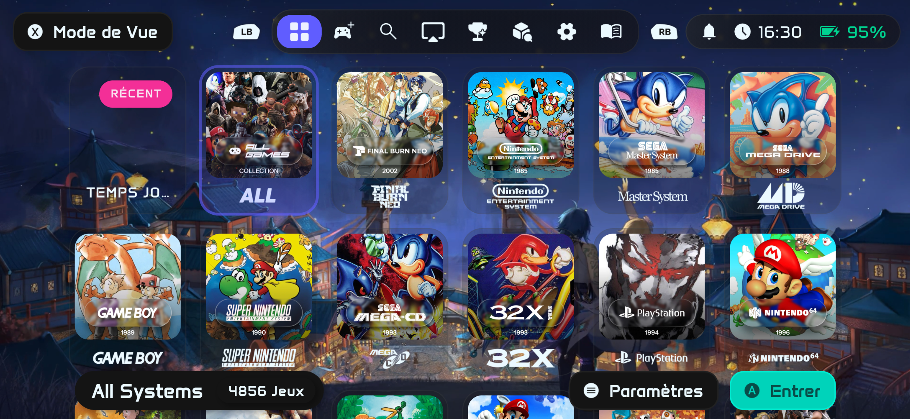

<div align="center">

# RewindBox

### Your games, consoles and library on iPhone and iPad



[](https://github.com/TarbleFR/RewindBox/releases/latest)
[](LICENSE.md)

**[Download latest: fix 0.0.9 (Build 530)](https://github.com/TarbleFR/RewindBox/releases/tag/0.0.9-fix.1)** · **[IPA download](https://github.com/TarbleFR/RewindBox/releases/download/0.0.9-fix.1/RewindBox-Build530.ipa)** · **[Sources and credits](docs/RELEASE_0.0.9_FIX_1_SOURCE_MANIFEST.md)**

</div>

**RewindBox is an independently maintained iOS/iPadOS fork** of
[NeoStation](https://github.com/misobadev/neostation-frontend), maintained
by [@TarbleFR](https://github.com/TarbleFR). This is not an official
NeoStation release; please use [RewindBox Issues](https://github.com/TarbleFR/RewindBox/issues)
or the [RewindBox community](https://discord.gg/G48u46ppX), not upstream
NeoStation support, for help with this fork.

RewindBox combines a game library with **embedded emulation runtimes** for
compatible systems. Libretro cores run inside RewindBox, as do the
integrated **MeloNX** Nintendo Switch engine, Dolphin, ARMSX2 and RPCS3.
A separate MeloNX app is not used to launch games from RewindBox. Users
provide their own compatible games, firmware, keys and BIOS where required.

## Latest release — fix 0.0.9 (Build 530)

**Published 25 October 2026 · GitHub tag `0.0.9-fix.1`**

- **MeloNX Vulkan stability:** addresses the identified iOS failure path where
  `VK_EXT_external_memory_host` led to `ErrorFeatureNotPresent` after a
  Switch game started rendering. The embedded engine uses its existing
  normal-buffer readback fallback instead of the unsupported direct host
  memory import on iOS.
- **Integrated Nintendo Switch emulator:** direct Switch playlist and
  local-game imports, save/configuration management and user-supplied
  firmware/keys, with the native JIT and capability checks required by iOS.
- **RPCS3 and other engines retained:** the release reuses the validated
  RPCS3 Core 528 and keeps the other embedded runtimes. NeoSwap remains
  experimental; this release does not promise higher FPS.
- **Existing features preserved:** 3D covers/manuals, HD texture catalogue,
  updated touch controls, cheats, skins, AirPlay and media-library tools.

The new MeloNX engine and IPA **passed automated compilation, ARM64 iOS
simulator, source-identity and packaging/signature checks**. A sustained
commercial-game session on a physical iPhone has **not** been independently
confirmed stable. Include the game, iPhone/iOS version and internal
app log when reporting remaining failures.

**Version distinction:** `fix 0.0.9` is the *GitHub release title*; the
actual IPA is **Build 530** and still reports internal app version **0.0.8**
(`CFBundleShortVersionString`). The earlier [`0.0.9` / Build 527](https://github.com/TarbleFR/RewindBox/releases/tag/0.0.9)
release remains available separately.

[Read release notes](https://github.com/TarbleFR/RewindBox/releases/tag/0.0.9-fix.1) ·
[Exact Build 530 source and dependency manifest](docs/RELEASE_0.0.9_FIX_1_SOURCE_MANIFEST.md) ·
[Source access guide](docs/SOURCE_CODE_ACCESS.md).

## Other additions since the 0.0.8 baseline

RewindBox also includes the expanded HD texture catalogue and supported RAR
imports, interactive 3D game boxes and PDF manual handling, customizable
touch layouts, PS2 blending and texture options, and PSP relaunch work.
Actual availability and compatibility depend on the engine, title and
user-supplied files. The earlier
[feature preparation notes](docs/RELEASE_NEXT.md) are **historical**, not a
description of a pending Switch integration or of the latest release.

## Unified cheats and patches

The reviewed catalogue withholds the eight Pokémon France programs pending permission. The 0.0.8 source audit recorded:
**50 active contributing source entries**, **2,395,541 programs and edition variants**,
and **1,926 source-backed 60 FPS selections** for supported native adapters.
One common installation serves the embedded engines. Matching uses the detected
game identity, region and revision; compatible codes appear as named switches.
Codes start disabled. Coverage and native support depend on the exact game edition.

Source profiles can share an upstream project, and their contributions overlap;
the counts do not mean unique games or effects.

**[Full source credits, pinned inputs and recorded license notices](docs/CHEAT_CATALOG_SOURCES.md)**
credit the collections and original authors. Their data keeps its own terms;
RewindBox’s frontend license does not relicense third-party codes.

<details>
<summary>51 historical source profiles (50 currently active)</summary>

| Source / import profile | Maintainers and original contributors |
| --- | --- |
| [Libretro Database](https://github.com/libretro/libretro-database) · [source record](docs/CHEAT_CATALOG_SOURCES.md#source-libretro) | Libretro Database contributors and original code authors |
| [GameHacking.org](https://gamehacking.org/) · [source record](docs/CHEAT_CATALOG_SOURCES.md#source-gamehacking) | Mezmorize / GameHacking.org |
| [DeadSkullzJr NDS(i) Cheat Databases](https://gbatemp.net/threads/deadskullzjrs-nds-i-cheat-databases.488711/) · [source record](docs/CHEAT_CATALOG_SOURCES.md#source-dsj) | DeadSkullzJr and the original code contributors; szTheory historical mirror |
| [CWCheat Database Plus](https://github.com/Saramagrean/CWCheat-Database-Plus-) · [source record](docs/CHEAT_CATALOG_SOURCES.md#source-cwcheat) | Saramagrean and collection contributors; original code authors |
| [DuckStation chtdb](https://github.com/duckstation/chtdb) · [source record](docs/CHEAT_CATALOG_SOURCES.md#source-duckstation) | duckstation and collection contributors; original code authors |
| [pcsx2_cheats_collection](https://github.com/xs1l3n7x/pcsx2_cheats_collection) · [source record](docs/CHEAT_CATALOG_SOURCES.md#source-ps2pnach) | xs1l3n7x; Ultimate PCSX2 Cheater; root670/CheatDevicePS2; original code authors |
| [Dolphin GameSettings](https://github.com/dolphin-emu/dolphin/tree/master/Data/Sys/GameSettings) · [source record](docs/CHEAT_CATALOG_SOURCES.md#source-dolphin) | dolphin-emu and collection contributors; original code authors |
| [GeckoArchive](https://github.com/SpaceXCheeseWheel/GeckoArchive) · [source record](docs/CHEAT_CATALOG_SOURCES.md#source-geckoarchive) | SpaceXCheeseWheel; geckocodes.org and its Archive.org preservation; original code authors |
| [FBNeo cheats](https://github.com/finalburnneo/FBNeo-cheats) · [source record](docs/CHEAT_CATALOG_SOURCES.md#source-fbneo) | finalburnneo and collection contributors; original code authors |
| [Project64 Cheats](https://github.com/project64/project64/tree/develop/Config/Cheats) · [source record](docs/CHEAT_CATALOG_SOURCES.md#source-pj64) | project64 and collection contributors; original code authors |
| [Mupen64Plus database](https://github.com/mupen64plus/mupen64plus-core/blob/master/data/mupencheat.txt) · [source record](docs/CHEAT_CATALOG_SOURCES.md#source-mupen) | Gent (Copyright 2008), Mupen64Plus contributors and original code authors |
| [Mesen2 CheatDb](https://github.com/SourMesen/Mesen2/tree/master/UI/Dependencies/Internal) · [source record](docs/CHEAT_CATALOG_SOURCES.md#source-mesen) | SourMesen and collection contributors; original code authors |
| [Snes9x cheats.bml](https://github.com/snes9xgit/snes9x/blob/master/data/cheats.bml) · [source record](docs/CHEAT_CATALOG_SOURCES.md#source-snes9x) | snes9xgit and collection contributors; original code authors |
| [ArtemisPS3](https://github.com/bucanero/ArtemisPS3/tree/master/docs/codes) · [source record](docs/CHEAT_CATALOG_SOURCES.md#source-artemis) | Daniel Gerendasy (Copyright 2020), bucanero and original code authors |
| [Artemis Patch Collection RPCS3](https://github.com/chidreams/Artemis-Patch-Collection-RPCS3) · [source record](docs/CHEAT_CATALOG_SOURCES.md#source-artemisrpcs3) | chidreams (Copyright 2023); Aldo’s PS3 Cheat Database; original code authors |
| [Pokémon France / PokéLord](https://www.pokemon-france.com/jeux/gen1/bleu_rouge/actionreplay/) · [source record](docs/CHEAT_CATALOG_SOURCES.md#source-pokemonfrance) | PokéLord / Pokémon France; einstein95/pokered-fr identity research — **withheld pending permission** |
| [MiSTer Cheats](https://github.com/MiSTer-devel/Cheats_MiSTer) · [source record](docs/CHEAT_CATALOG_SOURCES.md#source-mister) | MiSTer-devel; GameHacking.org (credited upstream for the cheats); original code authors |
| [LunaMoo PPSSPP workarounds](https://github.com/LunaMoo/PPSSPP_workarounds) · [source record](docs/CHEAT_CATALOG_SOURCES.md#source-lunamoo) | LunaMoo and collection contributors; original code authors |
| [TAbdiukov PPSSPP patches](https://github.com/TAbdiukov/PPSSPP-patches) · [source record](docs/CHEAT_CATALOG_SOURCES.md#source-tabdiukov) | Tim Abdiukov / TAbdiukov (Copyright 2019), collection contributors and original code authors |
| [Admentus Enhancement Codes](https://github.com/Admentus64/Enhancement-Codes) · [source record](docs/CHEAT_CATALOG_SOURCES.md#source-enhancement) | Admentus; darkludx; gamemasterplc; retroben; Bighead; BrianMp16 and the contributors in Credits.txt |
| [skyzyx OpenEmu cheat database](https://github.com/skyzyx/openemu-cheat-database) · [source record](docs/CHEAT_CATALOG_SOURCES.md#source-openemu_personal) | skyzyx and collection contributors; original code authors |
| [Mighty Mo's Cheat Code Pack](https://github.com/mightymo77/MightyMos-Cheat-Code-Pack) · [source record](docs/CHEAT_CATALOG_SOURCES.md#source-mighty_mo) | mightymo77 and collection contributors; original code authors |
| [dillonhafer OpenEmu cheats-database.xml](https://gist.github.com/dillonhafer/8399eb1926e2af9164470ad45da67a57) · [source record](docs/CHEAT_CATALOG_SOURCES.md#source-dillonhafer_xml) | dillonhafer OpenEmu cheats-database.xml contributors and original code authors |
| [FF7.fr — French Action Replay codes](https://www.ff7.fr/action_replay.php) · [source record](docs/CHEAT_CATALOG_SOURCES.md#source-ff7_fr) | Léonard Neveu / FF7.fr |
| [Ethereal Games](https://etherealgames.com/) · [source record](docs/CHEAT_CATALOG_SOURCES.md#source-ethereal) | Ethereal Games and the original posters credited by the collection |
| [PSX Data Center — Action Replay sections](https://www.psxdatacenter.com/) · [source record](docs/CHEAT_CATALOG_SOURCES.md#source-psxdatacenter) | PSX Data Center and original code authors |
| [Pokébip — Action Replay contributions](https://www.pokebip.com/espace-membre/blogs/129214/article/84411) · [source record](docs/CHEAT_CATALOG_SOURCES.md#source-pokebip_contributions) | Pokébip blog contributor; excerpt credits Pokémon Espace |
| [Square Palace — Secret of Mana codes](https://squarepalace.com/encyclopedies/secretofmana/cheat-codes-action-replay) · [source record](docs/CHEAT_CATALOG_SOURCES.md#source-squarepalace) | Square Palace; source credits No Secret For Me |
| [Weed Sheet — Sly Cooper](https://github.com/zzamizz/weed-sheet) · [source record](docs/CHEAT_CATALOG_SOURCES.md#source-weed_sheet) | zzamizz and collection contributors; original code authors |
| [XoEVOoX Pokémon FireRed codes](https://github.com/xoevoox/pokemon-fire-red-codes) · [source record](docs/CHEAT_CATALOG_SOURCES.md#source-xoevoox_firered) | XoEVOoX and repository contributors |
| [TylerD007 — The Shiny Pokémon Code Repository](https://github.com/TylerD007/The_Shiny_Pokemon_Code_Repository) · [source record](docs/CHEAT_CATALOG_SOURCES.md#source-tyler_shiny) | Ciro Bogea Fernandes / TylerD007 |
| [Kodewerx code contributions](https://www.kodewerx.org/forum/viewtopic.php?f=18&t=2763&view=print) · [source record](docs/CHEAT_CATALOG_SOURCES.md#source-kodewerx_codes) | dlong; source credits Viper and HyperHacker |
| [r/Gameshark — Pokémon Emerald event islands (12-digit codes)](https://www.reddit.com/r/Gameshark/comments/1804kz6/all_the_event_islands_for_pokemon_emerald_have/) · [source record](docs/CHEAT_CATALOG_SOURCES.md#source-gameshark_event_islands) | u/SoggyMinimum8386 |
| [DeltaCore — All Cheat Codes public workbook](https://github.com/rileytestut/DeltaCore/wiki/Cheats) · [source record](docs/CHEAT_CATALOG_SOURCES.md#source-delta_workbook) | DeltaCore community and the original workbook/code contributors |
| [Luckysugar God of War III 01.00](https://github.com/Luckisugar/rpcs3-gow3-patches) · [source record](docs/CHEAT_CATALOG_SOURCES.md#source-gow3_0100) | Luckysugar (repository: Luckisugar) |
| [Artemis Bladestorm static instruction adapter](https://github.com/bucanero/ArtemisPS3/blob/d79b41e525e20251bd0d919100039ac0a6433956/docs/codes/Bladestorm%20The%20Hundred%20Years%27%20War%20BLES00113%20BLUS30070%2001.00.ncl) · [source record](docs/CHEAT_CATALOG_SOURCES.md#source-bladestorm_static) | Daniel Gerendasy / ArtemisPS3 contributors; CodeFreak / PS3UserCheat source credits |
| [Artemis GoW3 identical-PPU static instruction ports](https://github.com/chidreams/Artemis-Patch-Collection-RPCS3) · [source record](docs/CHEAT_CATALOG_SOURCES.md#source-gow3_0103_ppu) | chidreams and the original patch authors named in each native document |
| [PSX Data Center reviewed PAL PS2 RAW](https://psxdatacenter.com/psx2/) · [source record](docs/CHEAT_CATALOG_SOURCES.md#source-psxdatacenter_pal477) | PSX Data Center and the original code authors |
| [Artemis Bladestorm Japan static instruction supplement](https://github.com/bucanero/ArtemisPS3/blob/d79b41e525e20251bd0d919100039ac0a6433956/docs/codes/Bladestorm%20Hyakunen%20Sensou%20BLJM60009%2001.00.ncl) · [source record](docs/CHEAT_CATALOG_SOURCES.md#source-bladestorm_jp477) | Daniel Gerendasy / ArtemisPS3 contributors and the original authors named in the NCL source |
| [PSX Data Center PNACH v2.0](https://psxdatacenter.com/psx2/down2.html) · [source record](docs/CHEAT_CATALOG_SOURCES.md#source-psxdatacenter_v2_478) | PSX Data Center and the original PNACH authors |
| [European PNACH collection](https://github.com/complicatiion/pcsx2_europe_cheats_collection) · [source record](docs/CHEAT_CATALOG_SOURCES.md#source-pal_pnach478) | complicatiion and collection contributors; original code authors |
| [ShadowNinja PNACH collection](https://github.com/shadowninja826/pcsx2_pnach_cheats) · [source record](docs/CHEAT_CATALOG_SOURCES.md#source-shadow_pnach478) | shadowninja826 and collection contributors; original code authors |
| [YukiXXL retail PNACH programs](https://github.com/YukiXXL/PS2-modding) · [source record](docs/CHEAT_CATALOG_SOURCES.md#source-yuki_pnach478) | YukiXXL and collection contributors; original code authors |
| [xGamingDragon93x PNACH collection](https://github.com/xGamingDragon93x/PCSX2-Ultimative-Cheats-Collection-PNACH) · [source record](docs/CHEAT_CATALOG_SOURCES.md#source-dragon_pnach478) | xGamingDragon93x and collection contributors; original code authors |
| [ArtemisPS3 complete static PPU programs](https://github.com/bucanero/ArtemisPS3/tree/d79b41e525e20251bd0d919100039ac0a6433956/docs/codes) · [source record](docs/CHEAT_CATALOG_SOURCES.md#source-artemis_static478) | Daniel Gerendasy, bucanero / ArtemisPS3 contributors and the original code authors |
| [Artemis RPCS3 authored PKG collection](https://github.com/PaauloSilva/Artemis-Patch-Collection-RPCS3_PKG) · [source record](docs/CHEAT_CATALOG_SOURCES.md#source-artemis_pkg478) | PaauloSilva collection; chidreams (MIT notice); original patch authors |
| [PCSX2/pcsx2_patches explicit 60 FPS patches](https://github.com/PCSX2/pcsx2_patches) · [source record](docs/CHEAT_CATALOG_SOURCES.md#source-pcsx2_fps478) | PCSX2 and collection contributors; original code authors |
| [Gabominated/PCSX2 explicit 60 FPS patches](https://github.com/Gabominated/PCSX2) · [source record](docs/CHEAT_CATALOG_SOURCES.md#source-gabominated_fps478) | Gabominated and collection contributors; original code authors |
| [Saramagrean/NetherSX2-cheats explicit 60 FPS patches](https://github.com/Saramagrean/NetherSX2-cheats) · [source record](docs/CHEAT_CATALOG_SOURCES.md#source-nethersx2_fps478) | Saramagrean and collection contributors; original code authors |
| [RPCS3 native 60 FPS patches, pinned illusion mirror](https://github.com/illusion0001/rpcs3-game-patch) · [source record](docs/CHEAT_CATALOG_SOURCES.md#source-illusion_fps478) | illusion0001 mirror, RPCS3 patch contributors and original patch authors |
| [TheYearOfWaluigi Gen IV battle framerate codes](https://www.reddit.com/r/PokemonROMhacks/comments/r9k94k/action_replay_codes_uncap_framerate_inbattle_only/) · [source record](docs/CHEAT_CATALOG_SOURCES.md#source-nds_fps478) | TheYearOfWaluigi |

</details>

## Embedded systems

| Integration | Systems / purpose |
| --- | --- |
| **Libretro — 35 cores embedded in Build 530** | NES, SNES, GB/GBC, GBA, DS, N64, 3DS, Sega 8/16-bit systems, Mega-CD, 32X, PlayStation, PSP, supported arcade and Neo Geo games |
| **Dolphin / DolphiniOS** | GameCube and Wii |
| **ARMSX2 / PCSX2** | PlayStation 2 |
| **RPCS3 / XITRIX iOS fork** | PlayStation 3 |
| **MeloNX — fully embedded** | Nintendo Switch; requires user-owned games/system files, the appropriate iOS JIT method and device entitlements |

RewindBox no longer includes native game ports, nor the Ports playlist.
KartPad (Mario Kart Wii) and Dusklight (Twilight Princess) were embedded in
earlier builds and removed in October 2026. KartPad's runtime carries code
translated from the game, so each player who wants it builds
[KartPad](https://github.com/chrissotraidis/kartpad) with its own tools and
installs it as a separate app. Twilight Princess remains playable from its
GameCube or Wii version with Dolphin. Files already in RewindBox's
`Ports/KartPad` and `Ports/Dusklight` folders are left untouched.

The old 0.0.8 / Build 480 release contained 34 Libretro cores. **Build 530
ships 35**, with Mesen added as an optional NES engine for compatible HD packs.
[All current core credits and license references](assets/legal/libretro/LIBRETRO_CORES.md)
are preserved. The number of cores differs from the number of console profiles. Compatibility,
features and performance depend on the game, core and device.

## Make it yours

- **Consoles tab:** choose which consoles appear, manage their folders and pick
  a skin, including before importing games.
- **Controller skins:** browse **Provenance, DeltaStyles, Delta Skins,
  PocketArch and Libretro overlays**. Compatible portrait and landscape layouts
  can be chosen independently. Default RewindBox skins remain available.
- **In-game controls:** touch controls, controllers, saves, save states, core
  settings and supported RetroAchievements features.
- **AirPlay:** use **Settings → General → AirPlay and external screen**.
  Fit preserves the full picture; Fill may crop it. Support depends on the
  engine and display connection.
- **Library:** game screenshots, videos, PDF manuals and console information
  where available.
- **Books and manga:** import your own EPUB, PDF, CBZ and TXT files, with
  progress, favorites and supported cover/page animations.
- **120 Hz interface:** optional on compatible displays; it does not increase
  an emulated game's native frame rate.
- **Twelve interface languages:** English, French, Spanish, German, Italian,
  Portuguese, Russian, Indonesian, Japanese, Korean, Simplified Chinese and
  Traditional Chinese.

[Skin compatibility and import guide](docs/SKINS.md)

## BIOS, saves and storage

Add your own Libretro BIOS/system files to
**Files → On My iPhone/iPad → RewindBox → Libretro → System**.
Keep the expected filenames and subfolders; **System** uses a capital S.

- **Settings → Tools → BIOS checker** identifies required and optional files.
- Use the **Nintendo 3DS system-file importer** for supported BIOS and NAND data.
- PS2 BIOS and PS3 firmware use their respective emulator settings.
- **Nintendo Switch / MeloNX:** import your own legally obtained keys and
  compatible firmware in the embedded Switch settings. The Switch playlist
  opens directly; an external MeloNX installation and its old game paths are
  not required.
- The PS3 library supports game-save import/export and user-supplied RAP licenses.
  Game saves and emulator save states are different formats.
- **Settings → Tools** also provides storage analysis and cleanup. Review the
  proposed files before confirming deletion.

No proprietary BIOS, firmware, encryption keys or commercial games are supplied.

## NeoSwap

**NeoSwap is functional but experimental**, and applies to embedded **RPCS3**.

Eligible allocations can use guest-memory relay objects, shared backing held by
helper processes, and selected file-backed allocations. Some supported cold
data can be stored and restored on demand. The budget reacts to available
memory and iOS memory pressure.

The graph's **App RAM** is the main process footprint. **NeoSwap Donated**
counts active guest objects and host/donor loans assigned to RPCS3; unused
prepared capacity and file-backed allocations are excluded.

All processes use the **same physical device RAM**. NeoSwap does not create
extra physical memory, guarantee a fixed allocation, or guarantee higher FPS.
Results depend on the game, device and allocation paths actually used.

[Allocation details](docs/neoswap-build441.md)
· [RPCS3 / NeoSwap / LLVM notes](docs/rpcs3-neoswap-llvm-build444-audit.md)

## Requirements and installation

- **iOS 18 or later**, and a compatible IPA signing/sideloading method such as
  [SideStore](https://sidestore.io/).
- Your own compatible games and any required system files.
- For embedded Dolphin, ARMSX2, RPCS3 and MeloNX: a valid pairing file, Developer Mode,
  suitable signing/provisioning and the supported StikJIT route. The current
  bridge checks a separately installed and activated **LocalDevVPN** route;
  RewindBox does not bundle or activate that VPN.

**LiveContainer is not supported for the embedded runtimes.**
Download the IPA from the release assets and sign/install it with your chosen
sideloading tool. The IPA's entitlement declarations alone do not authorize
restricted capabilities on a device.

## Build from source

The published `fix 0.0.9` IPA is **Build 530**. To inspect exactly the
application sources recorded inside this binary, use the pinned host commit
[`3f0c706afe1d0faa635465517871a500c3289582`](https://github.com/TarbleFR/RewindBox/tree/3f0c706afe1d0faa635465517871a500c3289582),
not a moving branch or the older `0.0.7`/`0.0.8` tags.
The current `main` branch carries the changes merged from `Claude`, with
subsequent release-documentation updates.

The release workflow uses **Flutter 3.47.2** and **Xcode 26.3**:

```bash
git clone https://github.com/TarbleFR/RewindBox.git
cd RewindBox
git checkout 3f0c706afe1d0faa635465517871a500c3289582
flutter pub get --enforce-lockfile
flutter config --no-enable-swift-package-manager
python3 packages/dolphin_internal_bridge/ci/build_support.py scaffold
```

These steps prepare the host, **not a distributable IPA on their own**. A
complete iOS build also needs the pinned native sources and library artifacts,
licenses, Xcode signing and entitlement checks, and the
[Build 530 delivery](.github/workflows/melonx-launch530-delivery.yml)
and [release-publishing workflow](.github/workflows/publish-fix-009.yml).
Use the [Build 530 source manifest](docs/RELEASE_0.0.9_FIX_1_SOURCE_MANIFEST.md)
for the exact application, MeloNX and RPCS3 revisions, legal records and
outstanding source-provenance boundaries. Do not commit signing secrets,
production keys or private user content.

## Credits and licenses

The original frontend is by **Miguel Soto / misobadev**, with **androosio,
ItsRetroPup** and upstream contributors. The iOS fork is independently
maintained by **TarbleFR**. Upstream authorship is credited; known notice and
source-availability gaps are recorded below. Attribution does not imply endorsement.

Thanks to the emulator, Libretro, StikJIT, RetroAchievements, ScreenScraper,
GameDB, texture, skin, shader, reading-library and memory-research contributors.
Historical port credits remain in the legal record for the builds that used them.
**[Full credits and source records](docs/LEGAL_AND_CREDITS.md)** include the
individual authors, **[all 35 current core license references](assets/legal/libretro/LIBRETRO_CORES.md)**,
**[HD texture creators and source credits](docs/HD_TEXTURE_SOURCES_AND_CREDITS.md)**
and **[all 51 historical cheat source entries, 50 active](docs/CHEAT_CATALOG_SOURCES.md)**.

The frontend's GPL license does **not** replace third-party terms.
Some cores have non-commercial restrictions; exact source correspondence and
combined-license questions remain documented in the
**[Build 530 release/source manifest](docs/RELEASE_0.0.9_FIX_1_SOURCE_MANIFEST.md)**,
**[source access and attribution review](docs/SOURCE_CODE_ACCESS.md)** and the
**[historical 0.0.7 review](docs/RELEASE_0.0.7_LICENSE_REVIEW.md)**.
The reviews distinguish existing IPAs from subsequent packaging changes.

**[Second source-rights review — 18 October 2026](docs/SOURCE_RIGHTS_REVIEW_2026-10-18.md):**
full redistribution clearance has not been established. Open findings include
FBNeo's donation restriction alongside the project's Patreon solicitations,
permission for some imported cheat data, exact source correspondence for
bundled binaries, and [overlay credits and notice preservation](docs/OVERLAY_SOURCES_AND_CREDITS.md). See the [implemented follow-up](docs/SOURCE_RIGHTS_FOLLOWUP_2026-10-18.md) and [per-engine provenance](docs/EMBEDDED_RUNTIME_PROVENANCE.md). Verified
upstream declarations supplement the frozen catalogue metadata in the source
register; credits alone do not resolve these findings.

See **[LICENSE.md](LICENSE.md)** and **[NOTICE.md](NOTICE.md)**. All trademarks
and third-party artwork remain the property of their respective owners.
RewindBox is not affiliated with the console manufacturers or upstream
projects unless explicitly stated.
