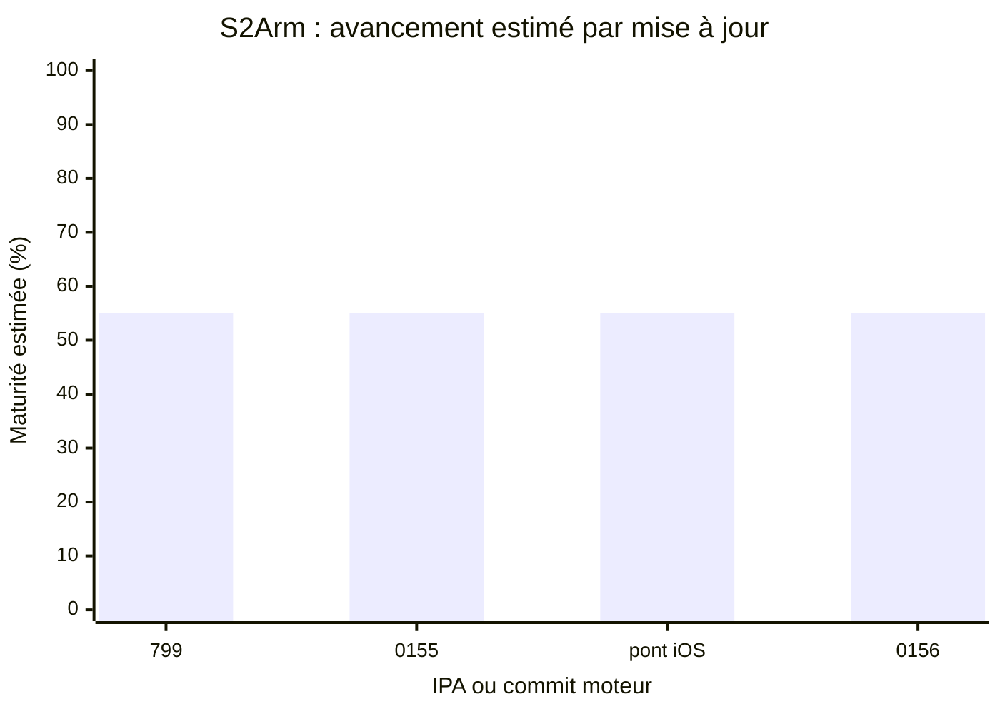

[Preuves techniques conservées](https://github.com/TarbleFR/RewindBox/blob/1a734455b8162ed70c7cf8e7a7fc76f85e5af69e/docs/AI_TASK_BOARD.md) : causes, essais, résultats et limites ; vérifier les anciens statuts, sans réactiver leurs procédures. Consignes actuelles : [AGENTS.md](../AGENTS.md).

20 novembre — [SSBU / Nextendo](evidence/nextendo-ssbu-ipa785-2026-11-18.md#compatibilité-du-certificat-privé--suite-du-20-novembre) : refus TLS confirmé sur l’IPA 796. Le client Nextendo accepte les certificats privés que RSwitch refusait ; ajout d’une compatibilité limitée à SSBU, désactivée par défaut et soumise à consentement dans l’app. Compte et autres connexions inchangés. Core `13ffc868` compilé et authentifié, deux sessions simulateur réussies ; IPA 798 en préparation, validation SSBU sur iPhone encore à effectuer. Persistance du refus déjà corrigée sur `2bef01cf` (analyse Dart et 28 tests existants réussis).

20 novembre — [Coupe Champignon 150 cc à 1×, IPA privée 797](evidence/rewind797/delivery.json). 35 recettes exactes vérifiées et ajoutées au profil prioritaire. Historique fusionné au premier dessin, préchargement borné et réduction du travail Metal et des lectures spéculatives. Les vérifications Metal sur Mac et la migration synthétique depuis la 796 passent. Les quatre courses, les promotions depuis les caches du joueur et la cadence en 1× restent à mesurer sur iPhone 16 Pro Max.

20 novembre — [IPA privée 799](evidence/rewind799/delivery.json). La livraison embarque le patch S2Arm 0154 pour la préparation et la récupération de l’historique de pipelines. Les charges utiles, les identifiants de mise à jour et la présence du patch dans l’IPA sont vérifiés. La [capture 799](evidence/s2arm-799-frame-stalls.md) mesure la cadence moteur ; les quatre courses et le gain comparatif à 1× restent à identifier.

## S2Arm

Objectif : 60 FPS constants sans saccades à 1×. Périmètre initial : Mario Kart World 1.0.0, Coupe Champignon 150 cc, quatre circuits, iPhone 16 Pro Max. Les notes évaluent ce périmètre, pas tous les jeux ou moteurs de RewindBox.

**Point de départ au 20 novembre 2026 : environ 55 % de maturité estimée.** Cette estimation de pilotage n’est ni un taux de tâches terminées ni le rapport FPS/60. La session 799 donne 30,414 FPS moteur sur 7 232 intervalles ; les quatre circuits restent à annoter.

| Jalon | Poids | Estimation 799 | État et limite |
| --- | ---: | ---: | --- |
| I — Import, préparation et lancement | 15 % | 90 % | Parcours fonctionnel et jeu exécuté ; reprise et sauvegardes à confirmer de bout en bout. |
| R — Rendu et parcours jouable | 20 % | 60 % | Course affichée ; fidélité et quatre circuits complets à valider. |
| C — Préparation et réutilisation graphiques | 25 % | 65 % | Caches et contrôles Metal présents ; premières utilisations sans blocage à démontrer sur iPhone. |
| P — Budget CPU/GPU pour 60 FPS à 1× | 25 % | 35 % | 799 : 30,414 FPS moteur ; p95 69,364 ms, p99 136,830 ms. |
| S — Stabilité prolongée, mémoire et chauffe | 15 % | 25 % | Corrections présentes ; session prolongée et absence de régression à valider. |

Calcul conservé d’une version à l’autre : somme(note × poids) / 100, arrondie au multiple de 5 le plus proche ; ici 54,25 → 55 %. Toute révision des notes exige une preuve ou une justification explicite ; une régression peut les faire baisser. Un changement de périmètre ou de pondération ouvre une série distincte.

Le graphique reprend les cinq derniers points de l’historique, dans le même ordre. Il commence à la 799 : aucun pourcentage antérieur n’a été reconstitué. Conserver toutes les lignes ci-dessous, même lorsque la note reste identique ; un résultat tardif complète la ligne de sa version.

| Date | IPA / source | I / R / C / P / S (%) | Global estimé | Évolution et preuve / mesure sur appareil |
| --- | --- | --- | ---: | --- |
| 2026-11-20 | [799](evidence/rewind799/delivery.json) / `27316165` | 90 / 60 / 65 / 35 / 25 | 55 % | Point initial : patch 0154 de préparation et récupération d’historique, contrôles Metal sur [Mac](https://github.com/TarbleFR/RewindBox/actions/runs/44659775244), compilation et livraison vérifiées ; [session appareil](evidence/s2arm-799-frame-stalls.md) : 30,414 FPS moteur, indice de course 27,282 ; 153/41/10 pauses >100/200/500 ms ; pic 5006 Mio, préparation 288,140 s. |
| 2026-11-20 | [Moteur 0155](https://github.com/TarbleFR/RewindBox/commit/49db0f52ba0679fd08ba9ffac58e547a5cf917f3) | 90 / 60 / 65 / 35 / 25 | 55 % | [Textures, attentes, RomFS, préparation, audio et cadence visible](evidence/s2arm-799-frame-stalls.md). Correctifs source ; mesure iPhone en attente. |
| 2026-11-20 | [Pont iOS après 0155](https://github.com/TarbleFR/RewindBox/commit/4abe6bbe7755794b1ef3c44c7d4f9ac4dc8b53ea) | 90 / 60 / 65 / 35 / 25 | 55 % | Durées monotones du moteur (prepareMs) et des exports de preuves (exportMs), y compris en réutilisation. Mesure iPhone en attente. |
| 2026-11-20 | Moteur 0156 | 90 / 60 / 65 / 35 / 25 | 55 % | Petits transferts CPU regroupés sur Mario Kart World, encodeur de calcul ouvert à la demande, prélecture bornée même en concurrence et fermeture des fichiers RomFS évincés hors verrou. Gain sur appareil à mesurer. |

**Mesures de référence, à conserver séparément de l’estimation :** [IPA 795](evidence/rewind796/profile-observations-795.json), 26,886 FPS moteur sur 9 145 intervalles sans lacune dans la plage observée (≈ 5 min 40 s), 213 >100 ms dont 36 >500 ms ; [ancien moteur 0001–0089](evidence/s2arm-ipa783-device-2026-11-18.md), 60 FPS sur 526 intervalles (≈ 8,8 s), scène non identifiée ; [IPA 786](evidence/s2arm-ipa786-device-2026-11-18.md), deux fenêtres à l’affichage à 23,9 / 22,5 FPS et GPU médian à 33,38 / 35,03 ms ; [IPA 794](evidence/s2arm-first-race-795.md), pic échantillonné de 5 175 Mio. Parcours, caches et réglages non uniformisés : aucun gain avant/après attribuable à partir de ces seuls relevés.

**Priorités :** 799 — attentes invitées et transferts de textures ; coût CPU/GPU courant, E/S et chauffe. Référence antérieure : attentes de premier usage graphique (image 5 536 de la 795 : 2 993 ms dont 2 591 ms cumulés de pipelines/bibliothèques) et budget CPU/GPU de 16,67 ms ; P1 — mémoire, relectures et chauffe. Prochaine preuve attendue : quatre circuits à 1×, premier passage puis caches réutilisés, session d’au moins 20 minutes, rendu et sauvegardes conservés.

**À chaque mise à jour S2Arm :** compléter ce même MD avec date, IPA ou commit moteur, changements, preuves, notes par jalon et statut distinct (corrigé, compilé, livré, observé sur appareil), puis actualiser le tableau courant et le graphique depuis l’historique. Une mise à jour documentaire seule ne crée pas de nouvelle version moteur. Indiquer « non mesuré » pour toute mesure absente, sans reprendre les FPS d’une ancienne IPA comme ceux de la nouvelle ; sans nouvelle justification, conserver les notes. Pour les mesures, identifier jeu/version, appareil, résolution, scène, cache et durée ; séparer cadence moteur et affichage, relever p95/p99, pauses >100/500 ms, GPU, mémoire et chauffe. Publier le graphique actualisé dans le bilan remis à l’utilisateur ; ne pas ajouter de workflow, compilation ou suite de tests pour ce suivi documentaire.
