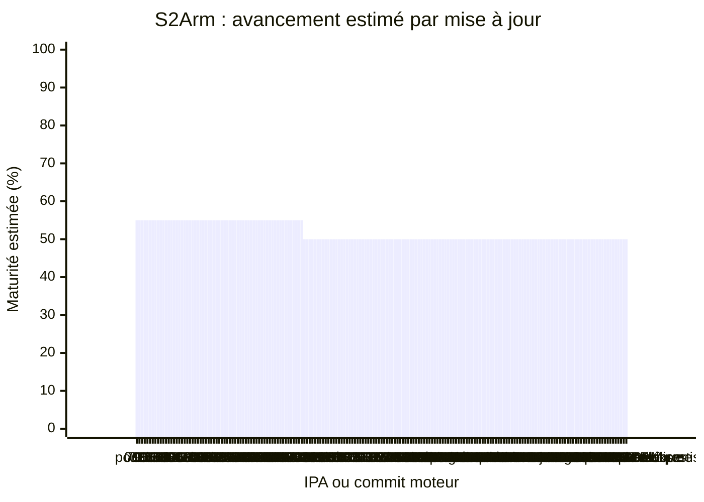

27 novembre — [Azahar à 10× : deuxième série](../native/azahar/README.md#performances-à-10--deuxième-série-27-novembre-2026). Journal Mario Kart 7 à 9× (57,8 i/s) : aucun effacement pris par la passe (`folded=0`). Correctif Azahar `82b6a4d9` : effacements gardés jusqu'à leur passe malgré envois, copies et images neuves ; cibles de rendu gardées à travers un remplissage (plus de réallocation par image) ; surfaces RGBA8 sans usage stockage ni format modifiable hors ombres, donc compressibles par Metal ; table de répartition rapide pour les branchements indirects du dorsal arm64 de dynarmic (5 retours au répartiteur au lieu de 20 004 sous qemu) ; mesures `[rb-perf]` complétées et ligne `[rb-jit] azahar cpu`. Compilé et testé sur hôte, compilation iOS demandée au job `source-cores` ; rien de mesuré sur iPhone, protocole dans le README.

27 novembre — [IPA privée 848 livrée et vérifiée](evidence/rewind848/delivery.json) : Wiimmfi ABI 4, interface partagée Nextendo, versions moteurs, S2Arm 0464–0470. Compilation complète réussie après correction du contrôle de console libretro ; IPA déchiffrée et vérifiée, 98 images natives et 11 bundles. Autres moteurs conservés ; écart du pont MeloNX expliqué par les stubs équivalents du linker. Mesures et multijoueur iPhone non exécutés. Les sources S2Arm ajoutées après le gel de cette IPA restent distinctes de cette livraison.

27 novembre — IPA848 : premier contrat CI réussi, compilation app `45997541453` arrêtée sur une variable hors portée dans le pont libretro (versions moteurs). Appel corrigé avec le validateur existant ; relance de la même livraison, moteurs conservés. Voir [préparation848](evidence/rewind848-preparation.md).

27 novembre — [IPA privée 848 en préparation](evidence/rewind848-preparation.md) : derniers ajouts Wiimmfi, versions des moteurs, Dolphin ABI 4 authentifié et S2Arm 0464–0470 épinglé. Autres moteurs conservés ; estimation S2Arm 50 % inchangée, mesures iPhone non exécutées. Aucun fichier IPA encore livré.

27 novembre — [Wiimmfi : parcours visuel Nextendo](evidence/wiimmfi-nextendo-interface-2026-11-27.md). Même menu de playlist, composants partagés identité/Services en ligne, état synthétique et catalogue replié. Préparation de la Wii à la place du compte ; switch guidé pour les prérequis manquants, aide avancée repliée et connexion réelle dans le jeu. 10 tests Wiimmfi et 32 Nextendo existants réussis, contrat import partagé et analyse ciblée sans problème. Core ABI 4 et authentification Nextendo inchangés ; aucune IPA, validation physique Wiimmfi toujours en attente.

27 novembre — [Wiimmfi : navigation terminée](evidence/wiimmfi-controller-completion-2026-11-27.md). Dernier défaut ouvert corrigé : entrées manette dans Propriétés et Réglages Wii, modales propriétaires, A/B, codes à cinq chiffres et retour sûr. Initialisation tardive/concurrente des manettes et retrait du clavier sur iOS corrigés ; doubles commandes empêchées. 35 tests existants réussis, analyse Dart sans problème. Core ABI 4 inchangé et empreintes vérifiées, aucune recompilation moteur ni IPA. Tous les défauts Wiimmfi identifiés par ces revues ont un correctif ; validation physique et multijoueur sur iPhone non exécutés.

27 novembre — [Wiimmfi : nouvelle confirmation et cas manquants](evidence/wiimmfi-followup-audit-2026-11-27.md). Correctifs antérieurs confirmés sur e0c4a54c et compilation ABI 3 vérifiée. Nouveaux défauts : dossiers courants vides écrasant les sauvegardes/Mii du dump ; lancement sans surveillance de fin de partie ; fermeture pendant opération ; arrière-plan pendant boot. Corrections vérifiées sur hôte, ABI 4 et signal atomique d’interruption ; dix tests Wiimmfi, sept tests du parcours de lancement et vingt cycles natifs GC/Wii passent, analyse sans problème ; [Core ABI 4 compilé et vérifié](https://github.com/TarbleFR/RewindBox/actions/runs/45979848094), source e19a37ac, SHA-256 a8c4540d…fb4aee6 et export d’interruption présents ; 35 avertissements inchangés. [Empreintes et limites](evidence/wiimmfi-followup-audit-2026-11-27.json). Navigation manette du panneau encore incomplète ; aucune IPA.

27 novembre — [Wiimmfi : contre-expertise et corrections](evidence/wiimmfi-counteraudit-2026-11-27.md). NAND hybride et Mii, TMD, exposition C++ au module Swift, patches mémoire locaux, WiiConnect24 hors ligne, capture PCAP/identifiants, secouement et circuit de lancement corrigés ; ABI 3. Snapshots historiques protégés, erreurs traduites conservées et diagnostic NAND à jour. 24 tests Flutter, 25 contrats stockage, 15 scénarios lancement et contrôles natifs ciblés réussis ; journaux testés sur 100 cycles. [Core final a660c337 compilé](https://github.com/TarbleFR/RewindBox/actions/runs/45977483996), SHA-256 e4811001…3346250 : téléchargement et liaison du prédicat vérifiés ; remplace les candidats précédents. [Empreintes et limites](evidence/wiimmfi-counteraudit-2026-11-27.json). 35 avertissements Core inchangés ; deux avertissements du banc corrigés et vérification hôte sous -Werror réussie, code produit inchangé. Aucune IPA ; bridge UIKit complet et multijoueur iPhone non validés. Échecs CI antérieurs hors lot documentés.

27 novembre — [Wiimmfi / Dolphin : intégration et limites](wiimmfi-integration.md). Sources `9af0abff` puis `d473517b` : import BootMii natif transactionnel avec conservation des sauvegardes, progression/annulation et refus des arbres malformés ; configuration Wii/jeu en 12 langues, images préparées par le joueur liées à leur SHA-256, sessions protégées et vrai blocage IP IOS hors ligne (ABI 2). 24 tests Flutter ciblés, validateur C++ ASan/UBSan et 27 requêtes IP ×100 sur hôte réussis. [Cœur arm64 et adaptateur d’import compilés avec le SDK iPhoneOS](https://github.com/TarbleFR/RewindBox/actions/runs/45972261314), source `b4ea094f`, Core `d4ac87f9…512ae2` ; 35 avertissements amont identiques à la première compilation, aucun nouveau. [Empreintes, dépendances et résultats](evidence/wiimmfi-2026-11-27.json). Aucun autre moteur modifié par ce lot, aucune IPA produite ni manifeste livré remplacé. Patch automatique, intégrité ECC/HMAC et authenticité Nintendo non certifiés ; compatibilité des neuf candidats/statistiques inconnues, vraie NAND, authentification, courses publiques/privées, reconnexion et mesures iPhone non testées. Prochaine livraison autorisée : sélectionner ce Core et inclure `build-utils/dolphin_wiimmfi.py` dans les gardes de source du composant.

[Preuves techniques conservées](https://github.com/TarbleFR/RewindBox/blob/1a734455b8162ed70c7cf8e7a7fc76f85e5af69e/docs/AI_TASK_BOARD.md) : causes, essais, résultats et limites ; vérifier les anciens statuts, sans réactiver leurs procédures. Consignes actuelles : [AGENTS.md](../AGENTS.md). 20 novembre — [SSBU / Nextendo](evidence/nextendo-ssbu-ipa785-2026-11-18.md#après-le-certificat--journal-du-20-novembre-ipa-799) : journal IPA 799 / Core `13ffc868` analysé. Certificat accepté à 11:13:33 UTC, sans preuve de login NEX ni de matchmaking. Défaut de lecture TLS reproduit (99 octets disponibles masqués par `Socket.Poll`) et corrigé : tampon propre, `Pending`/`Peek`, annulation des lectures à la fermeture et diagnostics après handshake. Lecture 100/100 octets, 523 contrôles du contrat, [Core `bde1a21c` compilé et authentifié](evidence/nextendo-tls-buffer-core-2026-11-20.json), deux sessions simulateur réussies. À la demande du mainteneur, [801 relancée avec Nextendo et S2Arm 0164–0165](https://github.com/TarbleFR/RewindBox/actions/runs/44733205671), source `f1d0df55` ; le run `44731993742` sans ces corrections est annulé. Contrat local réussi, moteurs réutilisés, destinataire privé conservé. Les 799/800 gardent le Core précédent ; [IPA 801 livrée et vérifiée](evidence/rewind801/delivery.json), partie SSBU sur iPhone encore non validée.

20 novembre — [Coupe Champignon 150 cc à 1×, IPA privée 797](evidence/rewind797/delivery.json). 35 recettes exactes vérifiées et ajoutées au profil prioritaire. Historique fusionné au premier dessin, préchargement borné et réduction du travail Metal et des lectures spéculatives. Les vérifications Metal sur Mac et la migration synthétique depuis la 796 passent. Les quatre courses, les promotions depuis les caches du joueur et la cadence en 1× restent à mesurer sur iPhone 16 Pro Max.

20 novembre — [IPA privée 799](evidence/rewind799/delivery.json). La livraison embarque le patch S2Arm 0154 pour la préparation et la récupération de l’historique de pipelines. Les charges utiles, les identifiants de mise à jour et la présence du patch dans l’IPA sont vérifiés. La [capture 799](evidence/s2arm-799-frame-stalls.md) mesure la cadence moteur ; les quatre courses et le gain comparatif à 1× restent à identifier.

20 novembre — [IPA privée 803 livrée et vérifiée](evidence/rewind803/delivery.json) : cadence native 0170, protocole générique 0171 et derniers correctifs Nextendo authentifiés. Première référence reproductible ; fluidité, son, chaleur et régressions sur iPhone restent à observer.

20 novembre — [IPA privée 804 livrée et vérifiée](evidence/rewind804/delivery.json) : moteur S2Arm revu `f956b7d8`, instrumentation et restitution du tas hôte 0172–0176. Clé privée existante réutilisée, quatre pièces chiffrées et IPA finale vérifiées, 97 images vérifiées et 10 identifiants de bundles conservés. Les différences de relais des deux ponts recompilés sont expliquées ; aucun nouvel avertissement Xcode face à 803. Comparaison mémoire et temps d’image sur iPhone en attente, estimation inchangée.

24 novembre — [S2Arm : chantier d'optimisation globale, audit et plan](evidence/s2arm-optimisation-globale.md). Cinq audits en lecture seule (streaming, synchronisation CPU ↔ GPU, fréquence GPU, coût des passes, puce A18 Pro et Metal 4) sur les journaux 836 et 834 : Zelda tourne à 51 % de sa vitesse faute de GPU (24,4 ms par image), Fire Emblem à 72 %, Mario Kart World à 86 % (relecture des commandes sur le CPU). Lot 1 (patchs 0352 et suivants, IPA 839) et lot traducteur séparé en écriture ; aucun gain mesuré à ce stade.

24 novembre — [IPA privée 838 livrée](evidence/rewind838/delivery.json) : la 837 avec le Core MeloNX `f2678122` (lignes `jitArena` désormais lisibles) et MoltenVK `4887c9b7` : objets de pipeline Metal partagés entre pipelines au descripteur identique, et une ligne qui détaille la mémoire Metal (tas, textures, tampons, alias, pools de descripteurs, visibilité, reste). IPA `d05ec6ee…68b5`, vérifiée hors ligne et envoyée ; clé privée détruite. Rien n'est mesuré sur l'iPhone.

24 novembre — [IPA privée 837 livrée](evidence/rewind837/delivery.json) : la 836 avec la seule collection libretro `57b47ff2` : DeSmuME en ×10 (couches 2D composées par colonnes pour les 10 lignes agrandies, sprites partiels en SIMD, couche 3D en NEON, rastériseur allégé, réglage `desmume_rb_raster_cores`, mesures `l3d`/`lbg`/`lobj`/`engAd`/`engAn`) et, à la demande du mainteneur, les passes Azahar pour GPU à tuiles. Run 45469657832, vérifiée hors ligne (`a6fb52f2…3665`, 335 246 658 octets), envoyée ; clé privée détruite. Rien de mesuré sur iPhone.

24 novembre — [IPA privée 836 livrée](evidence/rewind836/delivery.json) : la 835 avec le seul moteur S2Arm 0351 (épingle `7df424f4`) : garde anti-verrou et essais de 60 coupés pour tous les jeux, repli à 30 de 0349 sur demande, ligne de mesure `[rb-speed]`, à la demande du mainteneur après des jeux plus lents que le temps réel sur la 834. Run 45457017491, vérifiée hors ligne (`96e3259e…1e7d`, 335 186 099 octets), envoyée ; clé privée détruite. Rien de mesuré sur iPhone.

24 novembre — [S2Arm : vitesse des jeux sur la 834, patch 0351](evidence/s2arm-power-wall.md#vitesse-des-jeux-sur-lipa-834-24-novembre). Deux journaux : Mario Kart World à 62–90,5 % du temps réel (garde anti-verrou, essais de 60, image limitée par le processeur que le jeu ne voit pas), Zelda à 25–49 % (repli à 30 de 0349). 0351 coupe la garde et les essais, rend le repli facultatif et ajoute la ligne de mesure `[rb-speed]` ; relecture adverse, série vérifiée ; compilation iOS à suivre, rien de mesuré sur iPhone.

24 novembre — [IPA privée 835 livrée](evidence/rewind835/delivery.json) : la 834 avec le seul nouveau DeSmuME (3D asynchrone `desmume_rb_3d_async`, automatique par défaut : un rendu de plus de 8 ms est dessiné dans un second tampon pendant que la 2D montre la dernière 3D terminée, jamais près d'une capture d'affichage ; les deux écrans écrits directement dans la mémoire de l'hôte, copiée dans la texture par le GPU ; mesures `defer` et `direct`) et le travail Azahar demandé par le mainteneur (images Vulkan prêtées au présentateur sans copie). Run 45435777396, vérifiée hors ligne (`74be10ec…1160`, 335 184 218 octets), envoyée ; clé privée détruite. Rien de mesuré sur iPhone.

24 novembre — [MoltenVK, onzième partie : relevé de la mémoire Metal ; Core regelé](evidence/melonx-833-memoire-pipelines-2026-11-24.md#7-onzième-partie-de-moltenvk-relevé-de-la-mémoire-metal-et-nouveau-gel-du-core). Une ligne du résumé de performance de MoltenVK dit de quoi est faite la mémoire Metal : textures, tampons, alias, pools de descripteurs, visibilité, reste (mesure seule). Le correctif MoltenVK est une entrée figée du Core : les dixième et onzième parties exigent un nouveau gel, et les tas Metal qui portent la mémoire Vulkan sur GPU Apple sont comptés (`6c1accd83`). Le Core porte aussi des lignes `jitArena` lisibles (elles étaient masquées par le filtre de secrets, `f26781221`) : Core épinglé (run 45471263838, empreinte `e06d7124`), MoltenVK épinglé (run 45466266941, binaire `4887c9b7`). Pour l'IPA 838, sur la 837. Rien n'est mesuré sur l'iPhone.

24 novembre — [MoltenVK, dixième partie : objets de pipeline Metal partagés](evidence/melonx-833-memoire-pipelines-2026-11-24.md#6-dixième-partie-de-moltenvk--vérifiée-sur-macos-épinglée). Un pipeline Vulkan dont le descripteur Metal est identique à celui d'un pipeline existant reprend son objet de pipeline Metal (face éliminée, profondeur et stencil toujours appliqués par pipeline). macOS, vrai GPU : mêmes pixels, 11 objets compilés au lieu de 192, 91 ms au lieu de 168 ; pas de gain mémoire mesurable. Recompilation iOS épinglée (binaire `06df5df1`). Pas encore dans une IPA ; rien de mesuré sur iPhone.

24 novembre — [Hogwarts sur la 833 : mémoire et pipelines](evidence/melonx-833-memoire-pipelines-2026-11-24.md). Même arrêt que sur la 830 : alertes mémoire dès 55 s, empreinte 5,2 Gio à 4 % de mémoire libre sur l'appareil. POOL_830 n'a pas fait baisser le tas des gros objets (537 Mio, dont 200 à 290 libres). Code traduit : au moins 640 Mio. Metal : 1,5 Go, dont environ 700 Mo hors des allocations Vulkan ; 5 032 objets de pipeline et 4 088 bibliothèques compilés. VARIANT_CAUSES : 40 % des 508 états nouveaux en jeu ne diffèrent d'un état existant que par la face éliminée, la profondeur ou le stencil, que MoltenVK applique hors de l'objet de pipeline Metal ; suite : partage de ces objets dans MoltenVK, vérifié sur macOS. Rien de mesuré sur iPhone.

24 novembre — [IPA privée 833 livrée](evidence/rewind833/delivery.json) : la 832 avec le Core MeloNX `659f4f01` (POOL_830, journal VARIANT_CAUSES), le pont MeloNX `1dd1002a7` (relevés de gel en jeu) et la copie GPU des images Vulkan du pont libretro pour Azahar (`3282d67e5`), à la demande du mainteneur. Les cheats PS1 (correctif Beetle PSX) sont livrés depuis la 829 ; la collection libretro de la 832 est gardée telle quelle. Run 45414994773, vérifiée hors ligne (`1a1b5f74…f962`, 335 122 549 octets), envoyée ; seuls `MeloNXCore`, les ponts libretro et MeloNX et `Runner` changent. S2Arm 0342–0350 laissé à la 834. Clé privée détruite après la remise. Rien de mesuré sur iPhone.

24 novembre — [IPA privée 832 livrée](evidence/rewind832/delivery.json) : la 831 avec le seul nouveau DeSmuME (capture directe de la 3D ligne par ligne, composition 2D en NEON, fils du rastériseur sous le fil d'émulation) et les mesures du cœur écrites en direct dans `session.log`, à la demande du mainteneur ; vérifiée hors ligne, envoyée ; rien de mesuré sur iPhone.

24 novembre — [DeSmuME après la 831 : 40 i/s au plus, capture de la 3D, composition 2D en NEON](desmume-arm64-jit-architecture.md#166-après-lipa-831--40-is-au-plus-capture-de-la-3d-composition-2d-en-neon). Journal 831 sans mesure du cœur (app fermée depuis le sélecteur) ; piste principale trouvée dans le code : une capture directe de la 3D attendait toute l'image 3D. Corrigé, avec la composition 2D des voies SSE2 de DeSmuME écrites en NEON (couche vérifiée sur 281 048 résultats) : images identiques à la 831 sur 75 cas x86 et 39 cas AArch64 avec JIT ; banc : `engA` −28 à −46 %, capture forcée 51–57 → 59–61 i/s (Galaxy, ×5 + 3D 2x). Gain sur iPhone non mesuré.

24 novembre — [S2Arm, ennemi n°1 : 60 i/s durables malgré le plafond de puissance d'iOS](evidence/s2arm-power-wall.md). Journaux 830 : à pleine fréquence, image de 23,7 ms pour 12,0 ms de GPU ; après 15 à 38 s de course, sonde GPU fixe ×3,4 et 24 i/s. Étape 1 (0342–0344) écrite, relue et corrigée ; diagnostic croisé avec Zelda (GPU saturé à pleine fréquence), recherche amont/nxnative/projets iOS et expertise de l'interpolation d'images ajoutés. Aucun gain mesuré.

24 novembre — [IPA privée 831 livrée](evidence/rewind831/delivery.json) : la 830 avec le seul nouveau DeSmuME (3D dessinée pendant la composition 2D), à la demande du mainteneur ; vérifiée hors ligne, envoyée ; rien de mesuré sur iPhone.

24 novembre — [DeSmuME après la 830 : la 3D pendant la composition 2D](desmume-arm64-jit-architecture.md#165-après-lipa-830--journaux-du-mainteneur-la-3d-pendant-la-composition-2d). Journaux 830 : JIT actif (64 Mio, 31 555 blocs, aucun vidage) ; ×5 + 3D 2x à 42,4 i/s, dont 9,2 ms d'attente de la 3D lancée à la ligne 262. La 2D n'attend plus que ses propres lignes 3D, la conversion de sortie passe en NEON. Banc : 42–48 → 57–65 i/s en ×5 + 3D 2x, images identiques au bit près. Rien de mesuré sur iPhone.

24 novembre — [MeloNX après la 830 : mémoire et compilations](evidence/melonx-830-memoire-compilations-2026-11-24.md). Journaux 830 : Hogwarts Legacy s'arrête en jeu, 21 s après une alerte mémoire à 5 % de mémoire disponible sur l'appareil (1,8 Gio de marge pour le processus) ; les bibliothèques Metal passent de 44 ms à 1,4 s chacune sous la pression ; 217 états de pipeline jamais vus, 42 s d'attente du fil de rendu. Le tas des gros objets fait environ 500 Mio dès le lancement, dont 150 à 255 Mio libres, et se refragmente 15 s après un compactage. Core `659f4f01` (épingle `a940e1239`, run 45385342748 vert ; contrôles de livraison hors ligne passés ; IPA suivante demandée à la session S2Arm, base 832 avec le pont MeloNX `1dd1002a7`) : le pool de tampons alloue par classes de taille, garde au plus 96 Mio et ne relâche un gros tableau qu'après 30 s (POOL_830 ; banc hôte : 248 → 65 Mio alloués). Journal des causes de nouvelles variantes de pipeline (VARIANT_CAUSES), préalable aux états dynamiques. Rendu de pages malloc écarté (iOS les rend déjà). Rien de mesuré sur iPhone.

24 novembre — [DeSmuME : JIT absent sans cause, ×10 à 20 fps](desmume-arm64-jit-architecture.md#16-état--jit-absent-sans-cause-10-à-20-fps-24-novembre-2026). JIT : mêmes binaires 829 avec et sans JIT à sept minutes d'écart ; la préparation s'arrêtait côté Flutter (LocalDevVPN ou appairage) sans trace dans la session, chaque cause est désormais journalisée ; arène à 64 Mio. ×10 : travail série par pixel (composition 2D, conversions, copie de 39 Mo) ; images RGB565 envoyées telles quelles au GPU et suréchantillonnage 3D (×5 + 3D 2x : 59,5 fps contre 48,9 en ×10 sur le banc, 192 Mo contre 311 pour le cœur), mesures `[rb-perf]`. Collection `67ce2d3b` compilée (run 45304481777, artefact 14881770592) et inscrite, pont compilé pour iPhone ; aucune IPA, rien de mesuré sur iPhone.

23 novembre — [DeSmuME : gel de la 828 et rendu en haute résolution](desmume-arm64-jit-architecture.md#15-état--gel-de-lipa-828-corrigé-rendu-en-haute-résolution-23-novembre-2026). Cause trouvée hors appareil : les STM et PUSH du JIT écrivaient hors de la table des blocs depuis l'étape 1 (reproduit, corrigé, 45 homebrews sans plantage). Rendu : ×10 de 82,6 à 29,5 ms par image sur le banc x86, images identiques au bit près ; `desmume_num_cores` à `auto`. Collection `ccd5f047` compilée (run 45284351707) et inscrite ; aucune IPA, rien de mesuré sur iPhone, ×10 non garanti fluide (rendu logiciel).

23 novembre — [Hogwarts 824–828 : gel à t≈22 s](evidence/melonx-hogwarts-freeze-824-828-2026-11-23.md). Compilations compute ×200 = cache Metal du système vide (remplissage prouvé session par session) ; code de compilation et MoltenVK identiques à la 822. Appel exact du gel non visible dans les journaux : relevé des piles « aucune image depuis 2/5/12 s » ajouté au bridge (fb88bf8f0) et outil `tools/melonx/stall_report.py`. Mesure sur iPhone en attente.

23 novembre — [Nextendo : un seul interrupteur, tous les jeux NEX](evidence/nextendo-online-all-games-2026-11-23.md). Certificat privé, serveur sécurisé par adresse et choix DNS étendus de SSBU à tout titre NEX ; écran réduit au compte et aux services en ligne. Core et app compilés localement (HLE/Library) ; NPLN non couvert ; iPhone non testé.

23 novembre — [Grand nettoyage Actions, 500 dernières exécutions gardées](actions-history-cleanup-2026-11-23.md) : 2 584 exécutions supprimées en deux passages, reçus et relecture complète vérifiés ; 940 restent, dont 416 anciennes encore utilisées (épinglages, manifeste 826, routes actives, `main`, non terminées). 3 008 artefacts détachés (131 Go) attendent la purge différée de GitHub. Lanceur ponctuel retiré.

21 novembre — Préchargement 0192–0197. Rendement par source et octets lus par le processus. Mesures sur iPhone en attente.

21 novembre — Gouverneur mémoire 0186–0191. Suivi de dix minutes, seuils sur appareil en attente.

20 novembre — Textures Metal 0181–0185. Budget des copies facultatives et attribution des ré-envois. Mesure sur iPhone en attente.

20 novembre — Pipelines Metal 0177–0180. Compteurs par durée de vie, préchauffage récent et éviction après cinq minutes. Comparaison 803 sur appareil en attente.

21 novembre — [Cadence, passes NVN2 et QoS, 0262–0267](evidence/s2arm-race-pacing.md). Cadence de course A18 Pro à mesurer.

21 novembre — [Passes de profondeur/stencil et QoS, 0260–0261](evidence/s2arm-first-draw.md#gpu-et-qos-des-invités). Temps GPU sur iPhone non mesuré.

21 novembre — [Préparation des shaders et des dessins indirects, 0256–0259](evidence/s2arm-first-draw.md#correctifs-02560259). Résultat sur A18 Pro non mesuré.

21 novembre — [Première utilisation des shaders, 0248–0255](evidence/s2arm-first-draw.md). Temps par circuit et cadence soutenue sur A18 Pro à mesurer.

## S2Arm

Objectif : 60 FPS constants sans saccades à 1×. Périmètre initial : Mario Kart World 1.0.0, Coupe Champignon 150 cc, quatre circuits, iPhone 16 Pro Max. Les notes évaluent ce périmètre, pas tous les jeux ou moteurs de RewindBox.

> **Ennemi n°1, épinglé le 24 novembre 2026 : tenir 60 i/s en session longue malgré le plafond de puissance d'iOS.** [Diagnostic, historique et plan](evidence/s2arm-power-wall.md). IPA 830, quatre journaux : à pleine fréquence, image p50 de 23,7 ms pour 12,0 ms de GPU, parce que le processeur et le GPU travaillent l'un après l'autre. Après 15 à 38 s de course, iOS divise l'horloge du GPU par environ 3 (sonde fixe de 0,24 à 0,82 ms) et la course tombe à 24 i/s, aux états thermiques 0 à 2. Plan : moins d'énergie par image pour tous les jeux, puis processeur et GPU en parallèle ; aucune baisse de résolution. Non corrigé ; aucun gain mesuré.

**Point de départ au 20 novembre 2026 : environ 55 % de maturité estimée.** Cette estimation de pilotage n’est ni un taux de tâches terminées ni le rapport FPS/60. La session 799 donne 30,414 FPS moteur sur 7 232 intervalles ; les quatre circuits restent à annoter.

| Jalon | Poids | Estimation 799 | État et limite |
| --- | ---: | ---: | --- |
| I — Import, préparation et lancement | 15 % | 90 % | Parcours fonctionnel et jeu exécuté ; reprise et sauvegardes à confirmer de bout en bout. |
| R — Rendu et parcours jouable | 20 % | 60 % | Course affichée ; fidélité et quatre circuits complets à valider. |
| C — Préparation et réutilisation graphiques | 25 % | 65 % | Caches et contrôles Metal présents ; premières utilisations sans blocage à démontrer sur iPhone. |
| P — Budget CPU/GPU pour 60 FPS à 1× | 25 % | 35 % | 799 : 30,414 FPS moteur ; p95 69,364 ms, p99 136,830 ms. |
| S — Stabilité prolongée, mémoire et chauffe | 15 % | 25 % | 803 : tag 2 à 755 Mio rapportés. Attribution par propriétaire et restitution du tas livrées dans 804 ; objectif −250 Mo et temps d’image en attente des trois fenêtres valides par version. |

Calcul conservé d’une version à l’autre : somme(note × poids) / 100, arrondie au multiple de 5 le plus proche ; ici 54,25 → 55 %. Toute révision des notes exige une preuve ou une justification explicite ; une régression peut les faire baisser. Un changement de périmètre ou de pondération ouvre une série distincte.
**Dernière livraison vérifiée, 27 novembre — IPA privée 848, moteur S2Arm 0464–0470.** Producteur `e64d53205` / [CI 45988137849](https://github.com/TarbleFR/RewindBox/actions/runs/45988137849), intégré et épinglé dans la [livraison 848](evidence/rewind848/delivery.json), source `8847d7c86` / [CI 46000133193](https://github.com/TarbleFR/RewindBox/actions/runs/46000133193). Jalons I/R/C/P/S **50/60/65/35/25**, estimation globale **50 %**, inchangés. Cadence, chauffe, consommation et mémoire sur iPhone non mesurées. Les travaux source ultérieurs ci-dessous ne font pas partie de cette IPA.

**Runtime 0472–0476 compilé, 27 novembre.** Le contrôle du quota de mémoire de transfert réutilise le compteur de handles natifs. [Mesure CPU et limites](evidence/s2arm-runtime-0476.md). Pour le lot précédent, [mise à jour des pages et attribution des handles](evidence/s2arm-runtime-0474-0475.md). Estimation 50 %. Le lot IPC 0479 préserve le parcours circulaire et les cookies des sessions. [CI du lot IPC](https://github.com/TarbleFR/RewindBox/actions/runs/46008253226).

**Source runtime 0472–0473, 27 novembre.** Comptage des nouvelles pages physiques par mots du bitmap et saut des blocs distants non mappés. Parité et temps CPU vérifiés sur Linux. [CI iPhoneOS réussie](https://github.com/TarbleFR/RewindBox/actions/runs/46003441359). Estimation 50 %. [Mesures et limites](evidence/s2arm-runtime-0472-0473.md).

| Date | IPA / source | I / R / C / P / S (%) | Global estimé | Évolution et preuve / mesure sur appareil |
| --- | --- | --- | ---: | --- |
| 2026-11-20 | [799](evidence/rewind799/delivery.json) / `27316165` | 90 / 60 / 65 / 35 / 25 | 55 % | Point initial : patch 0154 de préparation et récupération d’historique, contrôles Metal sur [Mac](https://github.com/TarbleFR/RewindBox/actions/runs/44659775244), compilation et livraison vérifiées ; [session appareil](evidence/s2arm-799-frame-stalls.md) : 30,414 FPS moteur, indice de course 27,282 ; 153/41/10 pauses >100/200/500 ms ; pic 5006 Mio, préparation 288,140 s. |
| 2026-11-20 | [Moteur 0155](https://github.com/TarbleFR/RewindBox/commit/49db0f52ba0679fd08ba9ffac58e547a5cf917f3) | 90 / 60 / 65 / 35 / 25 | 55 % | [Textures, attentes, RomFS, préparation, audio et cadence visible](evidence/s2arm-799-frame-stalls.md). [Compilé sur macOS 15 et 26](https://github.com/TarbleFR/RewindBox/actions/runs/44670712737) ; mesure iPhone en attente. |
| 2026-11-20 | [Pont iOS après 0155](https://github.com/TarbleFR/RewindBox/commit/4abe6bbe7755794b1ef3c44c7d4f9ac4dc8b53ea) | 90 / 60 / 65 / 35 / 25 | 55 % | Durées monotones du moteur (prepareMs) et des exports de preuves (exportMs), y compris en réutilisation. [Compilation iOS arm64 réussie](https://github.com/TarbleFR/RewindBox/actions/runs/44670870535). Mesure iPhone en attente. |
| 2026-11-20 | [Moteur 0156](https://github.com/TarbleFR/RewindBox/commit/b3ab1140d686cd570c53a08212f00e5bb8b55d26) | 90 / 60 / 65 / 35 / 25 | 55 % | Petits transferts CPU regroupés sur Mario Kart World, encodeur de calcul ouvert à la demande, prélecture bornée même en concurrence et fermeture des fichiers RomFS évincés hors verrou. [Compilé sur macOS 15 et 26](https://github.com/TarbleFR/RewindBox/actions/runs/44671317240), empreintes des patches 0155/0156 vérifiées. Gain sur appareil à mesurer. |
| 2026-11-20 | [Moteur 0157](https://github.com/TarbleFR/RewindBox/commit/1178423daea79396531b12ee84cd24b7620bf558) | 90 / 60 / 65 / 35 / 25 | 55 % | Réveil ciblé des threads et mise en sommeil du travailleur de copies Metal lorsque iOS signale une chauffe sérieuse. Essai Linux, 8 threads et 5 000 événements reçus à chaque passage, 7 passages par version. Réveils 40 000 → 5 000, temps CPU médian 1 354,8 → 138,5 ms. À chacun des quatre niveaux thermiques simulés, les 34 768 copies se terminent dans l’ordre. Chauffe et FPS sur iPhone non mesurés avec ce moteur. |
| 2026-11-20 | [Moteur 0158](https://github.com/TarbleFR/RewindBox/commit/3472b90f158f01ff3c5fe895ca2a129e7e591fbf) | 90 / 60 / 65 / 35 / 25 | 55 % | Écritures du journal de course regroupées. Rejeu local des 7 232 images et 153 lignes de pause de la 799. Les écritures passent de 7 385 à 226 avec 2 089 095 octets identiques. Les lignes hors capacité et la sortie d’erreur gardent le format initial. Chauffe et FPS sur iPhone non mesurés avec ce moteur. |
| 2026-11-20 | [Moteur 0159](https://github.com/TarbleFR/RewindBox/commit/b4e34f4382761fa27a40650449a702749bc59ab9) | 90 / 60 / 65 / 35 / 25 | 55 % | Réveil du présentateur classique uniquement quand il peut présenter. Essai pthread synchronisé sur 5 000 images en mode DisplayLink et trois notifications distinctes par image. Revérifications inutiles du présentateur 15 000 → 0. Après 100 bascules, 1 001 images classiques traitées. Rejeu des 1 341 lignes de premier dessin de la 799 en 94 groupes observés ou subdivisés. Écritures 1 341 → 116 pour 400 406 octets identiques. Mesure sur iPhone en attente. |
| 2026-11-20 | [Moteur 0160](https://github.com/TarbleFR/RewindBox/commit/e5d8c2a08f8ecbba7b13c71d32ef5ec12f577303) | 90 / 60 / 65 / 35 / 25 | 55 % | Lancement de Mario Kart World. Rejeu séquentiel du manifeste de la 799, 698 → 298 contrôles de disponibilité pour 298 variantes. Empreintes des textures identiques dans 312 cas. Temps CPU médian du hachage de 131,25 Mio sur Linux, 43,71 → 14,84 ms. [Vidéo, mesures et méthode](evidence/s2arm-799-frame-stalls.md#chargement-de-la-carte-de-mario-kart-world). [Compilation réussie sur macOS 15 et 26](https://github.com/TarbleFR/RewindBox/actions/runs/44689588152). Les 160 empreintes de correctifs et les deux frameworks iOS arm64 correspondent au manifeste de [l’artefact](https://github.com/TarbleFR/RewindBox/actions/runs/44689588152/artifacts/14608277766). Gain en jeu à mesurer. |
| 2026-11-20 | [Moteur 0161](https://github.com/TarbleFR/RewindBox/commit/484b3d2ff2c2087b051273e1484e3ca76bf7d92e) | 90 / 60 / 65 / 35 / 25 | 55 % | Les tâches de préchauffage promues suivent le plafond thermique. Reprise à un worker pendant cinq secondes après la dernière mesure de chauffe sérieuse, si iOS autorise la reprise. Attente signalée lors d’un premier pipeline et regroupement des ajouts au manifeste personnel. Banc de quatre workers en pause thermique pendant 4,25 s : 64 → 14 réveils sur minuterie. Rejeu de 498 lignes : 498 → 6 écritures, 180 254 octets identiques. [Compilation réussie](https://github.com/TarbleFR/RewindBox/actions/runs/44718999549). Chauffe et cadence en jeu à mesurer sur iPhone. |
| 2026-11-20 | [Moteur 0162](https://github.com/TarbleFR/RewindBox/commit/3aae8ed4e30d9e4a9deebeac3cb5170849ef6cbf) | 90 / 60 / 65 / 35 / 25 | 55 % | La préparation de référence peut démarrer un pipeline exact déjà requis au premier plan. Un élément facultatif promu hors de ce préfixe reste soumis au plafond thermique. [Banc des files et mesures](evidence/s2arm-799-frame-stalls.md#réveil-des-workers-et-chauffe-après-0160). [Compilation macOS 15 et 26 réussie](https://github.com/TarbleFR/RewindBox/actions/runs/44719352785), les 162 empreintes et les frameworks iOS arm64 concordent. Validation iPhone en attente. |
| 2026-11-20 | [Moteur 0163](https://github.com/TarbleFR/RewindBox/commit/8eb3af9023298ac69c2966eefedca59715d03a5c) | 90 / 60 / 65 / 35 / 25 | 55 % | [Banc de 300 images et 1 683 recherches par image](evidence/s2arm-799-frame-stalls.md#débit-en-course-après-0162) : 36 à 81 % de recherches évitées selon les invalidations simulées. Regroupement de premiers transferts compatibles et mesure des échéances visibles. [Compilation macOS 15 et 26 réussie](https://github.com/TarbleFR/RewindBox/actions/runs/44725883644). Cadence à 1× sur iPhone à mesurer. |
| 2026-11-20 | [Moteur 0164](https://github.com/TarbleFR/RewindBox/commit/19706772b8f3857df70a93d13f611da3c0fa7a29) | 90 / 60 / 65 / 35 / 25 | 55 % | Marge iOS de zéro reconnue, écriture bornée de l’historique et export RAM aux étapes de la session. Mesure sur iPhone en attente. |
| 2026-11-20 | [Moteur 0165](https://github.com/TarbleFR/RewindBox/commit/71ea69e8173db4db3795c8092d74f552a8e89d90) | 90 / 60 / 65 / 35 / 25 | 55 % | Sous pression, récupération bornée des tampons Metal surdimensionnés après confirmation de fin du lot. [Moteur 0164–0165 compilé pour iOS](https://github.com/TarbleFR/RewindBox/actions/runs/44729718541). [Bancs et référence 799](evidence/s2arm-799-frame-stalls.md#empreinte-mémoire-et-transferts-après-0163). Réallocations et retransferts à mesurer sur iPhone. |
| 2026-11-20 | [IPA privée 801](evidence/rewind801/delivery.json) / `f1d0df55` | 90 / 60 / 65 / 35 / 25 | 55 % | Débit en course et audit RAM livrés avec les correctifs Nextendo du même lot. [Identité du moteur signé](evidence/rewind801/s2arm-identity801.json) authentifiée, 165 patches et identifiants des bundles identiques à la 799. Mesures du menu, de la relance et des quatre circuits sur iPhone en attente. |
| 2026-11-20 | Moteur 0166–0168 | 90 / 60 / 65 / 35 / 25 | 55 % | [Session 801 et changements](evidence/s2arm-801-driving-analysis.md) : 8 254 intervalles sans nouvelle compilation, périodes GPU 36–39 ms, attentes SVC et premiers uploads distincts. Réutilisation des adresses UBO, identifiants de vues et constantes identiques ; captures GPU bornées, producteur des attentes et séries de retards visibles. Revue indépendante et [compilation iOS réussie](https://github.com/TarbleFR/RewindBox/actions/runs/44743007001) ; candidats de binding réévalués puis remplacés par 0169. Gain iPhone non mesuré. |
| 2026-11-20 | [Moteur 0169](https://github.com/TarbleFR/RewindBox/commit/355273cc089ad414dedb0e6b0628999851bdf012) | 90 / 60 / 65 / 35 / 25 | 55 % | [Contre-expertise mesurée](evidence/s2arm-801-driving-analysis.md#contre-expertise-mesurée-et-chemin-court-0169--20-novembre-2026) : second cache UBO et comparaison des constantes retirés ; garde d'adresse inline et RID validé direct. [Banc RID](https://github.com/TarbleFR/RewindBox/actions/runs/44745877482) : 3,287 → 1,182 ns/appel, 11/11 passages favorables sur runner arm64 virtuel. Core ML exécuté, ANE indisponible ; reconstruction inactive. [Moteur iOS compilé sur macOS 15 et 26](https://github.com/TarbleFR/RewindBox/actions/runs/44746620489), 169 patches authentifiés. Banc isolé macOS `-O3`, couche NVN iOS `-Os` : mesure iPhone en attente, aucun FPS extrapolé. |
| 2026-11-20 | [IPA privée 802](evidence/rewind802/delivery.json) / `ffdb82c3` | 90 / 60 / 65 / 35 / 25 | 55 % | Chemins courts 0169 livrés avec les diagnostics bornés 0166–0168 et les correctifs Nextendo conservés. [Livraison réussie](https://github.com/TarbleFR/RewindBox/actions/runs/44749830555), téléchargement déchiffré et vérifié : 97 images binaires, 10 identifiants de bundles identiques à la 801, [moteur signé et 169 patches authentifiés](evidence/rewind802/s2arm-identity802.json). Même 1×, budget textures 192 Mio, préparation et caches compatibles conservés. FPS, qualité, chauffe et stabilité prolongée sur iPhone non mesurés avec la 802 ; estimation inchangée. |
| 2026-11-20 | Moteur 0170 / cadence native | 90 / 60 / 65 / 35 / 25 | 55 % | [Audit des exports 801/802 et correction](evidence/s2arm-cadence-803.md) : le manifeste générique contournait les intervalles 2 sans correction de vitesse. Retrait au consommateur, modules préparés et caches conservés ; profils, tables et patches explicites inchangés. MKW 802 : 34,388 FPS moteur sur 6 400 intervalles / 186,111 s ; fenêtres GPU 10,99–39,58 ms, aucune comparaison causale entre versions. Revue et application du patch réussies ; [compilation sur macOS 15 et 26 réussie](https://github.com/TarbleFR/RewindBox/actions/runs/44759330364), artefact authentifié. Livraison regroupée avec 0171 ; mesure iPhone en attente. |
| 2026-11-20 | Moteur 0171 / protocole générique | 90 / 60 / 65 / 35 / 25 | 55 % | [Protocole reproductible](s2arm-benchmark-protocol.md), [audit des 81 patchs / 18 familles](evidence/s2arm-fluidity-803/audit-803.md), fenêtre de 180 s et attribution VM complète après le score. Cadence native 0170 conservée ; Nextendo inclus dans le lot 803. Aucun changement de budgets/caches/audio ; aucun gain iPhone mesuré. [Compilation macOS 15 et 26 réussie](https://github.com/TarbleFR/RewindBox/actions/runs/44772035018), source `342f534e`, 171 patchs authentifiés et zéro avertissement sur les lignes ajoutées. Chaîne shaders inchangée (`0be3f28548fd`). [Pin contrôlé](https://github.com/TarbleFR/RewindBox/actions/runs/44774890033), livré dans 803 ; observations iPhone en attente. |
| 2026-11-20 | [IPA privée 803](evidence/rewind803/delivery.json) / `c5422386` | 90 / 60 / 65 / 35 / 25 | 55 % | [Livraison réussie](https://github.com/TarbleFR/RewindBox/actions/runs/44775472323), IPA téléchargée et vérifiée : 97 images, 10 identifiants de bundles conservés. Cadence 0170, banc générique 0171 et Core Nextendo `8988ced5` authentifiés. Zéro avertissement sur les lignes ajoutées ; chaîne shaders `0be3f28548fd` conservée. Première référence instrumentée : aucun avant/après iPhone comparable, aucun gain déclaré ; clé privée supprimée après remise. |
| 2026-11-20 | Moteur 0172–0176 / tas hôte | 90 / 60 / 65 / 35 / 25 | 55 % | [Attribution, couverture et critères](evidence/s2arm-fluidity-803/implementation-status.md#tas-hôte-ios--lots-0172-à-0176). Zones malloc et propriétaires, plafond des archives ouvertes et restitution sous pression. [Premier moteur `6bdf6fec` compilé et authentifié](evidence/s2arm-fluidity-803/engine176-build.json), pin contrôlé. Révision de revue ci-dessous ; gain iPhone non mesuré. |
| 2026-11-20 | [Révision tas hôte `f956b7d8`](https://github.com/TarbleFR/RewindBox/commit/f956b7d84b03c23f8ecb9ff500c7965a2ff25807) | 90 / 60 / 65 / 35 / 25 | 55 % | Archives détruites hors verrou, reconstruction après échec conservée, fournisseur audio protégé et horaires de collecte explicites. [Compilation macOS 15 et 26 réussie](evidence/s2arm-fluidity-803/engine176-review-build.json), 176 patchs authentifiés, aucun avertissement sur les 374 lignes nouvelles. Comparateur de trois fenêtres par version, compatible avec les deux booléens numériques de 803 sans changer les autres validations. [Pin contrôlé en CI](https://github.com/TarbleFR/RewindBox/actions/runs/44793831852), fichier régénéré identique au pin intégré. IPA privée et mesures iPhone en attente ; gain non mesuré. |
| 2026-11-20 | [IPA privée 804](evidence/rewind804/delivery.json) / `5f8fc02a` | 90 / 60 / 65 / 35 / 25 | 55 % | [Livraison réussie](https://github.com/TarbleFR/RewindBox/actions/runs/44803751366), fichier privé déchiffré avec la clé existante et remis après vérification. [Moteur signé revu et 176 patchs authentifiés](evidence/rewind804/s2arm-identity804.json), 97 images, 10 identifiants de bundles inchangés, Nextendo et autres moteurs conservés. [Deux écarts de relais expliqués](evidence/rewind804/bridge-image-difference804.json), [aucun nouvel avertissement Xcode face à 803](evidence/rewind804/application804-warnings.json). Corrigé, compilé et livré ; aucune fenêtre candidate sur appareil, aucun propriétaire >100 Mo établi, objectif −250 Mo/tag 2 et page-ins non validé. Repli `S2A_RB_HEAP_TRIM=0`, estimation inchangée. |
| 2026-11-20 | Moteur 0177–0180 / pipelines Metal | 90 / 60 / 65 / 35 / 25 | 55 % | [Mémoire et temps d’image](evidence/s2arm-fluidity-803/implementation-status.md#pipelines-metal-vivants). [Moteur revu `5bc7fa90` compilé sur macOS 15 et 26](evidence/s2arm-fluidity-803/engine180-build.json). Les recettes de rendu fusionné et les temps d’acquisition sont inclus. Gain sur appareil non mesuré. |
| 2026-11-20 | IPA 805 / livraison privée | 90 / 60 / 65 / 35 / 25 | 55 % | [IPA déchiffrée et vérifiée](evidence/rewind805/delivery.json). Les fenêtres comparables face à 803 restent à mesurer sur iPhone. |
| 2026-11-20 | Moteur 0181–0185 / textures Metal | 90 / 60 / 65 / 35 / 25 | 55 % | [Budget, attribution historique et conditions de mesure](evidence/s2arm-fluidity-803/implementation-status.md#textures-metal). Gain sur appareil non mesuré. |
| 2026-11-21 | IPA 806 / livraison privée | 90 / 60 / 65 / 35 / 25 | 55 % | [IPA vérifiée](evidence/rewind806/delivery.json). Mémoire des textures, ré-envois et temps d’image en attente des mesures sur iPhone. |
| 2026-11-21 | Moteur 0186–0191 / gouverneur mémoire | 90 / 60 / 65 / 35 / 25 | 55 % | [Quotas, ordre de réduction et critères de pagination](evidence/s2arm-fluidity-803/implementation-status.md#pagination-sur-dix-minutes). Non mesuré sur iPhone. |
| 2026-11-21 | Moteur 0192–0196 / préchargement | 90 / 60 / 65 / 35 / 25 | 55 % | [Mesures par source et critère de lecture](evidence/s2arm-fluidity-803/implementation-status.md#rendement-de-la-lecture-anticipée). Gain sur appareil non mesuré. |
| 2026-11-21 | Moteur 0197 / confirmation des lectures | 90 / 60 / 65 / 35 / 25 | 55 % | Lectures invitées confirmées et observations censurées distinguées dans le [suivi](evidence/s2arm-fluidity-803/implementation-status.md#rendement-de-la-lecture-anticipée). Non mesuré sur iPhone. |
| 2026-11-21 | Moteur 0203 / attribution et son | 90 / 60 / 65 / 35 / 25 | 55 % | Comptage des images longues et réserve audio dans le [suivi](evidence/s2arm-fluidity-803/implementation-status.md). Aucune mesure sur iPhone. |
| 2026-11-21 | Moteur 0204 / chronologie audio | 90 / 60 / 65 / 35 / 25 | 55 % | Récupération conditionnée aux retours de PCM réel après le fondu. Résultat sur iPhone non mesuré. |
| 2026-11-21 | IPA 807 / livraison privée | 90 / 60 / 65 / 35 / 25 | 55 % | [IPA vérifiée](evidence/rewind807/delivery.json). Pagination, rendement de lecture anticipée et temps d’image sur iPhone non mesurés. |
| 2026-11-21 | Moteur 0205 / priorité de circuit F14 | 90 / 60 / 65 / 35 / 25 | 55 % | [Comparaison sur deux circuits](evidence/s2arm-fluidity-803/implementation-status.md). Aucune fenêtre appariée sur appareil. |
| 2026-11-21 | IPA 808 / livraison privée | 90 / 60 / 65 / 35 / 25 | 55 % | [IPA vérifiée](evidence/rewind808/delivery.json). Attribution et latence audio sur iPhone non mesurées. |
| 2026-11-21 | Moteur 0206–0209 / Metal 4 A18 Pro | 90 / 60 / 65 / 35 / 25 | 55 % | [Attachements, trace MetalFX et profondeur](evidence/s2arm-fluidity-803/implementation-status.md#gpu-metal-4-sur-a18-pro). GPU et chauffe sur appareil non mesurés. |
| 2026-11-21 | Moteur 0210–0214 / A18 Pro | 90 / 60 / 65 / 35 / 25 | 55 % | [Trace 2813, attachements et copie D32](evidence/s2arm-fluidity-803/implementation-status.md#chronologie-vérifiée-sur-a18-pro). Gain après correction sur appareil en attente. |
| 2026-11-21 | Moteur 0215–0219 et pont iOS / A18 Pro | 90 / 60 / 65 / 35 / 25 | 55 % | [Charge soutenue, fences et MetalFX](evidence/s2arm-fluidity-803/implementation-status.md#charge-soutenue-sur-iphone-16-pro-max). Délai avant Fair et consommation sur appareil en attente. |
| 2026-11-21 | Moteur 0220–0225 / A18 Pro | 90 / 60 / 65 / 35 / 25 | 55 % | [Première utilisation des pipelines et protocole à deux lancements](evidence/s2arm-fluidity-803/implementation-status.md#première-utilisation-des-pipelines-sur-a18-pro). Mesure en jeu sur appareil en attente. |
| 2026-11-21 | IPA privée 810 livrée / `8e3db7f5` | 90 / 60 / 65 / 35 / 25 | 55 % | [Moteur iOS compilé et vérifié](evidence/s2arm-fluidity-803/engine225-build.json). Le test privé active la préparation asynchrone des pipelines pour le titre ciblé. [IPA signée vérifiée](evidence/rewind810/delivery.json). Cadence et chauffe sur iPhone non mesurées. |
| 2026-11-21 | IPA privée 811 livrée / `d11f3728` | 90 / 60 / 65 / 35 / 25 | 55 % | [Moteur iOS compilé et vérifié](evidence/s2arm-fluidity-803/engine229-build.json). Le test privé active la préparation asynchrone des pipelines pour le titre ciblé. [IPA signée vérifiée](evidence/rewind811/delivery.json). Cadence et chauffe sur iPhone non mesurées. |
| 2026-11-21 | IPA privée 812 livrée / `e7c8b693` | 90 / 60 / 65 / 35 / 25 | 55 % | [Moteur iOS compilé et vérifié](evidence/s2arm-fluidity-803/engine233-build.json). Rétention des cibles 3D, ombres à 0,75 et DRS par paliers en option. Le réglage PSO est identique à celui de la 811. [IPA signée vérifiée](evidence/rewind812/delivery.json). Cadence et chauffe sur iPhone non mesurées. |
| 2026-11-21 | Moteur 0234–0237 | 90 / 60 / 65 / 35 / 25 | 55 % | [Uploads, pager fichier, cadence réelle et profil par build](evidence/s2arm-upload-pacing.md). Titre 04007EF01F8AE000. [Backend Metal 4 macOS et framework iOS arm64 compilés](https://github.com/TarbleFR/RewindBox/actions/runs/44870326035), [pont UIKit compilé](https://github.com/TarbleFR/RewindBox/actions/runs/44869974500). Relecture de textures validée en Metal 3 sur GPU virtuel. Distribution des images après changement et pic mémoire sur iPhone non mesurés. |
| 2026-11-21 | Moteur 0238–0244 / thermique A18 Pro, Mario Kart World | 90 / 60 / 65 / 35 / 25 | 55 % | [Changements et protocole face à la 810](evidence/s2arm-thermal-813.md). [Backend macOS, frameworks iOS arm64 et tests Metal](https://github.com/TarbleFR/RewindBox/actions/runs/44873287460), [pont UIKit](https://github.com/TarbleFR/RewindBox/actions/runs/44873287530). La 810 de référence atteint Serious à 7,2 min. Thermique et cadence du nouveau moteur sur iPhone à mesurer. |

| 2026-11-21 | Moteur 0245–0247 / gel de présentation | 90 / 60 / 65 / 35 / 25 | 55 % | [Budget Mach, anti-rebond et quotas sous compression](evidence/s2arm-present-freeze.md). [247 patchs et frameworks iOS vérifiés](evidence/s2arm-fluidity-803/engine247-build.json). Deux périodes testées à 2,000 ms effectifs sur macOS arm64. Rejeu de 270 changements. Endurance sur iPhone à mesurer. |
| 2026-11-21 | IPA privée 813 livrée / `96b7e840` | 90 / 60 / 65 / 35 / 25 | 55 % | [Moteur iOS compilé et vérifié](evidence/s2arm-fluidity-803/engine247-build.json). Politique thermique GPU/PSO, QoS invité, budget Mach, anti-rebond et plafonds sous compression pour 0400C3F00006E000. Cadence et chauffe sur iPhone non mesurées. [IPA vérifiée, base 812](evidence/rewind813/delivery.json). |

| 2026-11-21 | Moteur 0256–0259 / chemin NVN2 | 90 / 60 / 65 / 35 / 25 | 55 % | [Travail par passe, identité de shader au rejeu, couverture du disque et utilitaires précalculés](evidence/s2arm-first-draw.md#correctifs-02560259). FPS affichés et temps de compilation sur iPhone non mesurés. |

| 2026-11-21 | Moteur 0260–0261 / A18 Pro et NVN2 | 90 / 60 / 65 / 35 / 25 | 55 % | [Effacement partiel D32F/S8 et mesure des transitions de QoS](evidence/s2arm-first-draw.md#gpu-et-qos-des-invités). [Moteur iOS arm64 compilé et vérifié, 261 patchs](evidence/s2arm-fluidity-803/engine261-build.json). Fréquence des cas éligibles et gain GPU sur appareil non mesurés. |
| 2026-11-21 | Moteur 0262–0267 / A18 Pro et NVN2 | 90 / 60 / 65 / 35 / 25 | 55 % | [Passes, événements, retenue de présentation, DRS thermique et transitions de QoS](evidence/s2arm-race-pacing.md). Temps GPU, cadence et évictions en course sur iPhone à mesurer. |
| 2026-11-21 | IPA privée 814 livrée / `a1007799` | 90 / 60 / 65 / 35 / 25 | 55 % | [Moteur iOS compilé et vérifié](evidence/s2arm-fluidity-803/engine267-build.json). Préparation des shaders et pipelines, passes NVN2, synchronisation, cadence et QoS thermique. Cadence et chauffe sur iPhone non mesurées. [IPA vérifiée, base 813](evidence/rewind814/delivery.json). |
| 2026-11-21 | Moteur 0268–0273 / comparaison 814 | 90 / 60 / 65 / 35 / 25 | 55 % | [Persistance, AIR, premier draw, uniformes et files NVN2](evidence/s2arm-nvn2-build814.md). Trames, réutilisation après relance et évictions à mesurer sur iPhone. |

| 2026-11-21 | Moteur 0274–0277 / NVN2 | 90 / 60 / 65 / 35 / 25 | 55 % | [Uniformes en vol, première passe après prépasse, AIR et charge en Fair](evidence/s2arm-nvn2-build814.md). Mesure sur iPhone en attente. |
| 2026-11-21 | Moteur 0278–0279 / NVN2 | 90 / 60 / 65 / 35 / 25 | 55 % | [Moteur iOS arm64 épinglé, archives et premier draw vérifiés sur Mac](evidence/s2arm-nvn2-build814.md#vérifications-apple-de-0279). Cadence et évictions sur iPhone à mesurer. |
| 2026-11-21 | IPA privée 815 livrée / `c9474bfb` | 90 / 60 / 65 / 35 / 25 | 55 % | [Moteur iOS compilé et vérifié](evidence/s2arm-fluidity-803/engine279-build.json). Cache de pipelines, premier draw, uniformes, cadence et résolution sur le chemin NVN2. Cadence et chauffe sur iPhone non mesurées. [IPA vérifiée, base 814](evidence/rewind815/delivery.json). |
| 2026-11-21 | Moteur 0280–0282 | 90 / 60 / 65 / 35 / 25 | 55 % | [Uniformes après transfert, MRT en Fair et réveils des workers](evidence/s2arm-nvn2-build816.md). Cadence, trafic mémoire et chauffe sur A18 Pro non mesurés. |
| 2026-11-21 | IPA privée 816 livrée / `ac2d9422` | 90 / 60 / 65 / 35 / 25 | 55 % | [Moteur iOS compilé et vérifié](evidence/s2arm-fluidity-803/engine282-build.json). Uniformes et ordonnancement thermique NVN2. Cadence et chauffe sur iPhone non mesurées. [IPA vérifiée, base 815](evidence/rewind816/delivery.json). |
| 2026-11-21 | Moteur 0283–0287 | 90 / 60 / 65 / 35 / 25 | 55 % | [Préparation des shaders NVN2 et premier draw](evidence/s2arm-nvn2-startup.md). Latence de la trame 0 et du chargement de circuit sur A18 Pro non mesurées. |
| 2026-11-22 | Moteur 0288–0292 | 90 / 60 / 65 / 35 / 25 | 55 % | [Allocations Metal, tuiles sparse, staging, bornes d’uniformes et politique thermique](evidence/s2arm-nvn2-startup.md). Mesures de cadence, de bande passante et de mémoire A18 Pro en attente. |
| 2026-11-22 | Moteur 0293 | 90 / 60 / 65 / 35 / 25 | 55 % | Le worker de replay conserve l’initialisation de secours d’une texture neuve. Une marge Metal épuisée suspend le travail facultatif. Mesures A18 Pro en attente. |
| 2026-11-22 | IPA privée 817 livrée / `8575a50b` | 90 / 60 / 65 / 35 / 25 | 55 % | [Moteur et tests Metal](evidence/s2arm-fluidity-803/engine293-build.json) · [Vérification de l’IPA](evidence/rewind817/nvn2-817.json). Premier draw, cadence, mémoire et bande passante en jeu sur A18 Pro à mesurer. |
| 2026-11-22 | Moteur 0294–0297 | 90 / 60 / 65 / 35 / 25 | 55 % | [Démarrage de la 817](evidence/s2arm-nvn2-startup.md#blocage-au-démarrage-de-la-817). Bind sans attente du préchauffage, budget Metal et lecture différée des archives. Délai au premier écran et progression sur iPhone à mesurer. |
| 2026-11-22 | [Moteur 0298–0299](https://github.com/TarbleFR/RewindBox/actions/runs/44979639172) | 90 / 60 / 65 / 35 / 25 | 55 % | Les deux compilations iOS arm64 passent. Le bind rend la main sous contention et deux PSO rouverts produisent les pixels attendus sur Mac. Les buffers d’upload respectent la marge validée du gouverneur. Démarrage et débit sur iPhone à mesurer. [Banc GPU](https://github.com/TarbleFR/RewindBox/actions/runs/44980382168/job/137079378851). |
| 2026-11-22 | IPA privée 818 observée sur iPhone / `1d228176` | 50 / 60 / 65 / 35 / 25 | 50 % | Régression : Mario Kart World reste à l’image 0 puis s’arrête sur `graphics_prepare`. La vérification reportée par 0297 tourne après `S2A_Init`, où l’état Fair retient tous les workers. I passe de 90 à 50 % sur cette preuve. [Analyse](evidence/s2arm-nvn2-startup.md#échec-graphics_prepare-de-la-818). |
| 2026-11-22 | Moteur 0296 corrigé, 0297 retiré | 50 / 60 / 65 / 35 / 25 | 50 % | La vérification et la préparation du cache graphique reviennent avant la configuration du moteur. L’index des archives s’ouvre de nouveau dès que le device Metal est prêt. Compilation à suivre ; lancement sur iPhone non mesuré, note inchangée. |
| 2026-11-22 | Moteur 0300 | 50 / 60 / 65 / 35 / 25 | 50 % | [Incohérences de 0270–0299](evidence/s2arm-nvn2-startup.md#patch-0300--incohérences-de-la-vague-02700299) : admission de la préparation obligatoire en Fair, archives après reprise et à l’arrêt, file de pages, publication des vidages, anneau d’upload, emplacements de lecture anticipée. Compilation à suivre ; iPhone non mesuré. |
| 2026-11-22 | IPA privée 819 livrée / `6342f078` | 50 / 60 / 65 / 35 / 25 | 50 % | [Vérification de l’IPA](evidence/rewind819/delivery.json), base 818. Moteur 0001–0300 sans 0297, Core MeloNX `8988ced5`. Lancement de Mario Kart World, fermeture et cadence sur iPhone à mesurer. |
| 2026-11-22 | IPA privée 820 livrée / `9a245f9e` | 50 / 60 / 65 / 35 / 25 | 50 % | [Vérification de l’IPA](evidence/rewind820/delivery.json), base 819. Moteur S2Arm inchangé ; Core MeloNX `0fe58d62` et nettoyage des dossiers d’anciennes installations. Lancement de Mario Kart World sur iPhone à mesurer. |
| 2026-11-22 | Moteur 0301 et pont | 50 / 60 / 65 / 35 / 25 | 50 % | [Génération graphique jamais activée depuis la 817](evidence/s2arm-nvn2-startup.md#génération-graphique-jamais-activée-depuis-la-817) : le manifeste de la preuve nomme le dossier d’archives `pipelines-v2`, le pont l’active. Moteur compilé (run 45036469078, macOS 26 et 15) et épinglé ; pont compilé et test hôte `pipelines-v2` vert (run 45036946760). Journal iPhone de la 820 : Mario Kart World en course (image 10804), archives dans `pipelines-v2/ea0c0edc…`, migration refaite — la cause est confirmée sur appareil. Aucune IPA ne contient ce correctif ; second lancement non mesuré, score inchangé. |
| 2026-11-22 | IPA privée 821 livrée / `4cb224f5` | 50 / 60 / 65 / 35 / 25 | 50 % | [Vérification de l’IPA](evidence/rewind821/delivery.json), base 820, construite par la session MeloNX et vérifiée hors ligne par la session S2Arm. Moteur S2Arm avec le patch 0301 (épingle `1f95a3a9`) et pont à jour ; Core MeloNX `c82639d5` (run 45041051613, épingle `d07a8f1b`) et MoltenVK à neuf parties (run 45041051603, épingle `70b6675a`), [preuve MeloNX](evidence/melonx-820-close-stutter-retention.md), contrat du Core non regelé en entier (2 portes neuves, 119 non rejouées). Rien n’est mesuré sur iPhone : second lancement de Mario Kart World (`graphics verified`) à observer. |
| 2026-11-22 | Moteur 0302 | 50 / 60 / 65 / 35 / 25 | 50 % | [Pipelines connus construits au dessin sous chauffe](evidence/s2arm-nvn2-startup.md#pipelines-connus-construits-au-dessin-sous-chauffe) : session iPhone après la 821, archive servie à 99,5 % mais 912 premiers dessins sur 1 170 construits au dessin, préchauffage suspendu dès Fair. Le patch garde deux voies jusqu'à Fair et une à Serious pour les lignes des programmes enregistrés, et ajoute le compteur `[rb-pso-ready]`. Compilé et testé en CI sur le GPU du Mac (run 45058228506), épinglé (`37562f23`) ; effet et chauffe non mesurés sur iPhone, score inchangé. |
| 2026-11-22 | Moteur 0303 | 50 / 60 / 65 / 35 / 25 | 50 % | [Fausse saturation du budget Metal](evidence/s2arm-nvn2-startup.md#gouverneur-mémoire--fausse-saturation-du-budget-metal) : `tier=2` et quotas à 4 Mio avec 5,7 Go de marge, parce que le total Metal compte de l'espace d'adressage. L'échantillon est borné par l'empreinte du processus, la chaleur sort du signal mémoire, le premier échantillon est pris tel quel. Le test d'archive qui ne compilait plus depuis 0300 reçoit sa fonction de remplacement. Compilé et testé en CI (run 45058228506), épinglé (`37562f23`) ; rien de mesuré sur iPhone, score inchangé. |
| 2026-11-22 | Moteur 0304 et pont | 50 / 60 / 65 / 35 / 25 | 50 % | [Index d'adresses des pools](evidence/s2arm-nvn2-startup.md#index-dadresses-des-pools--tris-complets-répétés) : 809 à 833 tris complets pour 1 215 à 1 239 modifications isolées par session, jusqu'à 1,8 tri par image pendant un chargement. Une modification applique désormais celle laissée en attente ; le pont active ce chemin pour tous les titres. Moteur et pont compilés et testés en CI (runs 45059398232 et 45059398170), épinglé (`37562f23`) ; rien de mesuré sur iPhone, score inchangé. |
| 2026-11-22 | Moteur 0305 | 50 / 60 / 65 / 35 / 25 | 50 % | [Planchers de TIMESTAMP et cadence 30](evidence/s2arm-race-pacing.md#planchers-de-timestamp-et-cadence-30-demandée-par-le-jeu) : pas d'attente parasite à l'affichage ; à Fair le moteur annonçait au jeu 18,68 à 22 ms de GPU et 32 à 59 % des images de course passaient à l'intervalle 2, contre 3 % avec le maintien de 16,6 ms. La chaleur seule garde désormais le maintien à Fair. Compilé et testé en CI (run 45060097526), moteur 0302–0305 épinglé (`37562f23`, artefact 14769571463). Aucune IPA ne contient encore ces patchs ; rien de mesuré sur iPhone, score inchangé. |
| 2026-11-23 | Moteur 0306 | 50 / 60 / 65 / 35 / 25 | 50 % | [Enregistrements de programmes abandonnés](evidence/s2arm-nvn2-startup.md#enregistrements-de-programmes-abandonnés-pendant-un-chargement) : la file d'avance gardait 32 enregistrements et abandonnait les autres sans compteur ; elle en garde 128 et compte les refus. Compilé et testé en CI (run 45096582947) ; rien de mesuré sur iPhone, score inchangé. |
| 2026-11-23 | Moteur 0307 | 50 / 60 / 65 / 35 / 25 | 50 % | [Poussée de résolution au plancher](evidence/s2arm-race-pacing.md#poussée-de-résolution-maintenue-au-plancher-du-jeu) : à Serious, le jeu déjà à 1248×700 recevait encore un temps GPU hors budget et demandait l'intervalle 2 pour 106 à 124 images sur 300 ; la poussée cesse quand elle ne réduit plus la taille. Compilé et testé en CI avec les contrôles thermiques (run 45098230085), moteur 0302–0307 épinglé (`785114b3`, artefact 14784704158). Aucune IPA ne contient encore les patchs 0302 à 0307 ; rien de mesuré sur iPhone, score inchangé. |
| 2026-11-23 | IPA privée 822 livrée / `c0679d06` | 50 / 60 / 65 / 35 / 25 | 50 % | [Vérification de l’IPA](evidence/rewind822/delivery.json), base 821, run 45107696035, vérifiée hors ligne (`cc4878ac…792aa6`, 333 836 921 octets). Moteur S2Arm avec les patchs 0302 à 0307 (épingle `785114b3`) et pont à jour ; Core MeloNX `8d810e8f` de la session MeloNX (run 45105667251, épingle `c31ffdda`). Images changées et déclarées : MeloNXCore, S2ArmEngine, Runner. Trois ponts changés sans être déclarés (armsx2, libretro, melonx) : mêmes tailles et mêmes sections, seuls `__LINKEDIT`, `__TEXT,__stubs` et `__TEXT,__objc_stubs` diffèrent de la 821, donc ce que fabrique l’éditeur de liens. Rien n’est mesuré sur iPhone : `[RB-MEM-GOV]`, `[rb-pso-ready]`, `[rb-bind-ahead] dropped=`, `pool address index`, `[rb-guest-drs] floor` et les images par seconde à Serious sont à lire dans `host.log`. |
| 2026-11-23 | Moteur 0308 | 50 / 60 / 65 / 35 / 25 | 50 % | [File d'avance saturée](evidence/s2arm-nvn2-startup.md#file-davance-saturée-par-des-étages-déjà-construits) : sur l'IPA 822, 512 enregistrements mis en file et 5 850 refusés avant l'image 300, puis 21 compilations MSL sur le fil de soumission dans les 900 premières images (4,1 s). Quatre tâches sur cinq trouvaient leur étage déjà chargé. Un étage chargé, réglé ou en vol ne prend plus de place ; la file tient 2 048 enregistrements et une seconde voie travaille à Fair ou plus froid, et les voies cèdent la place à une première utilisation en cours. Compilé et testé en CI (run 45115892568) ; non mesuré sur iPhone avec ce patch, score inchangé. |
| 2026-11-23 | Moteur 0309 | 50 / 60 / 65 / 35 / 25 | 50 % | [Verrou à 30 images par seconde](evidence/s2arm-race-pacing.md#verrou-à-30-images-par-seconde-et-gpu-ralenti-à-cette-cadence) : à l'intervalle 2 les mêmes passes sont 2,2 à 2,9 fois plus lentes (9,86 ms puis 24,47 ms à Fair) et le maintien de 33,2 ms empêche le jeu de lire un temps sous budget. Un essai rend le maintien de 16,6 ms pendant 30 images, avec attente doublée après un échec. Compilé et testé en CI avec les contrôles thermiques (run 45115892568) ; rien de mesuré sur iPhone, score inchangé. |
| 2026-11-23 | Moteur 0310 et IPA 822 observée | 50 / 60 / 65 / 35 / 25 | 50 % | [Session IPA 822 sur iPhone](evidence/s2arm-race-pacing.md#session-ipa-822-sur-iphone--patchs-0302-à-0307-observés) : FPS mesurés à Serious, 41,4 à 52,1 en course hors verrou (27,6 à 43,8 avant le patch 0307), 26,4 à 27,8 dans le verrou à 30 (2 360 images sur 7 800), 56,2 juste après. `tier=0` et 13 tris complets confirmés. Le plancher de résolution avait été appris dans un menu (1920×1080) : seule une poussée qui rétrécit la scène l'apprend désormais. Compilé et testé en CI (run 45115892568), moteur 0302–0310 épinglé (`c89c29fa`, artefact 14792755785) ; score inchangé tant que les patchs 0308 à 0310 ne sont pas mesurés. |
| 2026-11-23 | IPA privée 823 livrée / `afbbdcb6` | 50 / 60 / 65 / 35 / 25 | 50 % | [Vérification de l’IPA](evidence/rewind823/delivery.json), base 822, run 45119196431, vérifiée hors ligne (`d4691043…f601568`, 333 833 014 octets). Moteur S2Arm avec les patchs 0308 à 0310 (épingle `c89c29fa`) ; Core MeloNX `8d810e8f` retenu, inchangé. Images changées et déclarées : S2ArmEngine, Runner. Le pont MeloNX a changé sans être déclaré : mêmes tailles et mêmes sections, seuls `__LINKEDIT`, `__TEXT,__stubs` et `__TEXT,__objc_stubs` diffèrent de la 822 (ils reprennent les octets de la 821), donc ce que fabrique l’éditeur de liens. Rien n’est mesuré sur iPhone : `[rb-bind-ahead] dropped= known=`, `[rb-guest-drs] trial` et `floor … wait=`, la durée des fenêtres 300 à 900 et les images par seconde à Serious sont à lire dans `host.log`. |
| 2026-11-23 | Moteur 0311 et pont | 50 / 60 / 65 / 35 / 25 | 50 % | [File d'avance devenue une compilation continue](evidence/s2arm-nvn2-startup.md#file-davance-devenue-une-compilation-continue-patch-0308-et-cache-du-compilateur-metal) : sur l'IPA 823, 4 240 compilations de bibliothèques (1 905 s cumulées, 449 ms en moyenne contre 13 ms sur la 822), préparation froide figée pendant le menu, image de 24,2 s à la première course. Régression du patch 0308. Le patch 0311 limite la file aux annonces au compte-gouttes (16, une voie) et compte `known` / `deferred`. Le pont porte le cache du compilateur Metal de 64 Mio à 1 Gio et applique `Documents/env.txt` avant ses valeurs par défaut. [Audit course de l'IPA 823](evidence/s2arm-race-pacing.md#session-ipa-823-sur-iphone--course-fil-de-soumission-et-verrou) : à Fair, 23,8 à 50,0 images par seconde en course ; le fil de soumission est le premier verrou (17,7 à 21,5 ms par image contre 14,2 à 16,2 ms de GPU), à une horloge de 1,26 à 1,52 GHz décidée par le système ; verrou à 30 : 7 essais, 2 tenus. Compilé et testé en CI (moteur run 45134845578, avec le test GPU d'une rafale ; pont run 45134845737), moteur 0001–0311 épinglé (`311ec9be`, artefact 14799847367). Rien de mesuré sur iPhone avec ces changements, score inchangé. |
| 2026-11-23 | IPA privée 824 livrée / `6df22f05` | 50 / 60 / 65 / 35 / 25 | 50 % | [Vérification de l’IPA](evidence/rewind824/delivery.json), base 823, run 45137359219, vérifiée hors ligne (`3071eb2d…8e4e3e6`, 333 863 966 octets). Moteur S2Arm avec le patch 0311 (épingle `311ec9be`) et pont à jour (cache du compilateur Metal à 1 Gio, `Documents/env.txt` appliqué avant ses valeurs par défaut) ; Core MeloNX `fcea4ea2` de la session MeloNX (run 45130903131, épingle `2e76fb74`). Images changées et déclarées : MeloNXCore, S2ArmEngine, Runner. Le pont libretro a changé sans être déclaré : même taille et mêmes sections, seuls `__LINKEDIT`, `__TEXT,__stubs` et `__TEXT,__objc_stubs` diffèrent de la 823, donc ce que fabrique l’éditeur de liens. Rien n’est mesuré sur iPhone : `[rb-bind-ahead] translations_on_disk=` puis `known= deferred= dropped=`, la durée de `msl_source_ms` rapportée à `msl_source_count` au premier affichage, `[rb-pso-ready] prepared` pendant le menu et les images longues aux chargements de course sont à lire dans `host.log`. |
| 2026-11-23 | Moteur 0312 | 50 / 60 / 65 / 35 / 25 | 50 % | [Clippings noirs fugaces](evidence/s2arm-mkw-black-flicker.md) : sur l’IPA 824, aucun dessin sauté (`draws_skipped_pso` et `draws_skipped_shlib` à 0, aucune image isolée), mais 2 659 reprises de stockage dont 2 655 d’objets vivants, et 157 textures écrites par le GPU libérées comme orphelines : un objet qui perd sa texture la refait et relit en noir ce que le GPU y avait dessiné. Le patch 0312 reprend trois correctifs amont S2Arm (`5863a69cf`, `cb6853c50`, `50f032a62`) : clé de partage normalisée (échantillons, disposition des blocs) et textures lues par un identifiant enregistré gardées ; journal `[alias] near-miss`. Compilation iOS vérifiée (run 45148099154). Le test Metal `t_nvn_alias_orphan` ⑤–⑦ s'arrête sur le GPU virtuel de la CI (création du `MTLResidencySet` impossible) : il ne tourne que sur un Mac réel. La CI lance à sa place `t_rb_alias_key`, un test en C pur de la clé (8 cas), déjà passé en local. Rien de mesuré sur iPhone, score inchangé. |
| 2026-11-23 | Moteur 0313 | 50 / 60 / 65 / 35 / 25 | 50 % | [Attentes de pipelines](evidence/s2arm-pipeline-waits-824.md) : sur l’IPA 824, 576 pipelines construits à la demande ont coûté 7,2 s, dont 5,4 s pour 8 constructions. 248 pipelines déjà enregistrés et premiers dessinés entre les images 300 et 600 n’ont pas été préparés à temps, faute d’ordre dans le préchauffage. Le patch 0313 range la liste générique par image du premier dessin enregistré (`S2A_RB_WARM_FIRST_USE=0` : ordre précédent) et écrit toute attente d’une seconde ou plus avec la façon dont le pipeline a été obtenu (archive, compilation, construction déjà en cours). Gain attendu non mesuré : environ 0,9 s d’attente. Test C pur `t_rb_warm_order` passé en local ; CI à suivre. Score inchangé. |
| 2026-11-23 | Moteur 0314 | 50 / 60 / 65 / 35 / 25 | 50 % | [Trafic des passes](evidence/s2arm-pass-traffic-824.md) : l’essentiel des 321 / 364 Mio par image de l’IPA 824 est de la comptabilité (atlas creux de 191 Mio en quelques microsecondes) ; le trafic réel est dans la passe principale rouverte 6 à 11 fois et dans les copies de profondeur. Le patch 0314 reprend le correctif amont S2Arm `864e92cf1` : une écriture de stencil ne rend plus périmée une copie de la profondeur lue par une vue de profondeur (`DM_NVN_DSNAP_STRICT=1` : ancienne règle). L’amont a mesuré sur iPhone un CPU de 0,51 à 0,30 W et un GPU occupé de 763 à 518 ms/s sur un autre titre ; rien de mesuré sur Mario Kart World. Test C pur `t_rb_dsnap_rule` passé en local ; CI à suivre. Score inchangé. |
| 2026-11-23 | Moteur 0315 | 50 / 60 / 65 / 35 / 25 | 50 % | [Coût CPU du fil de soumission](evidence/s2arm-submit-cpu-825.md) : l’anticipation des pipelines vérifie son échéance toutes les 8 commandes au lieu de chaque commande, et le suivi d’usage des pipelines lit l’horloge une fois par soumission. La ligne `[rb-look-budget]` donne le temps total de l’anticipation et sa moyenne par image (l’IPA 824 ne donnait que le maximum, 2,063 ms par soumission). Gain faible, non mesuré ; CI à suivre. Score inchangé. |
| 2026-11-23 | Moteur 0316 | 50 / 60 / 65 / 35 / 25 | 50 % | [Coût CPU du fil de soumission](evidence/s2arm-submit-cpu-825.md) : correctif amont S2Arm `cbf37ad7d`. Avec le fil d’encodage actif (réglage par défaut sur iPhone), aucun tas de compteurs n’était créé, si bien que chaque limite de segment de 64 dessins soumettait un vrai tampon de commandes même quand le GPU était occupé. Le tas est désormais construit et ces limites ne gardent qu’un horodatage (`DM_NVN_CUT_BUSY=0` : comme avant). Gain attendu : quelques soumissions de moins par image, non mesuré. Test `t_nvn_cut_busy` ⑥ repris (Mac réel seulement) ; CI à suivre. Score inchangé. |
| 2026-11-23 | Moteur 0317 | 50 / 60 / 65 / 35 / 25 | 50 % | [Tri de l’amont S2Arm](evidence/s2arm-upstream-triage-825.md) : patch 0317, correctifs de stabilité du runtime amont (`892454c0e`, `464e19898`, `185de53d7`, `08fd71f8a`, `6b1a22267`, `8d1bae402` décodeur). Défaut de page ré-exécuté quand la page est déjà accessible ; `WaitSynchronization` épingle les événements (fin de l’arrêt 2001-0114 en fin de vidéo, que 0157 rendait systématique) ; repli par copie de `MapMemory` ; `SetHeapSize` et paires exclusives « far » corrigés. Le run 45161270894 a échoué : la cible `xstack_leaf` dépend d’une variable `S2A_UNAME` absente de notre arbre, et deux tests de retraduction ont échoué alors qu’ils passaient avant. Les bouts « feuille » (`bdaf69d07`, `b56e1c8b0`, `59f257104`) et le nettoyage de session (`9e2a24ed4`) sont retirés jusqu’à examen. Tests `t_crash` ⑩, `t_thread` ③b, `t_svc_mem`, `t_far` ; CI à suivre. Score inchangé. |
| 2026-11-23 | Moteur 0318 | 50 / 60 / 65 / 35 / 25 | 50 % | [Tri de l’amont S2Arm](evidence/s2arm-upstream-triage-825.md) : patch 0318, dernier lot de ports amont. `d2a28bf43` : contexte caméra sans appareil ; l’amont avait vu Mario Kart World s’arrêter juste après cet appel dans 5 sessions sur 5 sur iPad. `0b8145a6b` : une erreur GPU de mémoire épuisée ne met plus de programmes en quarantaine permanente. `73e4b57ce` : fuite du pool de mesures audren. `1dc3dd611` : la détection amiibo n’occupe plus un cœur. `a8918d7eb` : polices lues d’un bloc. `344609653` : export du diagnostic par blocs. Fil de soumission : `9ca83e5b1` (arène sans autorelease) et `905e91390` (`gw_commit` sur les seules pages notées). Le lot du traducteur de shaders est reporté : il invaliderait le pack NVN2 de Mario Kart World. CI complète à suivre. Score inchangé. |
| 2026-11-23 | IPA privée 825 livrée / `21dd9e04` | 50 / 60 / 65 / 35 / 25 | 50 % | [Vérification de l’IPA](evidence/rewind825/delivery.json), base 824, run 45187182554, vérifiée hors ligne (`b496f9e0…60592a5`, 334 024 357 octets). Moteur S2Arm avec les patchs 0312 à 0318 (épingle `79dfffd9`, run 45163398115) ; Core MeloNX `7d45996a` sur le Core Nextendo `3554d839`, sans `fcea4ea2` ; travail libretro de l’autre session inclus à la demande (présentation MetalFX, hôte JIT), avec la partie encore différée du travail sur les succès `b06888a9` dont il dépend (66 chemins, plus 3 lignes de service via `86970b20`). Deux runs rouges avant celui-ci : 45179246589 (`RBDiscHashReader.h` introuvable) et 45182840165 (paramètre Dart `contentPath` inconnu). Images changées et déclarées : App, MeloNXCore, S2ArmEngine, libretro_internal_bridge, melonx_internal_bridge, Runner. Rien n’est mesuré sur iPhone : les lignes `RewindBox (patch 0313): generic prewarm list by recorded first use` et `long pipeline wait`, `[rb-look-budget] … per_frame_ms=` et le compteur `same-pass depth sampling` sont à lire dans `host.log`. |
| 2026-11-23 | IPA 825 observée sur iPhone (4 sessions) | 50 / 60 / 65 / 35 / 25 | 50 % | [Verrou à 30 et récupération GPU](evidence/s2arm-race-pacing.md#sessions-ipa-825-sur-iphone--verrou-à-30-et-récupération-gpu) : en course, relance à 52–60 images par seconde hors verrou et 27–41 au verrou (jeu à l'intervalle 2, GPU 2 à 2,6 fois plus lent par image à 33,3 ms, comme sur la 824) ; première session à 27–42 même hors verrou, avec des attentes du jeu (`guest_sync`, p50 51 ms) qui suivent la relecture de la mémoire invité depuis ses fichiers (133 à 688 Mo par 10 s). [Flash noir](evidence/s2arm-mkw-black-flicker.md#ipa-825--flash-noir-et-récupération-gpu) : dans la vidéo, il précède de 1,4 s un gel ; le journal montre une image de 10,09 s puis 5 tampons rejetés « victim of GPU error/recovery », sans tampon fautif du moteur. Même récupération sur la 824 et le 16 novembre : pas introduite par 0312–0318. Saut à la première utilisation, attachements non chargés et `gpu-pass` écartés. Quatrième session, sans réglage changé : aucun flash, jamais au verrou, aucun essai 0309, taille de scène stable en course ; la première session après l'installation compile 15 fois plus longtemps (cache du compilateur Metal froid). Groupe de travail éteint (`S2A_WORKGROUP=0`) : jamais mesuré. Aucun changement de code, score inchangé. |
| 2026-11-23 | IPA privée 826 vérifiée, base de la 827 / `cef7a2d0` | 50 / 60 / 65 / 35 / 25 | 50 % | [Vérification de l’IPA](evidence/rewind826/delivery.json), base 825, run 45200418190, vérifiée hors ligne (`0b92c70b…58cd8`, 334 159 819 octets). Construite par la session libretro : Azahar 2127.0-rc5 sur l’interface JIT libretro, `LibretroJITHelper.appex`, MetalFX en pause seulement à l’état Critical. Moteur S2Arm inchangé (épingle `79dfffd9`). Vérifiée et enregistrée ici comme base de la 827, sans envoi : le mainteneur a demandé qu’une autre session que la session libretro fasse l’IPA. Deux ponts changés sans être déclarés (armsx2, rpcs3) : mêmes tailles et même `__text` ; seuls `__LINKEDIT`, l’UUID, `__TEXT,__stubs` (un stub) et `__TEXT,__objc_stubs` (tous) diffèrent de la 825, deux entrées de la table des imports ayant échangé leur place. C’est ce que fabrique l’éditeur de liens. Score inchangé. |
| 2026-11-23 | Moteur 0319, pont et Flutter | 50 / 60 / 65 / 35 / 25 | 50 % | [Jamais de verrou à 30](evidence/s2arm-race-pacing.md#patch-0319--jamais-de-verrou-à-30) : dans les 4 sessions 825, la limite d’images était sur « sans limite » ; le 30 venait du mode automatique du moteur (intervalle 2 tenu une seconde, maintien à 33,2 ms, GPU ralenti à cette cadence). Garde `S2A_RB_DRS_NO_LOCK` (posée par le pont pour Mario Kart World) : pas de poussée de résolution sous Serious, une série de moins de 3 images lentes lit le maintien de 16,6 ms, et quand le jeu passe à l’intervalle 2 ses rapports lisent 16,6 ms jusqu’à son retour à l’intervalle 1 (12 images au plus ; repos de 90 à 360 images après 3 échecs ou si la scène grossit). Option 30 retirée du moteur, du pont, du menu en jeu et de Flutter ; une valeur 30 enregistrée est lue comme « sans limite » et effacée. Tests : `t_rb_adaptive_drs.c` (local, gcc), `test/s2arm_never_30_lock_test.py` (13 cas, vérifiés par mutation), tests Dart ajoutés. CI moteur, pont et Flutter à suivre. Rien n’est mesuré sur iPhone : score inchangé. |
| 2026-11-23 | IPA privée 827 livrée / `9f2dee5a` | 50 / 60 / 65 / 35 / 25 | 50 % | [Vérification de l’IPA](evidence/rewind827/delivery.json), base 826, run 45218995176, vérifiée hors ligne (`8868f7e7…a0f8`, 334 696 336 octets), envoyée. Moteur S2Arm avec le patch 0319 (épingle `e68e505c`, run 45212529373) : Mario Kart World ne reste plus à 30 ; option 30 retirée du pont, du menu en jeu et de Flutter. À la demande de l’utilisateur, collection libretro `6cd6a89b` de la session « RetroArch MetalFX et JIT » (run 45213717171) : DeSmuME en JIT AArch64, Beetle PSX et PSX HW avec Lightrec, Azahar 2127.0-rc5, avec leur catalogue et leurs notices (`f449e07c`). 44 images retenues identiques à la 826 (RPCS3, ARMSX2, Dolphin, MeloNX et ses dépendances, Xenia, NS2Pro, 31 cœurs et MoltenVK). Images changées et déclarées : App, S2ArmEngine, Runner et les quatre cœurs. Quatre ponts changés sans être déclarés (armsx2, libretro, melonx, rpcs3) : mêmes tailles et même `__text` ; seuls `__LINKEDIT`, l’UUID, `__TEXT,__stubs` et `__TEXT,__objc_stubs` diffèrent de la 826. C’est ce que fabrique l’éditeur de liens. `c45e6566` (NeoStation), arrivé après le gel, n’y est pas. Rien n’est mesuré sur iPhone : lignes `[rb-guest-drs] no-lock guard on`, `escape`, `spike` et `[rb-jit]` à lire dans les journaux. Score inchangé. |
| 2026-11-23 | IPA privée 828 livrée / `859382b5` | 50 / 60 / 65 / 35 / 25 | 50 % | [Vérification de l’IPA](evidence/rewind828/delivery.json), base 827, run 45249524422, vérifiée hors ligne (`8e388c88…3a0f08`, 334 798 580 octets), envoyée. Moteur S2Arm inchangé (épingle de la 827, patch 0319), comme RPCS3, ARMSX2, Dolphin, MeloNX, Xenia et NS2Pro. Collection libretro `66e232e0` (run 45237317896) : DeSmuME JIT étapes 1 à 4 et interpréteur en cache sans JIT ; Azahar et les deux Beetle PSX recompilés à l’identique, donc retenus (le contrat l’admet désormais, la construction prouve l’égalité à l’octet). NeoStation (`d672e8d8`, `d21dcc8f` : cheats 3DS et PS1, packs HD), ligne d’état JIT et surimpression de performances libretro (`6c10d94d`), boîtes de jeu en vue 360° (`58f73018`). Images changées, exactement celles déclarées : App, Runner, desmume_libretro et les ponts armsx2, dolphin, libretro et neo_texture_catalog ; aucun changement non déclaré. Rien n’est mesuré sur iPhone. Score inchangé. |
| 2026-11-23 | Moteur 0320–0331 | 50 / 60 / 65 / 35 / 25 | 50 % | [Causes lues dans les journaux 827 et onze patchs](evidence/s2arm-mkw-60-0320-0331.md) : vues de textures par ID gardées tant que leur série et leur pool ne bougent pas (0320), échelle Fair retirée quand elle ne tient rien (0321), sondes d’audit échantillonnées (0322), faits de liaison par shader (0323), salissure limitée à l’étage fragment (0324), bloc d’arguments refait en partie (0325), bilan des 300 images étalé (0326), trois corrections de la garde 0319 sans en retirer une ligne (0327), trace des demandes d’intervalle 2 (0328), voie de lecture anticipée des textures liées (0329), détecteur d’image sombre (0331). Chaque patch a son interrupteur `S2A_RB_*` et son test de logique pure (12 tests, gcc et clang). 0330 (premier envoi hors du fil de soumission) non écrit : défaut de protection de pages reproduit. CI moteur à suivre. Rien n’est mesuré sur iPhone : score inchangé. |
| 2026-11-24 | IPA privée 829 livrée / `5a550d21` | 50 / 60 / 65 / 35 / 25 | 50 % | [Vérification de l’IPA](evidence/rewind829/delivery.json), base 828, run 45289424111, vérifiée hors ligne (`2eacfeef…06c7`, 334 888 201 octets), envoyée. Moteur S2Arm avec les patchs 0320–0331 ([causes et correctifs](evidence/s2arm-mkw-60-0320-0331.md) ; épingle `714b438e`, run 45281444784, 329 patchs) : moins de travail par dessin sur le fil de soumission, bilan des 300 images étalé, garde 0319 corrigée sans en retirer une ligne, lecture anticipée des textures liées, détecteur d’image sombre et trace des demandes d’intervalle 2. À la demande du mainteneur, la 829 embarque aussi ce que les autres sessions avaient poussé : Core MeloNX `e776bfd4` (moteur de la 822 avec Nextendo, épingle `7e48f06e`, artefact 14869999889) et relevés de piles du pont MeloNX pour le gel de Hogwarts Legacy ; collection libretro `ccd5f047` (artefact 14872740403 : correctif du JIT DeSmuME et rendu plus rapide, correctif des triches Beetle PSX) ; bouton de performances et mode JIT libretro ; améliorations et identités de textures HD de NeoStation. Aucun commit différé. La base 828 n’était plus sur la ligne « premier parent » : neuf fusions sans réécriture l’y remettent (recette § 3.9). 86 images retenues identiques à la 828 ; 11 images changées et déclarées (App, Runner, S2ArmEngine, MeloNXCore, DeSmuME, les deux Beetle PSX, ponts libretro et MeloNX, catalogues de triches et de textures). Une image changée sans être déclarée : `rpcs3_internal_bridge`, dont les sources sont identiques à la 828 mais qui se lie à `neo_cheat_catalog`, modifié dans cette build ; la comparaison section par section avec la 828 n’a pas pu être faite ici (la charge de la 828 est chiffrée pour une autre clé). Clé privée 829 détruite après la remise. Rien n’est mesuré sur iPhone : lignes `[rb-args]`, `texture-ID views`, `[rb-report]`, `[rb-guest-drs]`, `[rb-itv]`, `[rb-bind-lane]` et `[rb-dark]` à lire dans les journaux. Score inchangé. |
| 2026-11-24 | Moteur 0332–0340 | 50 / 60 / 65 / 35 / 25 | 50 % | [Diagnostic du plafond de 30 i/s et huit patchs](evidence/s2arm-mkw-60-0332-0341.md). En course à l'état Fair, trois causes : la traduction sur le fil du jeu (13,5 à 19,5 ms de CPU par image), le plafond de puissance qui divise l'horloge des cœurs P par deux en course (+6,7 à +9,4 ms, 16 à 26 mJ par image pour 15 au plus à 60 i/s) et la sérialisation CPU/GPU (3,1 à 5,0 ms après la soumission). Retirés par défaut, chacun derrière son interrupteur : échelle Fair (0332), QoS thermique des fils invités (0335), palier mémoire lié à la mémoire compressée (0336), attente du fil d'encodage après chaque pièce (0337), poussées thermiques de la DRS (0339), sonde d'image sombre (0340). Remplacé : synchro d'acquisition à la barrière du present qui retire la texture de l'écran, comme sur la console (0333) ; cœur de traduction compilé en -O2 (0334). Retirés du lot après relecture : 0338 (gain de 0 à 0,3 ms, deux défauts) et 0341 (deux défauts majeurs de cadence, gain nul). Tests de logique pure hors dépôt (gcc, clang ; AGENTS.md §2). Relecture adverse : 0333 corrigé (l'image N attendait N-3, moins que la console ; maintenant N-2), 0337 corrigé (vidanges avant une attente de file Metal 4 et à l'arrêt de session), témoin de construction de 0334, ligne de 0332 ; rien sur 0335, 0336 et 0339. CI moteur verte sur 735265b1 (run 45329221310, aucun avertissement sur les lignes ajoutées), moteur épinglé (artefact 14892675111, 337 patchs). Rien n'est mesuré sur iPhone : score inchangé. |
| 2026-11-24 | IPA privée 830 livrée / `f6686325` | 50 / 60 / 65 / 35 / 25 | 50 % | [Vérification de l’IPA](evidence/rewind830/delivery.json), base 829, run 45332507027, vérifiée hors ligne (`e51c105e…4a92`, 335 035 077 octets), envoyée. Tentative 3 : la première a buté sur la source MeloNX amont, refusée au runner (403, puis identifiants demandés par le miroir) alors qu’elle répondait d’ici ; la deuxième, relance du seul job en échec, ne pouvait pas passer le contrôle du contrat, dont le nom porte le numéro de tentative. Moteur S2Arm 0332–0340 ([diagnostic et patchs](evidence/s2arm-mkw-60-0332-0341.md) ; épingle `f0e555af`, run 45329221310, 337 patchs). Aussi, poussés par les autres sessions : Core MeloNX `7cf4ff80d` (épingle `97dfda63` : la vérification de liaison de Hogwarts Legacy demande d’abord son préchauffage), collection libretro `67ce2d3b` (DeSmuME : suréchantillonnage 3D, `[rb-perf]`, arène JIT de 64 Mio), pont libretro et App. 98 images : 89 identiques à la 829 ; 6 changées et déclarées (App, Runner, S2ArmEngine, MeloNXCore, DeSmuME, pont libretro) ; 3 changées sans être déclarées (ponts ARMSX2, Dolphin et RPCS3, dont les sources sont identiques à la 829 : reconstruits par cette compilation complète, sans changement de code). Clé privée 830 détruite après la remise. Rien n’est mesuré sur iPhone : lignes `[nvn] power`, `[nvn] translation` et `translation detail`, `[nvn] timing`, `[rb-acquire]` et `[rb-piece]` à lire dans les journaux. Score inchangé. |
| 2026-11-24 | IPA 830 observée sur iPhone (4 journaux), ennemi n°1 | 50 / 60 / 65 / 35 / 25 | 50 % | [Plafond de puissance d'iOS](evidence/s2arm-power-wall.md) : limite « sans limite » ou 60 sans effet. 33 fenêtres de course à pleine fréquence : image p50 23,7 ms, GPU 12,0 ms, 39,1 i/s. 61 fenêtres plafonnées après 15 à 38 s de course : GPU 34,2 ms, sonde fixe 0,24 → 0,82 ms, 24,1 i/s, états thermiques 0 à 2. Tests A, B et C : 0333, 0335, 0337, échéances temps réel et priorités écartés. Trafic des cibles : 652 Mio par image en course. Notes inchangées, P reste à 35 % ; aucun gain mesuré. |
| 2026-11-24 | IPA privée 831 livrée / `7b933e36` | 50 / 60 / 65 / 35 / 25 | 50 % | [Vérification de l’IPA](evidence/rewind831/delivery.json), base 830, run 45363528917, vérifiée hors ligne (`baf05722…28c9`, 335 038 758 octets), envoyée. À la demande du mainteneur, la 830 avec les seules corrections DeSmuME de la session libretro, rien des autres sessions : collection `LibretroCores-6f969042` (artefact 14903781916), seul `desmume_libretro` change ([3D dessinée pendant la composition 2D](desmume-arm64-jit-architecture.md#165-après-lipa-830--journaux-du-mainteneur-la-3d-pendant-la-composition-2d)). S2Arm, MeloNX, RPCS3 et Xenia inchangés depuis la base, App et ponts de la 830. Images changées : `desmume_libretro` et `Runner`, déclarées ; `dolphin_internal_bridge` changé sans être déclaré, sources identiques à la 830, cache de compilation de l’hôte manqué (compilation complète) ; comparaison section par section avec la 830 impossible ici (sa charge était chiffrée pour une clé jetable détruite). Fusion de réalignement `a691220a` (recette § 3.9) : la fusion 50e26093 avait mis la 830 hors de la ligne des premiers parents. Clé privée 831 détruite après la remise. Rien n’est mesuré sur iPhone. Score inchangé. |
| 2026-11-24 | Moteur 0342–0344 | 50 / 60 / 65 / 35 / 25 | 50 % | [Étape 1 de l'ennemi n°1](evidence/s2arm-power-wall.md#étape-1--patchs-0342-à-0344), pour tous les jeux : la passe continue quand le jeu rebinde les mêmes cibles (0342, 30 à 75 Mio réels par image visés), coupée avant tout dessin qui lit une cible déjà modifiée, poignées des tampons d'uniformes comprises. Pas de chargement d'une cible que le premier dessin recouvre (0343, 30 à 35 Mio). Garde anti-verrou 30 pour tout jeu vu alterner 60 et 30 (0344). Aucune baisse de résolution. Plans profondeur/stencil inutilisés non traités (nouveaux pipelines à compiler). Deux relectures adverses : deux défauts réels par patch, corrigés (toute cible de la passe compte, shaders task/mesh et tessellation vérifiés, passe terminée si le premier dessin couvrant n'est pas dessiné, seuls les passages 1↔2 comptent pour 0344) ; version relue compilée pour iOS (run 45378584979). Compléments : rejet en fin de passe continuée, réponse gardée tant que les arguments ne changent pas, tableaux de viewports refusés, désactivation par jeu de 0344 ; 0346 complète les marques « cible modifiée ». Frame Generation ajouté (0345, port amont, désactivé par défaut) ; son réglage est écrit (pont iOS, menu en jeu, Flutter, 12 langues ; tests statiques verts, compilation en CI à suivre). Compilation iOS du lot complet, IPA et mesure sur iPhone à suivre ; aucun gain mesuré. |
| 2026-11-24 | Moteur 0342–0346 relu | 50 / 60 / 65 / 35 / 25 | 50 % | [Relectures adverses du Frame Generation et des compléments](evidence/s2arm-power-wall.md#interpolation-dimages--frame-generation---expertise). 0345 : quatre défauts réels corrigés (le rallumer en jeu ne faisait rien, l'arrêt de partie n'attendait pas ses tampons GPU, lien d'affichage perdu après un échec, table d'arguments trop petite) ; un jeu à 60 i/s garde SMAA, agrandissement et rythme d'affichage ; le palier se lit sur le maintien d'image, donc pas d'interpolation sur les passages brefs de Mario Kart World à 30 ; une course qui pouvait geler le jeu est fermée. 0342 : mémoire de continuation vidée à la reprise d'une partie en pause ; 0343 : refus par fenêtres d'affichage compté à part, débordement corrigé ; 0346 : captures de géométrie et DrawTexture ne marquent plus de cibles qu'elles n'écrivent pas. [Gels de compilation](evidence/s2arm-power-wall.md#gels-de-compilation-en-jeu-24-novembre) analysés (Zelda : 2 042 compilations, 332 s par session) ; 0347 écrit (relu, ligne suivante). Compilation iOS en CI à suivre ; IPA et mesure sur iPhone à suivre ; aucun gain mesuré. |
| 2026-11-24 | IPA privée 832 livrée / `d620d583` | 50 / 60 / 65 / 35 / 25 | 50 % | [Vérification de l’IPA](evidence/rewind832/delivery.json), base 831, run 45382685674, vérifiée hors ligne (`4dfc2401…e5e5`, 335 116 176 octets), envoyée. À la demande du mainteneur, la 831 avec les seules corrections DeSmuME de la session libretro, rien des autres sessions : collection `LibretroCores-f5857282` (artefact 14913662229), seul `desmume_libretro` change ([capture 3D ligne par ligne, composition 2D en NEON](desmume-arm64-jit-architecture.md#166-après-lipa-831--40-is-au-plus-capture-de-la-3d-composition-2d-en-neon)) ; pont libretro : mesures du cœur dans `session.log` au fil de l'eau. Différés : patchs S2Arm 0342–0344 et journal des blocages MeloNX. S2Arm, MeloNX, RPCS3 et Xenia inchangés depuis la base. Images changées : `desmume_libretro`, `libretro_internal_bridge` et `Runner`, déclarées ; `armsx2_internal_bridge`, `melonx_internal_bridge` et `rpcs3_internal_bridge` changés sans être déclarés, comparés section par section à la 831 : code et données identiques, seuls `__stubs`, `__objc_stubs` (même taille) et l'UUID diffèrent (éditeur de liens, cache de l’hôte manqué). Fusion de réalignement `5aea0736` (recette § 3.9). Clé privée 832 détruite après la remise. Rien n’est mesuré sur iPhone. Score inchangé. |
| 2026-11-24 | Pont et Flutter : profils de réglage par jeu | 50 / 60 / 65 / 35 / 25 | 50 % | Comme la Switch 1 : chaque jeu Switch 2 peut avoir son profil (échelle de rendu, anticrénelage, filtre, limite d'images, Frame Generation, mode TV, écran large, langue, overlay) ; un réglage absent du profil vient des réglages globaux. Profil créé, modifié ou retiré depuis la fiche du jeu ou le menu en jeu ; copie dans Documents/S2Arm pour survivre à une mise à jour qui vide les préférences. Au lancement, le pont donne au moteur les valeurs du profil sans écraser une variable venue d'ailleurs (environnement, env.txt) ; aucune limite à 30 possible (test anti-verrou étendu). Tests statiques verts (pont 274 contrôles, reprise 47) ; tests Dart écrits ; compilation iOS en CI à suivre ; non livré, non observé sur appareil ; aucun effet mesuré. |
| 2026-11-24 | Moteur 0347 relu | 50 / 60 / 65 / 35 / 25 | 50 % | [Gels de compilation en jeu](evidence/s2arm-power-wall.md#gels-de-compilation-en-jeu-24-novembre) : la compilation qui suit une traduction passe sur des voies dédiées (2 sur l'A18 Pro, `S2A_RB_COMPILE_LANES`), le créneau de traduction se libère tout de suite ; rapport du cache Metal système au préchauffage. Relecture adverse : sept points corrigés (chargements de la soumission laissés sur la file bornée, gardes du travail spéculatif conscientes des voies, largeur dans la limite de l'appareil, compteurs, rapport macOS, deux tests existants ajustés). Série vérifiée, 44 tests purs verts ; compilation iOS et tests Metal en CI à suivre ; non livré, non mesuré sur iPhone. |
| 2026-11-24 | Moteur 0348 | 50 / 60 / 65 / 35 / 25 | 50 % | [Profil du fil de traduction de Zelda](evidence/s2arm-power-wall.md#zelda-et-mario-kart-world--diagnostic-croisé-24-novembre) : le suivi des écritures GPU prenait environ 14 % du fil (pages reportées une à une). Les grandes écritures sont maintenant gardées en plages (`S2A_RB_GW_RANGES`), réponses identiques ou plus justes que l'ancienne table, retour page par page quand les listes sont pleines. Test pur vert (gcc, clang) ; série vérifiée, 46 tests purs verts ; compilation iOS en CI à suivre ; non livré, gain non mesuré. |
| 2026-11-24 | Moteur 0349 relu | 50 / 60 / 65 / 35 / 25 | 50 % | [Repli à 30 stables](evidence/s2arm-power-wall.md#repli-à-30-stables-24-novembre), à la demande du mainteneur : un jeu qui reste à l'intervalle 1 sans tenir 60 (Zelda : 79 % d'images en retard, 28,5 i/s irréguliers) est tenu à 30 réguliers (33,3 ms par image sur le lien à 60 Hz), seulement sur une fenêtre complète à moitié en retard, retard expliqué par le coût et 30 à portée ; retour à 60 par essais justifiés par le coût et sondes espacées. Le jeu, ses temps lus et la résolution ne changent pas ; Mario Kart World et Fire Emblem jamais concernés ; `S2A_RB_FALLBACK30=0` pour couper. Relecture adverse : trois défauts de règles corrigés. Test pur vert (gcc, clang) ; compilation iOS en CI à suivre ; non livré, non mesuré. |
| 2026-11-24 | Moteur 0350 | 50 / 60 / 65 / 35 / 25 | 50 % | [À-coup toutes les 300 images](evidence/s2arm-power-wall.md#repli-à-30-stables-24-novembre) : la passe des textures sans référence re-hachait toute la mémoire des cibles écrites par le GPU, sur le fil qui présente (33,9 ms en médiane pour Mario Kart World). Elle s'arrête au premier bloc périmé, même décision (`S2A_RB_ORPHAN_EARLY`) ; le temps de chaque étape est journalisé. Série vérifiée, 48 tests purs verts ; compilation iOS en CI à suivre ; non mesuré. |
| 2026-11-24 | Moteur 0342–0350 épinglé | 50 / 60 / 65 / 35 / 25 | 50 % | Run 45413438600 sur `d1cdadaa` : moteur iOS compilé sur macos-15 et macos-26, contrôles de présentation, de gel et de DRS verts (0342–0346 : run 45390344079 ; 0347 : 45393067376 ; 0348 et workers observés : 45400159059). Archive du moteur 14932057201, 25 447 752 octets, sha256 `661e7881…4174`. L'épingle liste 346 patchs (0001–0350 sans 0297, 0330, 0338, 0341) ; préparation et données système inchangées ; `engine_pin.py verify` accepte les trois archives. Base de l'IPA privée 833 demandée par le mainteneur ; rien de mesuré sur iPhone. |
| 2026-11-24 | IPA privée 834 livrée / `763908f0` | 50 / 60 / 65 / 35 / 25 | 50 % | [Vérification de l'IPA](evidence/rewind834/delivery.json), base 833, run 45422937698, vérifiée hors ligne (`1119f708…3771`, 335 180 243 octets), envoyée ; clé privée détruite. Moteur S2Arm 0342–0350 (épingle `e0c0defa`) : continuation de passe, premier dessin couvrant, garde anti-verrou, Frame Generation (désactivé par défaut), marques de passe, compilations sur voies dédiées, écritures GPU par plages, repli à 30 stables avec retours à 60, passe des orphelins. Pont et Flutter : réglage Frame Generation, profil de réglages par jeu ; listes multi-disques de la bibliothèque. Images changées : App, S2ArmEngine et Runner (déclarées) ; `libretro_internal_bridge` et `rpcs3_internal_bridge` sans changement de source : chacun a deux cases voisines de `__got` liées à `objc_msgSend`, le cas des 720 et 722 (bouchons de l'éditeur de liens), comparaison octet par octet impossible sans l'IPA 833. Groupes de tests Flutter et natif non relancés par la livraison (comme la 833) ; tests Dart des profils verts en CI (45392107111). Rien de mesuré sur iPhone. |
| 2026-11-24 | IPA privée 835 livrée / `262fda5d` | 50 / 60 / 65 / 35 / 25 | 50 % | [Vérification de l'IPA](evidence/rewind835/delivery.json), base 834, run 45435777396, vérifiée hors ligne (`74be10ec…1160`, 335 184 218 octets), envoyée ; clé privée détruite. Moteur S2Arm inchangé (épingle de la 834, patchs 0342–0350), comme RPCS3, ARMSX2, Dolphin, MeloNX, Xenia et NS2Pro. Collection libretro `e5378e84` (run 45425936501) : DeSmuME (3D asynchrone, écrans écrits dans la mémoire de l'hôte, mesures `defer` et `direct`) et Azahar (une image de sortie par image du pool `libretro_vk`) ; pont libretro : deux tampons Metal partagés pour DeSmuME, images Vulkan prêtées au présentateur pour Azahar. Images changées et déclarées : azahar_libretro, desmume_libretro, libretro_internal_bridge et Runner. `armsx2_internal_bridge` et `melonx_internal_bridge` changent sans changement de source : face à la 832, le pont ARMSX2 ne diffère que par `__LINKEDIT`, `__TEXT,__stubs`, `__TEXT,__objc_stubs` (mêmes tailles) et l'UUID, donc ce que fabrique l'éditeur de liens ; source du pont MeloNX inchangée depuis la 833 (`1dd1002a`), comparaison octet par octet impossible sans les IPA 833 et 834. Travail concurrent `3a18f778` (MoltenVK pour MeloNX) laissé à la 836. Groupes de tests Flutter et natif non relancés (comme la 834). Rien de mesuré sur iPhone. Score inchangé. |
| 2026-11-24 | IPA 834 observée sur iPhone (2 journaux) | 50 / 60 / 65 / 35 / 25 | 50 % | [Vitesse des jeux sur l'IPA 834](evidence/s2arm-power-wall.md#vitesse-des-jeux-sur-lipa-834-24-novembre) : Mario Kart World, quatre segments de course : 50,2 i/s au premier (23 à 33 sur la 830, même circuit) mais 90,5 % du temps réel, 62 à 81,5 % sur les suivants (garde anti-verrou, essais de 60, et image de 17 à 21 ms limitée par le processeur que le jeu ne voit pas sur l'horloge GPU occupée) ; Zelda tenu à 30 par 0349 dès la présentation 3546 : 15,3 à 29,6 i/s, 25 à 49 % ; Frame Generation : 7 % d'images interpolées (Mario Kart World), aucune (Zelda). Notes inchangées : plus d'i/s, mais pas à 1×. |
| 2026-11-24 | Moteur 0351 | 50 / 60 / 65 / 35 / 25 | 50 % | [Patch 0351](evidence/s2arm-power-wall.md#vitesse-des-jeux-sur-lipa-834-24-novembre), à la demande du mainteneur : garde anti-verrou et essais de 60 coupés pour tous les jeux (`S2A_RB_NO_LOCK_GUARD=1` et `S2A_RB_DRS_TRIAL=1` les remettent), repli à 30 de 0349 sur demande (`S2A_RB_FALLBACK30=1`), ligne de mesure `[rb-speed]`. Relecture adverse : trois défauts corrigés (maintien de 60 à l'intervalle 2 retiré, essai faussé, Mario Kart World pris par un repli demandé pour tous). Série vérifiée, 50 tests purs verts ; compilation iOS en CI à suivre ; non mesuré. |
| 2026-11-24 | Moteur 0351 épinglé | 50 / 60 / 65 / 35 / 25 | 50 % | Run 45449520140 sur `65985f84` : moteur iOS compilé sur macos-15 et macos-26, contrôles de présentation, de gel, de rythme d'envoi et de DRS verts. Archive du moteur 14947239149, 25 453 518 octets, sha256 `3baa12d1…b4bc`. L'épingle liste 347 patchs (0001–0351 sans 0297, 0330, 0338, 0341) ; préparation et données système inchangées ; `engine_pin.py verify` accepte les trois archives. Base de l'IPA privée 836 ; rien de mesuré sur iPhone. |
| 2026-11-24 | IPA privée 836 livrée / `5ba673f5` | 50 / 60 / 65 / 35 / 25 | 50 % | [Vérification de l'IPA](evidence/rewind836/delivery.json), base 835, run 45457017491, vérifiée hors ligne (`96e3259e…1e7d`, 335 186 099 octets), envoyée ; clé privée détruite. Moteur S2Arm 0351 (épingle `7df424f4`) : garde anti-verrou et essais de 60 coupés pour tous les jeux, repli à 30 de 0349 sur demande, ligne `[rb-speed]` ; le reste est celui de la 835. Images changées : S2ArmEngine et Runner (déclarées) ; `dolphin_internal_bridge` change sans changement de source (aucun fichier de `packages/`, `ios/` ni `lib/` modifié depuis `262fda5d`), différence faite par l'éditeur de liens comme sur les 834 et 835, comparaison octet par octet impossible sans l'IPA 835. Source seulement, pour plus tard : MoltenVK pour MeloNX (`1d413b0a`, `a5b08812`, avec `3a18f778`) et le rendu en tuiles d'Azahar (`fceead82`, `85a5528e`). Groupes de tests Flutter et natif non relancés (comme la 835). Rien de mesuré sur iPhone ; score inchangé. |
| 2026-11-24 | IPA privée 837 livrée / `2314f6f9` | 50 / 60 / 65 / 35 / 25 | 50 % | [Vérification de l'IPA](evidence/rewind837/delivery.json), base 836, run 45469657832, vérifiée hors ligne (`a6fb52f2…3665`, 335 246 658 octets), envoyée ; clé privée détruite. Moteur S2Arm inchangé (0351, épingle de la 836), comme RPCS3, ARMSX2, Dolphin, MeloNX, Xenia et NS2Pro. Collection libretro `57b47ff2` (run 45459585271) : DeSmuME (composition par colonnes, sprites partiels en SIMD, couche 3D en NEON, rastériseur allégé : images identiques à la 835 sur 24 cas AArch64 et 230 cas x86) et Azahar (fceead82, 85a5528e promus). Images changées et déclarées : azahar_libretro, desmume_libretro et Runner ; `armsx2_internal_bridge` et `dolphin_internal_bridge` sans changement de source : face à la 835, le pont ARMSX2 ne diffère que par `__TEXT,__stubs`, `__TEXT,__objc_stubs` (mêmes tailles) et l'UUID, et le pont Dolphin est identique octet pour octet (c'est la 836 qui en différait). Travail MeloNX (03394eb5, 6c1accd8) laissé à la 838. Rien de mesuré sur iPhone. Score inchangé. |
| 2026-11-24 | IPA privée 838 livrée / `a1ed4f61` | 50 / 60 / 65 / 35 / 25 | 50 % | [Vérification de l'IPA](evidence/rewind838/delivery.json), base 837, run 45477703815, vérifiée hors ligne (`d05ec6ee…68b5`, 335 260 894 octets), envoyée ; clé privée détruite. Core MeloNX `f2678122` (run 45471263838 : lignes `jitArena` lisibles) et MoltenVK `4887c9b7` (dixième partie : objets de pipeline Metal partagés ; onzième : relevé de la mémoire Metal, tas compris). Collection libretro de la 837 conservée, comme RPCS3, ARMSX2, Dolphin, Xenia, S2Arm et NS2Pro. Score inchangé : rien n'est mesuré sur l'iPhone. |
| 2026-11-24 | Moteur 0352–0353 | 50 / 60 / 65 / 35 / 25 | 50 % | [Chantier d'optimisation](evidence/s2arm-optimisation-globale.md) : 0352 type et format des vues de textures lus dans l'enregistrement de la texture (`S2A_RB_VIEW_META`), 0353 passes ordonnées par les barrières du jeu, étages objet et mesh dans la barrière de fin, remise à zéro à chaque nouveau tampon de commandes (`S2A_RB_DRAW_BARRIERS=full` pour revenir). Tests purs gcc et clang verts ; compilation iOS en CI ; non mesuré sur iPhone. |
| 2026-11-24 | Moteur 0354–0356 | 50 / 60 / 65 / 35 / 25 | 50 % | [Sessions et décodage des tuiles](evidence/s2arm-optimisation-globale.md#premier-lot-vérifiable). Relecture des modes au démarrage d’une session, décodage des tuiles complètes et mesure des octets réellement traités. Essai de copie sur demande. [CI fddb985b](https://github.com/TarbleFR/RewindBox/actions/runs/45500619250) réussie sur les deux hôtes, 1 354 contrôles CPU, 65 536 pixels Metal conformes, huit assertions de redémarrage sur Mac. Sur M1 virtuel, 25,526 à 9,142 µs par tuile sur 64 Mio. FPS, mémoire et énergie sur A18 Pro à mesurer. |
| 2026-11-25 | IPA privée 839 vérifiée / `8f0cbe78` | 50 / 60 / 65 / 35 / 25 | 50 % | [Reçu de la 839](evidence/rewind839/delivery.json), base 838, run 45504332027. S2Arm 0352–0356 et MeloNX `693c9c94` intégrés. Le [microbanc M1](evidence/s2arm-optimisation-globale.md#premier-lot-vérifiable) mesure la conversion CPU des tuiles. Cadence, énergie et mémoire en jeu sur A18 Pro à mesurer. |
| 2026-11-25 | Moteur 0357–0360 | 50 / 60 / 65 / 35 / 25 | 50 % | [Synchronisation CPU/GPU](evidence/s2arm-optimisation-globale.md#synchronisation-cpugpu-03570360). Waits de queue enregistrés, polls de fences atomiques et buffers d’occlusion réservés au premier rendu. [CI 45553147358](https://github.com/TarbleFR/RewindBox/actions/runs/45553147358), source `c9e6d4ea`, compilation iPhoneOS sur macOS 15 et 26. Contrôles CPU 9/9 et occlusion 7/7. Ordre des appels testé par simulation de queue, lecture de buffers Metal pour l’occlusion. FPS, énergie et latence A18 Pro non mesurés. |
| 2026-11-25 | IPA privée 840 vérifiée / `d436aac8` | 50 / 60 / 65 / 35 / 25 | 50 % | [Reçu de la 840](evidence/rewind840/delivery.json), base 839, run 45555451366, tentative 2. Moteur 0357–0360 actif par défaut. 98 images natives inventoriées et six validateurs réussis. Ordre d’encodage et fences 9/9, buffers d’occlusion 7/7. Mesures et rendu en jeu sur A18 Pro à valider. |
| 2026-11-25 | Moteur 0361–0365 | 50 / 60 / 65 / 35 / 25 | 50 % | [Contre-expertise](evidence/s2arm-optimisation-globale.md#contre-expertise-03610365). Protection des allocateurs sur annulation, choix de drainage par session, records de waits sans bloc, attribution des drains et couverture des vrais chemins. Horloges, cadence et présentation vérifiées par huit comparaisons de sources. [CI 45562902054](https://github.com/TarbleFR/RewindBox/actions/runs/45562902054), source `c98c57e7`, moteur iPhoneOS compilé sur macOS 15 et 26. 31 contrôles CPU/buffers/session passés. Le GPU virtuel refuse Metal 4. Vitesse, FPS et thermique A18 Pro à mesurer. |
| 2026-11-25 | Moteur 0366 | 50 / 60 / 65 / 35 / 25 | 50 % | [Contrôle du vrai worker](evidence/s2arm-optimisation-globale.md#contre-expertise-03610365). Publication, ordre et rétention du record de wait via le vrai dm-encode et une queue simulée. [CI finale 45565566639](https://github.com/TarbleFR/RewindBox/actions/runs/45565566639), source `31726e1b`. Worker réel 4/4, contrôles CPU 12/12, visibilité 10/10 et sessions 9/9. Moteur iPhoneOS compilé sur macOS 15 et 26. Le device du runner refuse Metal 4. [Reçu des contrôles](evidence/s2arm-sync-review-checks.json). Mesures et rendu en jeu A18 Pro à valider. |
| 2026-11-25 | Zelda 840 / moteur 0367–0378 compilé | 50 / 60 / 65 / 35 / 25 | 50 % | [Relevé et lot diagnostic](evidence/s2arm-optimisation-globale.md#zelda-840--attente-restante-et-lot-03670378). Allocateur 2,010788 ms/image sur 1800–4200 : seuil d’ajout du mode par image franchi. Compteurs de réveils par source, coupures/réouvertures/faits MSL, sonde configurable, dispatchs ordonnés et compilation attendue priorisée sous interrupteurs séparés. [CI 45574225411](https://github.com/TarbleFR/RewindBox/actions/runs/45574225411), source `35eb173f` : iPhoneOS compilé sur macOS 15/26 ; GCC et Clang 347 assertions, archive 34 contrôles par hôte, synchronisation native 35. GPU virtuel sans Metal 4. [Preuves](evidence/s2arm-zelda-0378/checks.json). Aucun gain A/B ni replay Metal 4 sur iPhone établi. |
| 2026-11-25 | IPA privée 841 vérifiée / `a019a0b7` | 50 / 60 / 65 / 35 / 25 | 50 % | [Rapport Zelda](evidence/s2arm-zelda-841.md) · [Reçu](evidence/rewind841/delivery.json), base 840, run 45578695343 tentative 1. Contre-expertise 0361–0366 et lot diagnostic/moteur 0367–0378 livrés. 98 images et six validateurs contrôlés ; quatre ponts strictement identiques à la base. GCC/Clang 347 assertions, archive 34 par hôte, synchronisation 35. Aucun gain A/B, rendu Metal 4 ou résultat thermique du nouveau lot sur A18 Pro établi ; objectif 100 % / 60 i/s à mesurer. |

| 2026-11-25 | 841 observée / Zelda, diagnostics CPU et GPU | 50 / 60 / 65 / 35 / 25 | 50 % | [Analyse des captures](evidence/s2arm-zelda-841-device.md) : GPU p50 CPU 21,96–36,89 ms, vitesse 24,2–57,2 % par fenêtre ; allocateur 4,734508 ms/image sur 2700–6900, mode par image désactivé. Diagnostic GPU 7,176640 ms/image sur 3600–5700, 117 passes/image en médiane, état Serious. Sessions non appariées ; aucun gain revendiqué. Aucun défaut visuel/audio rapporté par le mainteneur, replay pixels et endurance non validés. Sources des appels de réveils identifiées ; early-Z invité inconnu et tableau shader saturé. Aucun nouveau moteur ni IPA. |

| 2026-11-25 | Moteur 0379–0393, source | 50 / 60 / 65 / 35 / 25 | 50 % | [Lot passes/tuiles](../build-utils/s2arm/engine/README.md#passes-et-tuiles-03790393-25-novembre-2026) : appelants des fermetures, actions et consommateurs encodés, vraie demande early-Z NVN2, comptage shader sans perte silencieuse ; première élision sur full clear prouvé après rasterisation seule, sur demande. Mesure de latence des attentes sans changement de délais. Aucun titre conditionnel dans les nouveaux correctifs. GCC et Clang 359 assertions ; compilation iOS et 512 pixels synthétiques Metal identiques sur macOS 15/26, 5000 observations shader sans perte ([preuves](evidence/s2arm-tile-842-checks.json), run 45596018196). IPA 842 en préparation ; aucun gain A18 Pro mesuré. Non-régression Zelda, MKW Coupe Champignon 150 cc et Fire Emblem : 3 × 180 s par mode à effectuer. |
| 2026-11-25 | IPA 842 compilée / `52b7b912` | 50 / 60 / 65 / 35 / 25 | 50 % | [Rapport et état de remise](evidence/s2arm-tile-842.md) ; [CI réussie](https://github.com/TarbleFR/RewindBox/actions/runs/45599445280), moteurs conservés authentifiés, signature contrôlée en CI. Quatre archives chiffrées téléchargées et SHA-256 contrôlés sur le PC. Vérification de l’IPA après déchiffrement et remise bloquées par l’espace d’exécution indisponible ; aucun reçu de livraison ni gain iPhone. Non-régression Zelda, MKW Coupe Champignon 150 cc et Fire Emblem encore à mesurer ; Frame Generation uniquement MKW. |
| 2026-11-25 | Moteur 0394–0395, traducteur 64/128 bits | 50 / 60 / 65 / 35 / 25 | 50 % | [Accès mémoire vectoriels 64/128 bits](../build-utils/s2arm/engine/README.md#accès-mémoire-vectoriels-64128-bits-03940395-25-novembre-2026) et [réconciliation des références](evidence/s2arm-optimisation-globale.md) : approche combinée A+B (`LoadRawV2/V4`/`StoreRawV2/V4` en mémoire brute + `PackPhysicalVectors`/`WideLoads`/`WideStores` `packed_uint2/3/4` en MSL pour SSBO et `threadgroup`, mémoire locale laissée scalaire, garde `dest.IsRZ`, repli scalaire bornes/désalignement, interrupteur `S2A_RB_WIDE_MEM` avec empreinte `xfp` isolée). [CI 45617683919](https://github.com/TarbleFR/RewindBox/actions/runs/45617683919) (source `a1180b649`) réussie sur `macos-15` et `macos-26` : moteur iOS compilé (`make ios`), inventaire des licences/symboles et frameworks vérifiés, `test_wide_mem.py` **46/46** contrôles verts (28 contrôles traducteur/MSL + 12 compilations Metal `macosx`/`iphoneos` + exécution GPU Metal bit-à-bit `gpu_fails=0` sur alignements `+0/+4/+8/+12`, petits tampons, enroulement 32 bits, chevalement et miss ; shader synthétique de type Zelda : appels bruts 24 → 6, SSBO 8 → 2, `threadgroup` 16 → 4). Non livré en IPA ; replay pixels Zelda/MKW/Fire Emblem et A/B iPhone (3×180 s `GPU p50` / `[rb-speed]`) non mesurés. Score inchangé. |
| 2026-11-25 | Moteur 0396–0399, optimisation globale | 50 / 60 / 65 / 35 / 25 | 50 % | [Vague d'optimisation globale](../build-utils/s2arm/engine/README.md#vague-doptimisation-globale-03960399-25-novembre-2026) : 0396 traducteur GPU (`S2A_RB_SHADER_OPT` : `dm_pool_mark` sans atomique, `GatherQuad` 2×2, `UMulHi` puissance de 2, `spvMulExtended` et `NoContraction` en ligne, empreinte `xfp` à 4 états dans la même vague que 0394–0395), 0397 streaming générique (`S2A_RB_BIND_LANE_ALL`, `S2A_RB_POOL_SCAN_AHEAD` `MADV_WILLNEED`, `S2A_RB_SPARSE_ZERO_TILES` `memset` bit-exact, `S2A_RB_GUEST_ROOM_FG` `ActivePrewarm`), 0398 attribution inter-threads `[rb-sync]` et `S2A_RB_COMPILE_ORIGIN`, 0399 compression sans perte TBDR `D32F_S8` opt-in (`S2A_RB_DS_COMPRESS=0` par défaut, mise à niveau PFV collante). [CI 45627949530](https://github.com/TarbleFR/RewindBox/actions/runs/45627949530) (source `06b4743f2`) verte sur `macos-15` et `macos-26` : `test_wide_mem.py` **46/46**, `test_global_opt.py` **39/39** (`test_global_opt_c` 20/20 `-Wall -Wextra -Werror`, GPU Metal `mul_fails=0 nc_fails=0 mark_fails=0`, `test_ds_compress_metal fails=0`), `t_guest_file_retry` et `t_guest_file_auto` 0 écart, `make ios` complet ; pin `4bb8b447f` attesté en CI ([45631236077](https://github.com/TarbleFR/RewindBox/actions/runs/45631236077), 395 patchs, `S2ArmEngine` `f87cc73d…`, `NS2Pro` inchangé). Non mesuré sur iPhone A18 Pro ; score inchangé. |
| 2026-11-25 | [IPA privée 843 livrée](evidence/rewind843/delivery.json) / `1cb7aa16` | 50 / 60 / 65 / 35 / 25 | 50 % | [Reçu](evidence/rewind843/delivery.json) · [Vérification hors ligne](evidence/rewind843/download843-verification.json) · [Ponts](evidence/rewind843/bridge-comparison.json). Base vérifiée 841, run [45632047757](https://github.com/TarbleFR/RewindBox/actions/runs/45632047757) tentative 1 (`preflight`, `republish`, `application` verts ; groupes `flutter`/`native` `not-run`). Moteur S2Arm 0379–0399 (`f87cc73d…`), tous les autres moteurs retenus identiques à la 841. Déchiffrée avec la clé permanente du mainteneur (`privateKeyMatchesRecipient: true`, fichiers temporaires supprimés) : `335 444 279` octets, SHA-256 `722563c6…5dee`, 11 bundles `0.0.8 (843)`, 98 images, 6/6 validateurs hors ligne à `0`. `S2ArmEngine` et `Runner` changés et déclarés ; `rpcs3_internal_bridge` (`f852400e…`) correspond exactement à la variante connue d'éditeur de liens déjà vérifiée dans la 841 (0 source modifiée), les trois autres ponts sont identiques octet par octet à la 841. Non mesuré sur iPhone A18 Pro ; score inchangé. |

| 2026-11-25 | 843 observée / Zelda à chaud | 50 / 60 / 65 / 35 / 25 | 50 % | [Analyse des archives privées](evidence/s2arm-zelda-843-device.md) · [Mesures dérivées](evidence/rewind843/device-observations.json). 1205 pipelines réutilisés / 84 compilés, 76 archives périmées, 78 écritures au dernier instantané, aucune éviction rapportée ; 394 clés encore à retraduire. Gel de 9,279 s à l’image 4134, dont 8,541 s au poste pipelines/bibliothèques. Images 3601–7500 : 18,760 FPS moteur sur 207,886 s. Images 4201–5700 : 23,687 FPS sur 63,326 s sans nouvelle attente PSO mesurée, GPU p50 des fenêtres 29,69–32,44 ms, allocateur 9,288 ms/image, Serious. Roulade non horodatée ; boucle de recompilation identique non établie. Sessions non appariées, aucun gain causal, aucune nouvelle compilation ; score inchangé. |
| 2026-11-25 | Moteur 0400–0403, source | 50 / 60 / 65 / 35 / 25 | 50 % | [Correctifs Zelda et S1–S5 engagés](evidence/s2arm-structurels-844.md) : recettes déjà utilisées admises sous gardes thermiques/mémoire et préparation bornée, allocateurs par image avec rotation, compilation de la seule entrée vertex de profondeur choisie (S2), candidat de réveil sur progression borné et désactivé par défaut (S5). S1/S3/S4 audités, transfert de propriété et mesures appareil encore requis. Aucun gain mesuré ; compilation à suivre, tests appareil non exécutés. |
| 2026-11-25 | Moteur 0404–0407, source | 50 / 60 / 65 / 35 / 25 | 50 % | [Implémentation structurelle](evidence/s2arm-structurels-844.md) : worker CPU de relecture NVN2 (S1), présentation Metal 4 avec tickets de fin GPU et résidence détenue (S4), capture de première compilation Metal 4 pour supprimer la recompilation d'archive (S2), polls secondaires dormants sur progression (S5). Chemins intégrés sans configuration joueur. S3 et unification complète des variantes S2 encore en travail. Série appliquée à la base 0403, compilation de ce lot demandée, aucun nouveau test ajouté ni gain appareil revendiqué. Le lot précédent 0400–0403 a compilé sur macOS 15/26, run 45653081904. |
| 2026-11-25 | Moteur 0408–0410, source | 50 / 60 / 65 / 35 / 25 | 50 % | [Archives natives isolées, stencil séparé à la lecture et worker corrigé](evidence/s2arm-structurels-844.md). La compilation 0404–0407 a échoué sur une déclaration C manquante ; corrigée par 0410. Nouvelle compilation demandée, replays et gains iPhone non mesurés. |
| 2026-11-25 | Moteur 0411, source | 50 / 60 / 65 / 35 / 25 | 50 % | [Variantes sommets sur appareil réunies après réécriture de l'instance de base](evidence/s2arm-structurels-844.md) ; chargement shadow depuis la bibliothèque déjà ouverte, voies GS/TF/layer et padding conservées. C# Release compilé localement, iPhoneOS demandé. `xfp` renouvelé ; pixels, temps à froid et gains iPhone non mesurés. |
| 2026-11-25 | Moteur 0412, source | 50 / 60 / 65 / 35 / 25 | 50 % | [Référence locale ARC pour les lots d'archives mixtes](evidence/s2arm-structurels-844.md). Corrige l'échec C/Objective-C de la CI 45659945710 sur macOS 15/26. Nouvelle compilation demandée ; aucun résultat appareil déduit. |
| 2026-11-25 | Moteur 0413, source | 50 / 60 / 65 / 35 / 25 | 50 % | [Publication de la préparation connue avant le premier submit](evidence/s2arm-structurels-844.md) et attribution des jointures du worker. Budget et arrêts conservés, liste incomplète explicitement signalée. Compilation demandée ; pixels et gains iPhone non mesurés. |
| 2026-11-25 | Moteur 0414 + pont `xfp`, source | 50 / 60 / 65 / 35 / 25 | 50 % | [Reconstruction visible au changement `xfp` sur tous les titres (dont Zelda) et protection de la preuve stricte MKW](evidence/s2arm-structurels-844.md) : `warm_done` lié à `s2a_dsh_xfp()`, libellés français `loadpage.*`, lignes personnelles restantes admises au démarrage quand `g_warm_rekept > 0` ou sans `.binds`, `S2ArmShaderXfp.txt` (`guest.mk`) intégré à `S2ArmGraphicsGeneration` sans invalider la prépa CPU, contournement `.metal4archive` pour la preuve stricte `rb_ref_verify` et `rb_ref_checkpoint` admis jusqu'à `Serious`. `t_loadprog` 13/13, test `xfp` C et tests pont/identité verts en local ; CI moteur/pont demandée, non mesuré sur iPhone. |
| 2026-11-25 | Moteur 0415–0417, source | 50 / 60 / 65 / 35 / 25 | 50 % | [Coupures uniformes in-pass, `early_z` NVN2 et optimisations validées activées par défaut](evidence/s2arm-structurels-844.md) : `0415` anneau UBO en vol porté à 64 soumissions / 512 plages / pool 512 pages bitset (~2,80 Mio) pour éliminer les refus « earlier submission running » multi-pièces ; `0416` `early_fragment_tests` NVN2 (`ctl[0x5b]`, repli `S2A_RB_NVN2_EARLY_Z=0`, `xfp = ecd99354f03b846d`) ; `0417` activation par défaut en NVN2 hébergé de `S2A_RB_DISPATCH_ORDER=game` (avec déplacement correctif de 0371 de `blit()` vers `dispatch_enc()`), `S2A_RB_SPARSE_FAST_COPY=1`, `S2A_RB_TILE_RASTER_CLEAR=1`, `S2A_RB_PSO_WAIT_BOOST=1` et `S2A_RB_ARCHIVE_ERROR_NIL=1`. `git apply` 0001–0417 (413 patchs), `t_rb_ubo_versions` + stress, `S2A.Dsh` Release et tests pont/identité/épingle verts en local ; CI moteur à suivre, non mesuré sur iPhone. |
| 2026-11-25 | [IPA privée 844 livrée](evidence/rewind844/delivery.json) / `ed9c3c57` | 50 / 60 / 65 / 35 / 25 | 50 % | [Reçu](evidence/rewind844/delivery.json) · [Vérification hors ligne](evidence/rewind844/download844-verification.json) · [Ponts](evidence/rewind844/bridge-comparison.json). Base vérifiée 843 ; moteur 0400–0417 (413 patchs) compilé sur `macos-15` et `macos-26` ([45672467487](https://github.com/TarbleFR/RewindBox/actions/runs/45672467487), artefact `15052180211`), épingle `d9811f9b` attestée ([45675386809](https://github.com/TarbleFR/RewindBox/actions/runs/45675386809), `S2ArmEngine` `40132146…`, `NS2Pro` inchangé), livraison [45676121964](https://github.com/TarbleFR/RewindBox/actions/runs/45676121964) tentative 1 (`preflight`, `republish`, `application` verts ; groupes `flutter`/`native` `not-run`). IPA privée déchiffrée et vérifiée hors ligne (`335 477 432` octets, SHA-256 `0e1c0abb…45e5`, 11 bundles `0.0.8 (844)`, 98 images, 49 empreintes retenues vérifiées, 6/6 validateurs à `0`, `S2ArmShaderXfp.txt = ecd99354f03b846d`, `S2ArmDirectChain.txt = 0be3f28548fd`, libellés français `loadpage.*` présents). `S2ArmEngine` et `Runner` changés et déclarés ; `dolphin_internal_bridge` (`9d9ef0fe…`) sans modification de source correspond exactement à la variante d’éditeur de liens déjà vérifiée dans les 830 et 836, les quatre autres ponts sont identiques octet par octet à la 843. Non mesuré sur iPhone A18 Pro (FPS, chauffe, mémoire et visuel à observer) ; score inchangé. |
| 2026-11-26 | 844 observée sur iPhone (Zelda + MKW) | 50 / 60 / 65 / 35 / 25 | 50 % | [Observations appareil 844](evidence/s2arm-844-device.md). Gains confirmés : `0415` anneau UBO (`recovered=8829` sur Zelda, `1222` sur MKW, `fail_wrap=0`, `fail_opaque=0`), préparation connue MKW terminée en `3,31 s` (`1674/1674`). Régressions isolées : `0404` replay worker (`admission_wait_ms` `135,7 s` Zelda / `67,2 s` MKW), `0405` file Metal 4 dédiée (`7` remises `WindowAcquireTexture` encore à l’écran sur Zelda, corruption de fond des réglages), `0406`/`0408` archives Metal 4 (`33` + `1` erreurs `PersistentState`), plafond `30 s` coupant la préparation Zelda (`399` pipelines restants, gels jusqu’à `4,53 s`, `p50 38,09–45,08 ms`, vitesse `15,0–30,1 %`, `Serious` ; MKW `p50 41,58 ms`, `21,1 fps`, vitesse `67,1–71,0 %`, `Fair`), et 17 drapeaux pont limités à MKW. Sessions non appariées ; score inchangé. |
| 2026-11-26 | Moteur 0418–0421 + pont/Flutter (vague 845, compilé) | 50 / 60 / 65 / 35 / 25 | 50 % | [Vague 845](evidence/s2arm-845-wave.md) : `0418` passe `0404`/`0405`/`0406`/`0408` en opt-in avec chemin rapide atomique sans mutex, présentation/MetalFX de retour sur `g_q4`, garde `g_rb_m4_live_captures` et `MTL4Compiler` partagé ; `0419` porte `rb_wait_known_prepare` à `180 s` et ajoute le mode fluide `S2A_RB_FLUID_PSO=1` (bascule live `s2a_rb_guest_set_fluid_pso`, attente bornée `12 ms` sur les dessins sans écriture storage) ; `0420` réduit le churn `res_commit_`/`res_add`, passe `rb_alloc_frame` à `32 Mio`, fusionne 3+ clears et étend `rb_raster_then_clear` à 16 ops ; `0421` ajoute Frame Generation adaptatif tous jeux (`dm_fi_adaptive`), qualité d’ombres universelle (`512..4096`, `1`/`0.75`/`0.5`, ARC-safe) et rétention d’échelle universelle (`rs_retain_on`). Pont iOS : 17 drapeaux CPU/rendu déverrouillés pour tous les titres + `S2A_RB_AUTO_PROBE=0` hors opt-in + 4 nouveaux réglages Switch 2 dans le menu natif, Flutter et 12 langues (`S2A.Dsh` inchangé, `xfp = ecd99354f03b846d`). CI verte sur `82cdb56a1` : moteur iPhoneOS `macos-15` + `macos-26` ([45783857233](https://github.com/TarbleFR/RewindBox/actions/runs/45783857233)) et pont iOS ([45783857329](https://github.com/TarbleFR/RewindBox/actions/runs/45783857329)) ; non mesuré sur iPhone, score inchangé. |
| 2026-11-26 | Moteur 0422 (MKW pipelines fluides + `alias_orphan_pass`) | 50 / 60 / 65 / 35 / 25 | 50 % | [Vague 845 (`0422`)](evidence/s2arm-845-wave.md) : corrige l’exclusion involontaire de MKW dans `0419` (`!rb_course_exact()` remplacé par `!rb_ref_profile_on()`, activant les pipelines fluides et la bascule live sur Mario Kart World hors préparation stricte) et supprime le gel de `59,79–95,34 ms` toutes les 300 images dans `alias_orphan_pass` (sortie immédiate sans verrou `g_rmu` quand 0 candidat orphelin + cache des pointeurs immuables `view_parent`/`view_root`/`alt_root`/`ar_root`/`im_root` dans `treg_t` avec `rb_alias_held_ids_for(cands)` en C pur, zéro appel Objective-C `.parentTexture`). `git apply` `0001..0422` (418 patchs) vérifié sur `6b6a571` ; banc hôte passe vide `0,714 → 0,001 ms` (×662, parité exacte) ; non mesuré sur iPhone, score inchangé. |
| 2026-11-26 | Moteur 0423 (chemins chauds MKW, compilé) | 50 / 60 / 65 / 35 / 25 | 50 % | [Vague 845 (`0423`)](evidence/s2arm-845-wave.md) : `nvn_dirty.c` `find_span` via l’index trié `g_rix` en $O(\log N)$ (banc réel 5 002 pools / 105 000 appels : `270,13 ms` `-Os` → `7,78 ms` `-O2`, ×34,7, hash `c6ce0ceb2afde0a3` identique) ; `rb_args_ubo.h` (`rb_args_why_ex`) + `nvn_mtl.m` (`OP_BIND_SSBO` partiel, Compute `stage == 5` partiel/réutilisé, réutilisation inter-passes sous gardes `rb_ab_had_fb`/`rb_ab_had_ubd` : rejeu MKW 1,13 M encodages, full `−57,9 %`, skips `+74,8 %`, `wrong=0`, gardes prouvées par mutation) ; scoping local `g_ser_gen++` (`alias_orph_drop`, `txr_out`, `ghost_finish_submission` : `fast_keep ×2,48`, lents globaux `−56,1 %`) ; `-O2` étendu dans `graphics/nvn/Makefile` à `nvn_dirty.c`, `nvn_tex.c` et `nvn_deswizzle.c` (`nvn_deswizzle` 40× 1024² : `169,99 → 58,63 ms`, ×2,90, checksum `5080` identique). CI iPhoneOS verte sur `d57104f0e` (`macos-15` + `macos-26`, [45789373411](https://github.com/TarbleFR/RewindBox/actions/runs/45789373411)) ; non mesuré sur iPhone, score inchangé. |
| 2026-11-26 | Moteur 0424 (boucle Zelda + MKW, bancs comparatifs hôte) | 50 / 60 / 65 / 35 / 25 | 50 % | [Vague 845 (`0424`)](evidence/s2arm-845-wave.md) : `rb_ubo_versions.h` plages triées disjointes aux deux bouts de `spans[]` (0 RAM supplémentaire) + Bloom 64 bits + `valid_mask` 64 bits + copie par mots (`172,51 → 44,70 ms`, ×3,86 sur scénario Zelda 300 images / 16 200 lectures, hash `5bd6d37827119af4` identique) ; `rb_args_ubo.h` + `nvn_mtl.m` déblocage `sh->rf.pool` et `size_abi` intra-passe + masques `rb_args_masks`/`rb_args_mod` (réutilisation entière hors slots lus + partielle par slot `OP_BIND_TEX`/`OP_BIND_SAMP`) + garde `rb_safe_xpass` (`!size_abi && !(fs && rs_on)`) : full `−75,0 %` Zelda / `−75,5 %` MKW, lookups `−72,0 %` / `−76,9 %`, `wrong=0` + 5/5 mutations négatives ; `alias_take_over` débloque `txr_keep` sous `RB_GOV_NORMAL` (borné par `rb_texture_share(8)`), snapshot profondeur exact direct sur Zelda et anneau `g_fit_snap` 8 vues dans `tex_fit` ; `tex_by_id` `view_vseq` pour textures GPU en pool virtuel ; `thread.c` `yield_bo` workers secondaires (`run/4` plancher `40 µs`, `rb_yield_event_sleep` dès `500 µs` : `−60,3 %` réveils/s Zelda / `−56,7 %` MKW en simulation). 41/41 tests C NVN verts sur `0001..0424` ; CI iPhoneOS en cours (`45796873768`), non mesuré sur iPhone, score inchangé. |
| 2026-11-26 | Moteur 0425 (boucle Zelda + MKW tour 3, bancs comparatifs hôte) | 50 / 60 / 65 / 35 / 25 | 50 % | [Vague 845 (`0425`)](evidence/s2arm-845-wave.md) : `lc_sampled_mask`/`lc_take` bindless (`rb_cont_binding_class` + `rb_cont_hit_mask`, repli `TEXP`/`external+gmem` : clears autonomes `−85,0 %`, `6 000 → 900`, 4/4 mutations) ; `nvn_dirty.c` 64 bandes atomiques `wseq`+`wbusy` pour grands pools `≥ 128` pages (pool 32 Mio × 250 tex × 300 images : lents `−96,8 %`, `75 000 → 2 400`, `8 165 → 5 976 µs`, concurrence `clean_slow` `133 994 → 0`, `missed=0`, `t_rb_dirty_range` vert) ; scoping local `rb_serial_local_locked` dans `alias_take_over`/`tex_upgrade`/`cpu_unc_drop`/`rb_swap_storage_locked` (`why_global` `89 472 → 0`, `−100 %`, mutation `lsn==0` vérifiée) ; `g_dsnap` sélectif (`rb_dsnap_rule.h` + cache 2 vues + garde `OP_DISPATCH` : copies `−63,6 %`, `3 300 → 1 200`, 6/6 mutations) ; `rb_cont_reads_rt_memo` par générations + sortie $O(1)$ sans lecture texture (`0,0 → 269,0` hits/image, walks `−74,7 %`, `wrong=0`). 41/41 tests C NVN verts sur `0001..0425` ; CI iPhoneOS lancée, non mesuré sur iPhone, score inchangé. |
| 2026-11-26 | Moteur 0426 | 50 / 60 / 65 / 35 / 25 | 50 % | [Banc hôte et correction de compilation](evidence/s2arm-845-wave.md). Modèle synthétique, 629 441 → 536 491 reconstructions dans le cas éligible. FPS sur appareil non mesurés. |
| 2026-11-26 | IPA privée 845 / `acc45935b` | 50 / 60 / 65 / 35 / 25 | 50 % | [Reçu et empreintes](evidence/rewind845/delivery.json). S2Arm 0418–0426 et ARMSX2 2.6.1 livrés. FPS, GPU p50 et fluidité en jeu non mesurés sur cette IPA. |
| 2026-11-26 | Moteur 0427–0428 | 50 / 60 / 65 / 35 / 25 | 50 % | [Registre GPU et recherche de pipelines](evidence/s2arm-0428/README.md), comparaisons sur hôte. FPS iPhone du candidat non mesurés. |
| 2026-11-26 | Moteur 0429 | 50 / 60 / 65 / 35 / 25 | 50 % | [Reconstruction des tampons uniformes](evidence/s2arm-0428/README.md). Six charges comparées sur hôte, FPS et pixels du candidat sur appareil non mesurés. |
| 2026-11-26 | Moteur 0430 | 50 / 60 / 65 / 35 / 25 | 50 % | [Comparaison des clés de pipelines en file dense](evidence/s2arm-0428/README.md). Scénarios de collisions et de réemploi vérifiés sur hôte. [Moteur compilé pour iOS sur macOS 15 et 26](https://github.com/TarbleFR/RewindBox/actions/runs/45820002605). FPS iPhone du candidat non mesurés. |
| 2026-11-26 | Moteur 0431–0436 (boucle perf, fidélité et caches froids/chauds) | 50 / 60 / 65 / 35 / 25 | 50 % | [Preuves, analyse vidéo Moo Moo Meadows et bancs comparatifs](evidence/s2arm-0431-0436/README.md) : `0431` règle fluide unifiée corrigeant l’inversion `may_skip` (`4 711,3 → 82,3 ms`, `−98,3 %`, pic `2 202,5 → 35,0 ms`) ; `0432` Frame Gen sans spirale de priming (`−86,6 %`), anti-rebond DisplayLink (`−99,4 %`), MV FP16 (`−50 %` mémoire TG, parité `128/128`) ; `0433` bitset `rb_treg_cand` (`−100 %` envois bind-lane inutiles), pré-scan soumission 128 tex, `pool_gpu()` sans verrou/horloge (`10,14×`), `pool_seen_scan` (`−91,2 %`) ; `0434` 4 correctifs structurels de fidélité (`persistent_rt` `20 → 0`, cohérence `rb-args` Compute/handles/rw/geo/gmem `57 837 → 0`, `g_twin_parent_key`/`g_bcal_n`, `rt_seen_mark`), `g_rmu` sans verrou Zelda (`−84,4 %`, `6,37×`), `RB_VIEW_BUCKETS` `4 096` (`−75 %` collisions) ; `0435` caches froids/chauds (`Fair` disk-warm `1 425/1 425` Zelda & `1 593/1 593` MKW, rafale froide `80 → 0` différés et `520 → 0 ms` stall xlate, persistance `pso_user.tsv`) ; `0436` cache LRU 2 slots `g_dsnap` (blits `−60,0 %`, trafic `−64,3 %`). `S2A.Dsh` inchangé (`xfp = ecd99354f03b846d`), 24/24 tests C portables ASan+UBSan verts ; compilation iOS CI en cours, aucune IPA livrée, FPS/visuel sur iPhone non mesurés ; score inchangé. |
| 2026-11-26 | Moteur 0437–0441 | 50 / 60 / 65 / 35 / 25 | 50 % | [Comparaison et contre-expertise](evidence/s2arm-0437-review/README.md). Chargement des textures, tables d’uniformes, suivi des pages et arithmétique des vecteurs MetalFX. Mesures appareil du candidat en attente. |
| 2026-11-26 | Moteur 0442–0444 | 50 / 60 / 65 / 35 / 25 | 50 % | Tables de bornes et clés de pipelines. Lot CPU de 256 recherches à chaud, médiane du p95 sur Linux, 0,134 → 0,093 ms contre 0436. FPS et frametime iPhone non mesurés. [Résultats par paire](evidence/s2arm-0437-review/pipeline/three-source.csv). |
| 2026-11-26 | Moteur 0445–0446 | 50 / 60 / 65 / 35 / 25 | 50 % | En présentation, 681 divergences sur 1 920 scénarios synthétiques avant correction, zéro après. Cinq séries de 300 sessions vérifient le retrait des ressources de la file dédiée. FPS moteur et générés sur iPhone non mesurés. [Contrôles et portée](evidence/s2arm-0437-review/present/README.md). |
| 2026-11-26 | Moteur 0447 | 50 / 60 / 65 / 35 / 25 | 50 % | Sonde mémoire de la copie auxiliaire de stencil adaptée à macOS. Contrôles des archives et lecture retour Metal du homebrew public. Temps d’image et empreinte iPhone non mesurés. [Portée des vérifications](evidence/s2arm-0437-review/README.md). |
| 2026-11-26 | Moteur 0448 | 50 / 60 / 65 / 35 / 25 | 50 % | Compteurs de présentation affinés. Sur 400 scénarios synthétiques, les retours GPU et écran distinguent interpolation, copie et coupure. Le code des callbacks ordinaires est identique dans le banc Linux. FPS sur appareil non mesurés. [Protocole](evidence/s2arm-0437-review/present/observation/README.md). |
| 2026-11-26 | Moteur 0449 | 50 / 60 / 65 / 35 / 25 | 50 % | Grand écran, détection des projections sans copies superflues. Sur Mac arm64, médiane CPU de 131 072 fenêtres mixtes 38,70 → 33,29 ms. 792 contrôles existants et comparaison des octets sur les deux entrées. FPS natifs, température et énergie iPhone non mesurés. [Mesures, portée et contre-expertise](evidence/s2arm-0437-review/matrices/README.md). |
| 2026-11-26 | Moteur 0450 | 50 / 60 / 65 / 35 / 25 | 50 % | Cibles de rendu linéaires. Sur 288 régions 0x40, 208 écritures aux mauvais emplacements avant correction, zéro après. Les octets voisins et les données de remplissage sont comparés. FPS et rendu en jeu non mesurés. [Protocole](evidence/s2arm-0437-review/linear-flags/README.md). |
| 2026-11-27 | Moteur 0451–0463, source | 50 / 60 / 65 / 35 / 25 | 50 % | [Série autonome A18 Pro et contre-expertise](evidence/s2arm-0437-review/README.md#série-04510463--boucle-doptimisation-autonome-a18-pro-et-contre-expertise) : `0451` écritures CPU linéaires partielles (`45863044570`, `−78 %` à `−92 %`, 0/3 103 écarts), `0452` pages sales + staging serré (`7 680/7 680` Metal exacts, `997×` Linux 1pg), `0453` `nvn_hmap` hash8/ILP4 (`−42,3 %` / `−32,8 %`), `0454` `span_hash` ILP4 (`3,01×`), `0455` masque dynamique `g_rb_ed_dirty` (`−80,5 %`, 200k SHA-256 exact + garde `NVN_FACE_FRONT_AND_BACK`), `0456` `S2A.Dsh` (`Py.Rc` `4 096→50`, MSL `5,89×`, SPIR-V `3,65×`, `4 314/4 314` golden, `xfp = ed1bab862c12fb97`), `0457` `dpool_tab` sans verrou + `sh_overwrite` (`7,37×`, TSan propre), `0458` rafales `dm-encode` (`−31,7 %`, verrous `−95,7 %`), `0459` `fpd`/`mdxchk` opt-in + `draw_emit` `*avail` + `nvn_hmap` + `dispatch_enc`, `0460` cache PSO mesh `g_cur_mtk_ps` + `g_enc_mtk_tab` (invalidation dessin classique & session), `0461` `wait_unlink` $O(1)$ + `SignalToAddress` (`2,39×`) + `wq_flush`, `0462` unmap fusionné (`−99,7 %` appels) + `QueryMemory` 64 bits (`9,65×`), `0463` curseur `IndexedStorage` (`6,97×`) + `LazyHostFile` `SafeFileHandle` LRU intrusif (`−69,2 %` alloc GC). Série `0001–0463` compilée sur `macos-15` et `macos-26` ([45933674709](https://github.com/TarbleFR/RewindBox/actions/runs/45933674709)), épinglée ([45935174414](https://github.com/TarbleFR/RewindBox/actions/runs/45935174414)) ; FPS, visuel et chauffe sur iPhone non mesurés, score inchangé. |
| 2026-11-27 | [IPA privée 847 vérifiée](evidence/rewind847/delivery.json) / `feab6f5d6` | 50 / 60 / 65 / 35 / 25 | 50 % | [Reçu](evidence/rewind847/delivery.json) · [Vérification hors ligne](evidence/rewind847/download847-verification.json). Base vérifiée `845` ; moteur S2Arm `0427–0463` (`463` patchs, épingle `f90255c9…`, `S2ArmEngine` `169fca94…`, `S2ArmShaderXfp = ed1bab862c12fb97`, `S2ArmDirectChain = 0be3f28548fd`), tous les autres moteurs (RPCS3, MeloNX, Dolphin, ARMSX2 2.6.1, libretro, Xenia, NS2Pro) et `App.framework` conservés identiques à la `845` (`025a688f` laissé en `sourceOnly`). Run [45935495324](https://github.com/TarbleFR/RewindBox/actions/runs/45935495324) tentative 1 (`preflight`, `republish`, `application` verts ; groupes `flutter`/`native` `not-run`). Déchiffrée et vérifiée hors ligne avec la clé permanente du mainteneur (`privateKeyMatchesRecipient: true`, copies temporaires supprimées) : `338 047 036` octets, SHA-256 `c9c23ecc…b3b9`, `11` bundles `0.0.8 (847)`, `98` images, `49` empreintes retenues vérifiées, `6/6` validateurs à `0`. `S2ArmEngine` et `Runner` changés et déclarés ; `dolphin_internal_bridge` (`9d9ef0fe…`) et `melonx_internal_bridge` (`fd80f3cc…`) sans changement de source correspondent octet par octet aux variantes d’éditeur de liens déjà vérifiées dans les IPA `836`/`844` et `839`. FPS, rendu, mémoire et chauffe sur iPhone 16 Pro Max non mesurés ; score inchangé. |
| 2026-11-27 | Moteur 0464–0467, compilé (`89c0fc3aa`) | 50 / 60 / 65 / 35 / 25 | 50 % | [Reprise autonome S2Arm `0464–0467`](evidence/s2arm-0437-review/README.md#série-04640467--reprise-autonome-s2arm-encodage-darguments-liaison-sommets-et-soumission-zéro-arc) : parité traduction homebrew (`switchbrew/deko_basic` + 2 microprogrammes, 6 passages équilibrés, SHA-256 exacts `366,691 → 330,417 → 323,713 ms`) ; `0464` horloges de génération par slot `rb-args` + `rb_args_diff` 8 o + saut `NVN_RB_CBUF`/`ubcap` + `g_rb_ubolen_fast[6]` $O(1)$ + garde `pool_gen` (M04 12 passages `−13,49 %` vs `0436` / `−12,97 %` vs `0463`, `full 28 800 → 80`, `500k` événements ASan+UBSan `wrong=0`) ; `0465` masque sale `bind_vbufs` (`rb_draw_fast_rule.h`, 4 régimes `−82,77 %` à `−4,15 %`, `500k` événements `0` écart, `pc_get()` 64 Kio MRU rejeté après régression sur 4/5 régimes dont `13,3×` sur 16 pools 4 Kio) ; `0466` `arena_alloc(NULL)` zéro-ARC (18 sites chauds), cache `g_ubs_cpu/gpu` + `upd_ent/ubd_ent.cpu`, `g_half_masks_gpu`, `rb_cctx_t` POD différé, `g_commit_blocks` paresseux (banc ObjC 6 paires `30,648 → 5,269 ms`, `−82,82 %`, parité `cctx` `10 000/10 000`, `compare_ubolen.py` vert, 14/14 tests NVN ASan+UBSan, `10/10` modules `bench_suite.py` 12 passages sans régression) ; `0467` comptage `AMASK_PROBE_N(7)` sous `S2A_UNIT_TEST` corrigeant `t_svc_mem` `212/213 → 213/213` (coût nul en production). `S2A.Dsh` inchangé (`xfp = ed1bab862c12fb97`) ; [CI 45945441918](https://github.com/TarbleFR/RewindBox/actions/runs/45945441918) **verte** sur `macos-15` (`make ios` `542 s`, `ios-guest` `25 s`) et `macos-26` (`Xcode 26.6`, `make ios` `683 s`, `ios-guest` `39 s`, `S2ArmEngine` `9a3f70d6…cbe5`, `153` exports / `0` glslang, `48` stages iPhoneOS `pipeline_driver` médianes `fresh 4,0322 ms` / `one_fresh 2,0553 ms` / `vertex_fresh 1,7619 ms` / `crossed 0,0662 ms` / `repeated 0,1189 ms`, `3×6` relectures Metal homebrew exactes, `4 320` dessins hors écran 720p `limit=1` `gpu_p50 0,7774 ms` / `encode_cpu_p95 0,0904 ms`, et `thermal_gpu_checks` complet vert : `t_nvn_ubd_index`, `t_nvn_pso_batch 15/15`, `t_nvn_xqueue 14/14`, `t_svc_mem 213/213`, `t_far 111/111`, `t_nvn2 199/199`, `t_tdump_stress 300/300`) ; aucune IPA ; FPS, pixels, chauffe et consommation sur iPhone 16 Pro Max **non mesurés**, score inchangé. |
| 2026-11-27 | Moteur 0468, compilé (`6f5bb0772`) | 50 / 60 / 65 / 35 / 25 | 50 % | [Fil d’encodage : appels par IMP mise en cache](evidence/s2arm-0437-review/README.md#0468--répartition-des-appels-du-fil-dencodage). Sur le runtime Apple (runner macOS 26, run [45952496588](https://github.com/TarbleFR/RewindBox/actions/runs/45952496588), méthodes triviales, 12 paires) : `7,735 → 4,653 ns` par enregistrement (`−34,73 %`), parité vérifiée. Travail Metal non mesuré. Rejeté : verrou unique dans `rec_put`, sans gain reproductible ; gain du brouillon simulé retiré. [CI 45953045391](https://github.com/TarbleFR/RewindBox/actions/runs/45953045391) verte sur macOS 15 et 26. Aucune IPA ; FPS et chauffe sur iPhone non mesurés, score inchangé. |
| 2026-11-27 | Moteur 0470, compilé (`d451b0074`) | 50 / 60 / 65 / 35 / 25 | 50 % | [Index de stockage : emplacements vivants par étage](evidence/s2arm-0437-review/README.md#0470--index-de-stockage-emplacements-vivants-par-étage). Banc Linux synthétique, 12 paires × 2 séries, événements identiques : `−3,4 %`/`−3,6 %` avec 10 % de dessins sans programme chargé, `−9,9 %`/`−10,3 %` avec 100 %, régime stable sans écart significatif. Axe reliaison `pso_predict_rest_` clos par analyse. [CI 45958486174](https://github.com/TarbleFR/RewindBox/actions/runs/45958486174) verte sur macOS 15 et 26, homebrew 3×6/6 exact. Aucune IPA ; FPS et chauffe sur iPhone non mesurés, score inchangé. |
| 2026-11-27 | Moteur 0469 (gardes), compilé (`33d653f67`) | 50 / 60 / 65 / 35 / 25 | 50 % | Crochets de mesure du rejeu vides dans le moteur ; deux gardes livrées (ensemble de résidence absent, `supportsPlacementSparse` qui lève une exception). [CI 45982852470](https://github.com/TarbleFR/RewindBox/actions/runs/45982852470) verte sur macOS 15 et 26, 153 exports, chaîne `0be3f28548fd` inchangée ; homebrew 3 × 6 relectures Metal exactes ; compilation de pipelines synthétiques 12 paires (médianes fresh 3,47 ms, one_fresh 1,73 ms, crossed 0,052 ms, runner différent de 0470 : non comparable). Rejeu synthétique 5 × 7 variantes : pixels identiques ; empreinte d’état rendue stable par correction de l’outil ([CI 45986463824](https://github.com/TarbleFR/RewindBox/actions/runs/45986463824)) ; découpe de passe dépendante du minutage vue 2 fois sur 30 (coût de recharge des attachements ouvert). Aucun gain revendiqué ; iPhone non mesuré. |
| 2026-11-27 | Moteur 0468–0470 compilé ensemble (`e64d53205`) | 50 / 60 / 65 / 35 / 25 | 50 % | `0469` : crochets de mesure du rejeu NVN, vides dans le moteur, et deux gardes (sans ensemble de résidence ; `supportsPlacementSparse` protégé). `0470` : listes d’emplacements utilisés par étape dans la pré-analyse des écritures (ajouté par la relance automatique). [CI 45988137849](https://github.com/TarbleFR/RewindBox/actions/runs/45988137849) verte sur macOS 15 et 26. Aucune IPA ; FPS et chauffe sur iPhone non mesurés, score inchangé. |
| 2026-11-27 | Banc de rejeu : coupures en passe (`c63966c1e`, sans changement moteur) | 50 / 60 / 65 / 35 / 25 | 50 % | [Coupures en cours de passe](evidence/s2arm-0437-review/README.md#coupures-en-cours-de-passe--octets-bornés-temps-non-mesurable-sur-le-runner-27-novembre) : une coupure en passe ajoute un stockage et un rechargement des attachements (`+262 144` o chacun sur l’image synthétique), pixels identiques ; temps mural sur runner trop bruité pour la borner ([CI 45991888494](https://github.com/TarbleFR/RewindBox/actions/runs/45991888494)). Shaders synthétiques et homebrew (6/6 exacts) relus dans [CI 45988137849](https://github.com/TarbleFR/RewindBox/actions/runs/45988137849). Aucune IPA ; FPS et chauffe sur iPhone non mesurés, score inchangé. |
| 2026-11-27 | Moteur 0472–0473 compilé (`dd53717b`) | 50 / 60 / 65 / 35 / 25 | 50 % | [Bancs Linux](evidence/s2arm-runtime-0472-0473.md) : comptage sur 64 Mio, 14,38 → 0,18 µs en bitmap mixte ; parcours des blocs distants sur 128 Mio, 8,41 → 0,26 µs en répertoire mixte avec interfaces Mach simulées. Résultats identiques et cas courts documentés. [CI 46003441359](https://github.com/TarbleFR/RewindBox/actions/runs/46003441359) réussie sur macOS 15 et 26. FPS, mémoire résidente et énergie sur iPhone non mesurés. |
| 2026-11-27 | Moteur 0474–0475 compilé (`65f122925`) | 50 / 60 / 65 / 35 / 25 | 50 % | [Bancs Linux](evidence/s2arm-runtime-0474-0475.md). Marquage de 64 Mio libres, 23,79 → 5,71 µs. Attribution et fermeture avec 512 handles actifs, 161,91 → 10,04 ns. Parité vérifiée. [CI 46004226378](https://github.com/TarbleFR/RewindBox/actions/runs/46004226378) réussie sur macOS 15 et 26. FPS, mémoire résidente et énergie sur iPhone non mesurés. |
| 2026-11-27 | Moteur 0476 compilé (`067bc2347`) | 50 / 60 / 65 / 35 / 25 | 50 % | [Banc Linux](evidence/s2arm-runtime-0476.md). Lecture du nombre de handles de mémoire de transfert, 4,67 µs → 2,21 ns. 17 382 états à résultat identique. [CI 46004723336](https://github.com/TarbleFR/RewindBox/actions/runs/46004723336) réussie sur macOS 15 et 26. FPS, empreinte et énergie sur iPhone non mesurés. |
| 2026-11-27 | [IPA privée 848](evidence/rewind848/delivery.json) / `8847d7c86` | 50 / 60 / 65 / 35 / 25 | 50 % | Moteur 0464–0470 compilé, épinglé et livré ; [livraison vérifiée](https://github.com/TarbleFR/RewindBox/actions/runs/46000133193). Cadence, chauffe, consommation et mémoire sur iPhone non mesurées ; estimation inchangée. |
| 2026-11-27 | Moteur 0477, source GPU (Metal 3) | 50 / 60 / 65 / 35 / 25 | 50 % | Liaison des blocs d’arguments sans verrou de résidence ni recherche binaire (`m3_buf_at`), résultat identique par construction ; compteur exact `m3_arg_hints` et variante `m3_arg_hint_off` au rejeu synthétique, CI à suivre. Temps non mesuré. Aucune IPA ; FPS et chauffe sur iPhone non mesurés, score inchangé. |
| 2026-11-27 | Moteur 0478, source GPU (Metal 3) | 50 / 60 / 65 / 35 / 25 | 50 % | Liaisons Metal 3 identiques sautées et décalage seul (`set*BufferOffset`) pour le même tampon, par état lié de l’encodeur ; compteurs `m3_bind_skips` / `m3_buffer_offset_binds` et variante `m3_bind_cache_off` au rejeu synthétique, CI à suivre. Temps non mesuré. Aucune IPA ; FPS et chauffe sur iPhone non mesurés, score inchangé. |
| 2026-11-27 | Moteur 0471 compilé (`da0e8f7a9`) | 50 / 60 / 65 / 35 / 25 | 50 % | Passes plein écran sans chargement : S2A.Dsh calcule la position des vertex shaders sans entrée (`pos_const`) et l’hôte prouve qu’un premier dessin couvre sa cible. Rejeu NVN synthétique : octets chargés `81 920 → 0` par image, pixels et état identiques (économie structurelle prouvée sur Mac). Empreinte du traducteur changée : une retraduction à froid après mise à jour. [CI 46001412062](https://github.com/TarbleFR/RewindBox/actions/runs/46001412062) verte. FPS et chauffe sur iPhone non mesurés, score inchangé. |
| 2026-11-27 | Moteur 0479 compilé (`8fbe6ddca`) | 50 / 60 / 65 / 35 / 25 | 50 % | [Banc NativeAOT Linux](evidence/s2arm-runtime-0479.md). Ouverture/fermeture de session, 1 882,27 → 652,76 ns à 1 023 sessions remplies et 23,02 → 20,57 ns à vide. 65 000 opérations à résultat identique. [CI 46008253226](https://github.com/TarbleFR/RewindBox/actions/runs/46008253226) réussie sur macOS 15 et 26. Appareil non mesuré. |
| 2026-11-27 | Moteur 0480 compilé (`14c9940cc`) | 50 / 60 / 65 / 35 / 25 | 50 % | [Contre-expertise CPU](evidence/s2arm-cpu-counteraudit-0480.md). Quota de mémoire de transfert, deux demandes concurrentes font passer 127 objets à 129 avant correction et à 128 après avec restitution du prêt refusé. 300 courses synchronisées et 3 400 demandes vérifiées sur hôte. [CI 46011786771](https://github.com/TarbleFR/RewindBox/actions/runs/46011786771) réussie sur macOS 15 et 26. Effets sur FPS, empreinte et énergie sur iPhone non mesurés. |
| 2026-11-27 | Moteur 0481–0483, compilé et vérifié sur bancs | 50 / 60 / 65 / 35 / 25 | 50 % | [Textures tuilées, shaders mesh et effacements](evidence/s2arm-gpu-0481/README.md). 11 → 9 encodeurs, 17 → 12 barrières AIR. Rendu mesh non pris en charge par le runner. iPhone non mesuré. |
| 2026-11-27 | Moteur 0484 compilé (`865e6519f`) | 50 / 60 / 65 / 35 / 25 | 50 % | [Contre-expertise CPU](evidence/s2arm-cpu-counteraudit-0480.md). Pic déclaré au jeu corrigé après mappage puis libération, écart de 65 536 octets supprimé sur le cas synthétique. 26 432 plages par mode vérifiées, octets, voisins, permissions et pic attendu. [CI 46012990218](https://github.com/TarbleFR/RewindBox/actions/runs/46012990218) réussie sur macOS 15 et 26. FPS, empreinte et énergie sur iPhone non mesurés. |
| 2026-11-27 | Moteur 0485, compilé et vérifié sur Metal | 50 / 60 / 65 / 35 / 25 | 50 % | Mise à jour de la page sale d’un seul mip et d’une seule couche. 1 Mio → 16 Kio de staging et 24 sous-ressources exactes sur Metal. [12 paires et preuves Apple](evidence/s2arm-gpu-0481/README.md). iPhone non mesuré. |
| 2026-11-27 | Moteur 0490–0494 compilé (`7c476455`) | 50 / 60 / 65 / 35 / 25 | 50 % | [Contre-expertise complémentaire](evidence/s2arm-cpu-counterreview-0490/README.md). Créations concurrentes bornées, erreurs d’allocation traitées, lectures mémoire cohérentes et replis de comparaison 0476/0479. Reproductions hôte et [CI iPhoneOS macOS 15/26](https://github.com/TarbleFR/RewindBox/actions/runs/46021383946) réussies : mémoire 213/213, pages distantes 111/111, fixture threads réussie. Aucune IPA, appareil non mesuré. |
| 2026-11-27 | Moteur 0495–0500, RAM | 50 / 60 / 65 / 35 / 25 | 50 % | [Banc Linux](evidence/s2arm-ram-0495-0500.md). 64 Mio de staging retirés sur un déplacement distant témoin, 3,28 Mo de tas RomFS vivant économisés et zéro descripteur restant après 512 ouvertures échouées. [CI Apple](https://github.com/TarbleFR/RewindBox/actions/runs/46021860184) réussie. Empreinte et temps d’image sur iPhone non mesurés. |
| 2026-11-27 | Moteur 0501, RomFS | 50 / 60 / 65 / 35 / 25 | 50 % | [Contre-mesure Linux](evidence/s2arm-ram-0495-0500.md#contre-mesure-romfs--0501). Petites lectures aléatoires à 31,03 Mio/s comme la référence (27,12 avant reprise), et 1,56 Mio de tas vivant économisés à l’ouverture. [CI Apple](https://github.com/TarbleFR/RewindBox/actions/runs/46022538892) réussie. iPhone non mesuré. |
| 2026-11-27 | Moteur 0502–0505, thermique | 50 / 60 / 65 / 35 / 25 | 50 % | [Banc hôte](evidence/s2arm-thermal-0502-0505.md). Verrou de relevé évité sur un plan valide, notifications de libération limitées aux places réouvertes, réveil du relevé par notification système. Garde d’admission sur sonde optionnel. [CI Apple](https://github.com/TarbleFR/RewindBox/actions/runs/46024696863) réussie. Énergie et FPS sur iPhone non mesurés. |
| 2026-11-27 | Moteur 0506–0512, parallélisme NVN2 (`56d09d52`, banc et rejeu Apple) | 50 / 60 / 65 / 35 / 25 | 50 % | [Contre-expertise](evidence/s2arm-parallelism/README.md). Remise anticipée à l’encodage, requêtes indépendantes, refus de présentation réparé et trace CPU/GPU. Sur pthread, −5,8 % pour 240 commandes, +1,4 % pour 1 024. Sur GPU Apple virtuel Metal 3, deux séries de 2 880 images et 189 images de rejeu validées. Options de performance désactivées. FPS et énergie sur A18 Pro non mesurés. |
| 2026-11-27 | Moteur 0513–0516, contre-expertise | 50 / 60 / 65 / 35 / 25 | 50 % | [Contrôles d’hôte](evidence/s2arm-counterreview-0513-0516.md). Reprise après charge légère, âge de la sonde, arrêt tardif Metal 4 et bornes RomFS. FPS, chauffe et mémoire sur iPhone non mesurés. |
| 2026-11-27 | Moteur 0517, sonde GPU | 50 / 60 / 65 / 35 / 25 | 50 % | [Contre-expertise](evidence/s2arm-counterreview-0513-0516.md). La sonde reste réessayable après refus d’allocation. FPS et chauffe sur iPhone non mesurés. |
| 2026-11-27 | Moteur 0518–0522, ombres NVN2 | 50 / 60 / 65 / 35 / 25 | 50 % | [Contre-expertise](evidence/s2arm-shadows/README.md). 9 450 cas mip/couche sur Linux. Charge logique D16 et D32S8 corrigée. FPS, énergie et débit physique sur A18 Pro non mesurés. |

**Mesures de référence, à conserver séparément de l’estimation :** [IPA 795](evidence/rewind796/profile-observations-795.json), 26,886 FPS moteur sur 9 145 intervalles sans lacune dans la plage observée (≈ 5 min 40 s), 213 >100 ms dont 36 >500 ms ; [ancien moteur 0001–0089](evidence/s2arm-ipa783-device-2026-11-18.md), 60 FPS sur 526 intervalles (≈ 8,8 s), scène non identifiée ; [IPA 786](evidence/s2arm-ipa786-device-2026-11-18.md), deux fenêtres à l’affichage à 23,9 / 22,5 FPS et GPU médian à 33,38 / 35,03 ms ; [IPA 794](evidence/s2arm-first-race-795.md), pic échantillonné de 5 175 Mio. Parcours, caches et réglages non uniformisés : aucun gain avant/après attribuable à partir de ces seuls relevés.

Le protocole est désormais générique pour les jeux Switch 2. La série à 55 % ci-dessus reste l’estimation historique MKW ; aucune note globale de compatibilité Switch 2 n’est déduite de cette compilation.

**Priorités actuelles :** l'[ennemi n°1](evidence/s2arm-power-wall.md), 60 i/s durables malgré le plafond de puissance d'iOS, pour tous les jeux et sans baisse de résolution. Ensuite : comparaison 803/804 avec trois fenêtres valides par version selon le [protocole générique de 180 secondes](s2arm-benchmark-protocol.md), attribution de la mémoire compressée et identification des propriétaires au-dessus de 100 Mo. Objectif : tag 2 réduit d’au moins 250 Mo et médiane des page-ins plus basse, sans hausse du p95 affiché ni des images >100 ms. CPU, son et endurance viennent ensuite selon les mesures. Le même protocole couvre les deux autres jeux Switch 2 cités par le mainteneur. Les anciens parcours non appariés restent des preuves diagnostiques, pas un avant/après. Un seul lot cohérent par IPA ; aucune hausse de maturité pour une compilation.
**À chaque mise à jour S2Arm :** compléter ce même MD avec date, IPA ou commit moteur, changements, preuves, notes par jalon et statut distinct (corrigé, compilé, livré, observé sur appareil), puis actualiser le tableau courant et le graphique depuis l’historique. Une mise à jour documentaire seule ne crée pas de nouvelle version moteur. Indiquer « non mesuré » pour toute mesure absente, sans reprendre les FPS d’une ancienne IPA comme ceux de la nouvelle ; sans nouvelle justification, conserver les notes. Pour les mesures, identifier jeu/version, appareil, résolution, scène, cache et durée ; séparer cadence moteur et affichage, relever p95/p99, pauses >100/500 ms, GPU, mémoire et chauffe. Publier le graphique actualisé dans le bilan remis à l’utilisateur ; ne pas ajouter de workflow, compilation ou suite de tests pour ce suivi documentaire.
