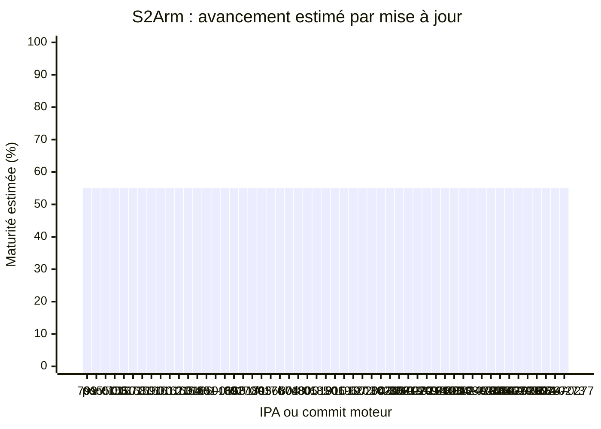

[Preuves techniques conservées](https://github.com/TarbleFR/RewindBox/blob/1a734455b8162ed70c7cf8e7a7fc76f85e5af69e/docs/AI_TASK_BOARD.md) : causes, essais, résultats et limites ; vérifier les anciens statuts, sans réactiver leurs procédures. Consignes actuelles : [AGENTS.md](../AGENTS.md). 20 novembre — [SSBU / Nextendo](evidence/nextendo-ssbu-ipa785-2026-11-18.md#après-le-certificat--journal-du-20-novembre-ipa-799) : journal IPA 799 / Core `13ffc868` analysé. Certificat accepté à 11:13:33 UTC, sans preuve de login NEX ni de matchmaking. Défaut de lecture TLS reproduit (99 octets disponibles masqués par `Socket.Poll`) et corrigé : tampon propre, `Pending`/`Peek`, annulation des lectures à la fermeture et diagnostics après handshake. Lecture 100/100 octets, 523 contrôles du contrat, [Core `bde1a21c` compilé et authentifié](evidence/nextendo-tls-buffer-core-2026-11-20.json), deux sessions simulateur réussies. À la demande du mainteneur, [801 relancée avec Nextendo et S2Arm 0164–0165](https://github.com/TarbleFR/RewindBox/actions/runs/44733205671), source `f1d0df55` ; le run `44731993742` sans ces corrections est annulé. Contrat local réussi, moteurs réutilisés, destinataire privé conservé. Les 799/800 gardent le Core précédent ; [IPA 801 livrée et vérifiée](evidence/rewind801/delivery.json), partie SSBU sur iPhone encore non validée.

20 novembre — [Coupe Champignon 150 cc à 1×, IPA privée 797](evidence/rewind797/delivery.json). 35 recettes exactes vérifiées et ajoutées au profil prioritaire. Historique fusionné au premier dessin, préchargement borné et réduction du travail Metal et des lectures spéculatives. Les vérifications Metal sur Mac et la migration synthétique depuis la 796 passent. Les quatre courses, les promotions depuis les caches du joueur et la cadence en 1× restent à mesurer sur iPhone 16 Pro Max.

20 novembre — [IPA privée 799](evidence/rewind799/delivery.json). La livraison embarque le patch S2Arm 0154 pour la préparation et la récupération de l’historique de pipelines. Les charges utiles, les identifiants de mise à jour et la présence du patch dans l’IPA sont vérifiés. La [capture 799](evidence/s2arm-799-frame-stalls.md) mesure la cadence moteur ; les quatre courses et le gain comparatif à 1× restent à identifier.

20 novembre — [IPA privée 803 livrée et vérifiée](evidence/rewind803/delivery.json) : cadence native 0170, protocole générique 0171 et derniers correctifs Nextendo authentifiés. Première référence reproductible ; fluidité, son, chaleur et régressions sur iPhone restent à observer.

20 novembre — [IPA privée 804 livrée et vérifiée](evidence/rewind804/delivery.json) : moteur S2Arm revu `f956b7d8`, instrumentation et restitution du tas hôte 0172–0176. Clé privée existante réutilisée, quatre pièces chiffrées et IPA finale vérifiées, 97 images vérifiées et 10 identifiants de bundles conservés. Les différences de relais des deux ponts recompilés sont expliquées ; aucun nouvel avertissement Xcode face à 803. Comparaison mémoire et temps d’image sur iPhone en attente, estimation inchangée.

21 novembre — Préchargement 0192–0197. Rendement par source et octets lus par le processus. Mesures sur iPhone en attente.

21 novembre — Gouverneur mémoire 0186–0191. Suivi de dix minutes, seuils sur appareil en attente.

20 novembre — Textures Metal 0181–0185. Budget des copies facultatives et attribution des ré-envois. Mesure sur iPhone en attente.

20 novembre — Pipelines Metal 0177–0180. Compteurs par durée de vie, préchauffage récent et éviction après cinq minutes. Comparaison 803 sur appareil en attente.

21 novembre — [Cadence, passes NVN2 et QoS, 0262–0267](evidence/s2arm-race-pacing.md). Cadence de course A18 Pro à mesurer.

21 novembre — [Passes de profondeur/stencil et QoS, 0260–0261](evidence/s2arm-first-draw.md#gpu-et-qos-des-invités). Temps GPU sur iPhone non mesuré.

21 novembre — [Préparation des shaders et des dessins indirects, 0256–0259](evidence/s2arm-first-draw.md#correctifs-02560259). Résultat sur A18 Pro non mesuré.

21 novembre — [Première utilisation des shaders, 0248–0255](evidence/s2arm-first-draw.md). Temps par circuit et cadence soutenue sur A18 Pro à mesurer.

## S2Arm

Objectif : 60 FPS constants sans saccades à 1×. Périmètre initial : Mario Kart World 1.0.0, Coupe Champignon 150 cc, quatre circuits, iPhone 16 Pro Max. Les notes évaluent ce périmètre, pas tous les jeux ou moteurs de RewindBox.

**Point de départ au 20 novembre 2026 : environ 55 % de maturité estimée.** Cette estimation de pilotage n’est ni un taux de tâches terminées ni le rapport FPS/60. La session 799 donne 30,414 FPS moteur sur 7 232 intervalles ; les quatre circuits restent à annoter.

| Jalon | Poids | Estimation 799 | État et limite |
| --- | ---: | ---: | --- |
| I — Import, préparation et lancement | 15 % | 90 % | Parcours fonctionnel et jeu exécuté ; reprise et sauvegardes à confirmer de bout en bout. |
| R — Rendu et parcours jouable | 20 % | 60 % | Course affichée ; fidélité et quatre circuits complets à valider. |
| C — Préparation et réutilisation graphiques | 25 % | 65 % | Caches et contrôles Metal présents ; premières utilisations sans blocage à démontrer sur iPhone. |
| P — Budget CPU/GPU pour 60 FPS à 1× | 25 % | 35 % | 799 : 30,414 FPS moteur ; p95 69,364 ms, p99 136,830 ms. |
| S — Stabilité prolongée, mémoire et chauffe | 15 % | 25 % | 803 : tag 2 à 755 Mio rapportés. Attribution par propriétaire et restitution du tas livrées dans 804 ; objectif −250 Mo et temps d’image en attente des trois fenêtres valides par version. |

Calcul conservé d’une version à l’autre : somme(note × poids) / 100, arrondie au multiple de 5 le plus proche ; ici 54,25 → 55 %. Toute révision des notes exige une preuve ou une justification explicite ; une régression peut les faire baisser. Un changement de périmètre ou de pondération ouvre une série distincte.

| Date | IPA / source | I / R / C / P / S (%) | Global estimé | Évolution et preuve / mesure sur appareil |
| --- | --- | --- | ---: | --- |
| 2026-11-20 | [799](evidence/rewind799/delivery.json) / `27316165` | 90 / 60 / 65 / 35 / 25 | 55 % | Point initial : patch 0154 de préparation et récupération d’historique, contrôles Metal sur [Mac](https://github.com/TarbleFR/RewindBox/actions/runs/44659775244), compilation et livraison vérifiées ; [session appareil](evidence/s2arm-799-frame-stalls.md) : 30,414 FPS moteur, indice de course 27,282 ; 153/41/10 pauses >100/200/500 ms ; pic 5006 Mio, préparation 288,140 s. |
| 2026-11-20 | [Moteur 0155](https://github.com/TarbleFR/RewindBox/commit/49db0f52ba0679fd08ba9ffac58e547a5cf917f3) | 90 / 60 / 65 / 35 / 25 | 55 % | [Textures, attentes, RomFS, préparation, audio et cadence visible](evidence/s2arm-799-frame-stalls.md). [Compilé sur macOS 15 et 26](https://github.com/TarbleFR/RewindBox/actions/runs/44670712737) ; mesure iPhone en attente. |
| 2026-11-20 | [Pont iOS après 0155](https://github.com/TarbleFR/RewindBox/commit/4abe6bbe7755794b1ef3c44c7d4f9ac4dc8b53ea) | 90 / 60 / 65 / 35 / 25 | 55 % | Durées monotones du moteur (prepareMs) et des exports de preuves (exportMs), y compris en réutilisation. [Compilation iOS arm64 réussie](https://github.com/TarbleFR/RewindBox/actions/runs/44670870535). Mesure iPhone en attente. |
| 2026-11-20 | [Moteur 0156](https://github.com/TarbleFR/RewindBox/commit/b3ab1140d686cd570c53a08212f00e5bb8b55d26) | 90 / 60 / 65 / 35 / 25 | 55 % | Petits transferts CPU regroupés sur Mario Kart World, encodeur de calcul ouvert à la demande, prélecture bornée même en concurrence et fermeture des fichiers RomFS évincés hors verrou. [Compilé sur macOS 15 et 26](https://github.com/TarbleFR/RewindBox/actions/runs/44671317240), empreintes des patches 0155/0156 vérifiées. Gain sur appareil à mesurer. |
| 2026-11-20 | [Moteur 0157](https://github.com/TarbleFR/RewindBox/commit/1178423daea79396531b12ee84cd24b7620bf558) | 90 / 60 / 65 / 35 / 25 | 55 % | Réveil ciblé des threads et mise en sommeil du travailleur de copies Metal lorsque iOS signale une chauffe sérieuse. Essai Linux, 8 threads et 5 000 événements reçus à chaque passage, 7 passages par version. Réveils 40 000 → 5 000, temps CPU médian 1 354,8 → 138,5 ms. À chacun des quatre niveaux thermiques simulés, les 34 768 copies se terminent dans l’ordre. Chauffe et FPS sur iPhone non mesurés avec ce moteur. |
| 2026-11-20 | [Moteur 0158](https://github.com/TarbleFR/RewindBox/commit/3472b90f158f01ff3c5fe895ca2a129e7e591fbf) | 90 / 60 / 65 / 35 / 25 | 55 % | Écritures du journal de course regroupées. Rejeu local des 7 232 images et 153 lignes de pause de la 799. Les écritures passent de 7 385 à 226 avec 2 089 095 octets identiques. Les lignes hors capacité et la sortie d’erreur gardent le format initial. Chauffe et FPS sur iPhone non mesurés avec ce moteur. |
| 2026-11-20 | [Moteur 0159](https://github.com/TarbleFR/RewindBox/commit/b4e34f4382761fa27a40650449a702749bc59ab9) | 90 / 60 / 65 / 35 / 25 | 55 % | Réveil du présentateur classique uniquement quand il peut présenter. Essai pthread synchronisé sur 5 000 images en mode DisplayLink et trois notifications distinctes par image. Revérifications inutiles du présentateur 15 000 → 0. Après 100 bascules, 1 001 images classiques traitées. Rejeu des 1 341 lignes de premier dessin de la 799 en 94 groupes observés ou subdivisés. Écritures 1 341 → 116 pour 400 406 octets identiques. Mesure sur iPhone en attente. |
| 2026-11-20 | [Moteur 0160](https://github.com/TarbleFR/RewindBox/commit/e5d8c2a08f8ecbba7b13c71d32ef5ec12f577303) | 90 / 60 / 65 / 35 / 25 | 55 % | Lancement de Mario Kart World. Rejeu séquentiel du manifeste de la 799, 698 → 298 contrôles de disponibilité pour 298 variantes. Empreintes des textures identiques dans 312 cas. Temps CPU médian du hachage de 131,25 Mio sur Linux, 43,71 → 14,84 ms. [Vidéo, mesures et méthode](evidence/s2arm-799-frame-stalls.md#chargement-de-la-carte-de-mario-kart-world). [Compilation réussie sur macOS 15 et 26](https://github.com/TarbleFR/RewindBox/actions/runs/44689588152). Les 160 empreintes de correctifs et les deux frameworks iOS arm64 correspondent au manifeste de [l’artefact](https://github.com/TarbleFR/RewindBox/actions/runs/44689588152/artifacts/14608277766). Gain en jeu à mesurer. |
| 2026-11-20 | [Moteur 0161](https://github.com/TarbleFR/RewindBox/commit/484b3d2ff2c2087b051273e1484e3ca76bf7d92e) | 90 / 60 / 65 / 35 / 25 | 55 % | Les tâches de préchauffage promues suivent le plafond thermique. Reprise à un worker pendant cinq secondes après la dernière mesure de chauffe sérieuse, si iOS autorise la reprise. Attente signalée lors d’un premier pipeline et regroupement des ajouts au manifeste personnel. Banc de quatre workers en pause thermique pendant 4,25 s : 64 → 14 réveils sur minuterie. Rejeu de 498 lignes : 498 → 6 écritures, 180 254 octets identiques. [Compilation réussie](https://github.com/TarbleFR/RewindBox/actions/runs/44718999549). Chauffe et cadence en jeu à mesurer sur iPhone. |
| 2026-11-20 | [Moteur 0162](https://github.com/TarbleFR/RewindBox/commit/3aae8ed4e30d9e4a9deebeac3cb5170849ef6cbf) | 90 / 60 / 65 / 35 / 25 | 55 % | La préparation de référence peut démarrer un pipeline exact déjà requis au premier plan. Un élément facultatif promu hors de ce préfixe reste soumis au plafond thermique. [Banc des files et mesures](evidence/s2arm-799-frame-stalls.md#réveil-des-workers-et-chauffe-après-0160). [Compilation macOS 15 et 26 réussie](https://github.com/TarbleFR/RewindBox/actions/runs/44719352785), les 162 empreintes et les frameworks iOS arm64 concordent. Validation iPhone en attente. |
| 2026-11-20 | [Moteur 0163](https://github.com/TarbleFR/RewindBox/commit/8eb3af9023298ac69c2966eefedca59715d03a5c) | 90 / 60 / 65 / 35 / 25 | 55 % | [Banc de 300 images et 1 683 recherches par image](evidence/s2arm-799-frame-stalls.md#débit-en-course-après-0162) : 36 à 81 % de recherches évitées selon les invalidations simulées. Regroupement de premiers transferts compatibles et mesure des échéances visibles. [Compilation macOS 15 et 26 réussie](https://github.com/TarbleFR/RewindBox/actions/runs/44725883644). Cadence à 1× sur iPhone à mesurer. |
| 2026-11-20 | [Moteur 0164](https://github.com/TarbleFR/RewindBox/commit/19706772b8f3857df70a93d13f611da3c0fa7a29) | 90 / 60 / 65 / 35 / 25 | 55 % | Marge iOS de zéro reconnue, écriture bornée de l’historique et export RAM aux étapes de la session. Mesure sur iPhone en attente. |
| 2026-11-20 | [Moteur 0165](https://github.com/TarbleFR/RewindBox/commit/71ea69e8173db4db3795c8092d74f552a8e89d90) | 90 / 60 / 65 / 35 / 25 | 55 % | Sous pression, récupération bornée des tampons Metal surdimensionnés après confirmation de fin du lot. [Moteur 0164–0165 compilé pour iOS](https://github.com/TarbleFR/RewindBox/actions/runs/44729718541). [Bancs et référence 799](evidence/s2arm-799-frame-stalls.md#empreinte-mémoire-et-transferts-après-0163). Réallocations et retransferts à mesurer sur iPhone. |
| 2026-11-20 | [IPA privée 801](evidence/rewind801/delivery.json) / `f1d0df55` | 90 / 60 / 65 / 35 / 25 | 55 % | Débit en course et audit RAM livrés avec les correctifs Nextendo du même lot. [Identité du moteur signé](evidence/rewind801/s2arm-identity801.json) authentifiée, 165 patches et identifiants des bundles identiques à la 799. Mesures du menu, de la relance et des quatre circuits sur iPhone en attente. |
| 2026-11-20 | Moteur 0166–0168 | 90 / 60 / 65 / 35 / 25 | 55 % | [Session 801 et changements](evidence/s2arm-801-driving-analysis.md) : 8 254 intervalles sans nouvelle compilation, périodes GPU 36–39 ms, attentes SVC et premiers uploads distincts. Réutilisation des adresses UBO, identifiants de vues et constantes identiques ; captures GPU bornées, producteur des attentes et séries de retards visibles. Revue indépendante et [compilation iOS réussie](https://github.com/TarbleFR/RewindBox/actions/runs/44743007001) ; candidats de binding réévalués puis remplacés par 0169. Gain iPhone non mesuré. |
| 2026-11-20 | [Moteur 0169](https://github.com/TarbleFR/RewindBox/commit/355273cc089ad414dedb0e6b0628999851bdf012) | 90 / 60 / 65 / 35 / 25 | 55 % | [Contre-expertise mesurée](evidence/s2arm-801-driving-analysis.md#contre-expertise-mesurée-et-chemin-court-0169--20-novembre-2026) : second cache UBO et comparaison des constantes retirés ; garde d'adresse inline et RID validé direct. [Banc RID](https://github.com/TarbleFR/RewindBox/actions/runs/44745877482) : 3,287 → 1,182 ns/appel, 11/11 passages favorables sur runner arm64 virtuel. Core ML exécuté, ANE indisponible ; reconstruction inactive. [Moteur iOS compilé sur macOS 15 et 26](https://github.com/TarbleFR/RewindBox/actions/runs/44746620489), 169 patches authentifiés. Banc isolé macOS `-O3`, couche NVN iOS `-Os` : mesure iPhone en attente, aucun FPS extrapolé. |
| 2026-11-20 | [IPA privée 802](evidence/rewind802/delivery.json) / `ffdb82c3` | 90 / 60 / 65 / 35 / 25 | 55 % | Chemins courts 0169 livrés avec les diagnostics bornés 0166–0168 et les correctifs Nextendo conservés. [Livraison réussie](https://github.com/TarbleFR/RewindBox/actions/runs/44749830555), téléchargement déchiffré et vérifié : 97 images binaires, 10 identifiants de bundles identiques à la 801, [moteur signé et 169 patches authentifiés](evidence/rewind802/s2arm-identity802.json). Même 1×, budget textures 192 Mio, préparation et caches compatibles conservés. FPS, qualité, chauffe et stabilité prolongée sur iPhone non mesurés avec la 802 ; estimation inchangée. |
| 2026-11-20 | Moteur 0170 / cadence native | 90 / 60 / 65 / 35 / 25 | 55 % | [Audit des exports 801/802 et correction](evidence/s2arm-cadence-803.md) : le manifeste générique contournait les intervalles 2 sans correction de vitesse. Retrait au consommateur, modules préparés et caches conservés ; profils, tables et patches explicites inchangés. MKW 802 : 34,388 FPS moteur sur 6 400 intervalles / 186,111 s ; fenêtres GPU 10,99–39,58 ms, aucune comparaison causale entre versions. Revue et application du patch réussies ; [compilation sur macOS 15 et 26 réussie](https://github.com/TarbleFR/RewindBox/actions/runs/44759330364), artefact authentifié. Livraison regroupée avec 0171 ; mesure iPhone en attente. |
| 2026-11-20 | Moteur 0171 / protocole générique | 90 / 60 / 65 / 35 / 25 | 55 % | [Protocole reproductible](s2arm-benchmark-protocol.md), [audit des 81 patchs / 18 familles](evidence/s2arm-fluidity-803/audit-803.md), fenêtre de 180 s et attribution VM complète après le score. Cadence native 0170 conservée ; Nextendo inclus dans le lot 803. Aucun changement de budgets/caches/audio ; aucun gain iPhone mesuré. [Compilation macOS 15 et 26 réussie](https://github.com/TarbleFR/RewindBox/actions/runs/44772035018), source `342f534e`, 171 patchs authentifiés et zéro avertissement sur les lignes ajoutées. Chaîne shaders inchangée (`0be3f28548fd`). [Pin contrôlé](https://github.com/TarbleFR/RewindBox/actions/runs/44774890033), livré dans 803 ; observations iPhone en attente. |
| 2026-11-20 | [IPA privée 803](evidence/rewind803/delivery.json) / `c5422386` | 90 / 60 / 65 / 35 / 25 | 55 % | [Livraison réussie](https://github.com/TarbleFR/RewindBox/actions/runs/44775472323), IPA téléchargée et vérifiée : 97 images, 10 identifiants de bundles conservés. Cadence 0170, banc générique 0171 et Core Nextendo `8988ced5` authentifiés. Zéro avertissement sur les lignes ajoutées ; chaîne shaders `0be3f28548fd` conservée. Première référence instrumentée : aucun avant/après iPhone comparable, aucun gain déclaré ; clé privée supprimée après remise. |
| 2026-11-20 | Moteur 0172–0176 / tas hôte | 90 / 60 / 65 / 35 / 25 | 55 % | [Attribution, couverture et critères](evidence/s2arm-fluidity-803/implementation-status.md#tas-hôte-ios--lots-0172-à-0176). Zones malloc et propriétaires, plafond des archives ouvertes et restitution sous pression. [Premier moteur `6bdf6fec` compilé et authentifié](evidence/s2arm-fluidity-803/engine176-build.json), pin contrôlé. Révision de revue ci-dessous ; gain iPhone non mesuré. |
| 2026-11-20 | [Révision tas hôte `f956b7d8`](https://github.com/TarbleFR/RewindBox/commit/f956b7d84b03c23f8ecb9ff500c7965a2ff25807) | 90 / 60 / 65 / 35 / 25 | 55 % | Archives détruites hors verrou, reconstruction après échec conservée, fournisseur audio protégé et horaires de collecte explicites. [Compilation macOS 15 et 26 réussie](evidence/s2arm-fluidity-803/engine176-review-build.json), 176 patchs authentifiés, aucun avertissement sur les 374 lignes nouvelles. Comparateur de trois fenêtres par version, compatible avec les deux booléens numériques de 803 sans changer les autres validations. [Pin contrôlé en CI](https://github.com/TarbleFR/RewindBox/actions/runs/44793831852), fichier régénéré identique au pin intégré. IPA privée et mesures iPhone en attente ; gain non mesuré. |
| 2026-11-20 | [IPA privée 804](evidence/rewind804/delivery.json) / `5f8fc02a` | 90 / 60 / 65 / 35 / 25 | 55 % | [Livraison réussie](https://github.com/TarbleFR/RewindBox/actions/runs/44803751366), fichier privé déchiffré avec la clé existante et remis après vérification. [Moteur signé revu et 176 patchs authentifiés](evidence/rewind804/s2arm-identity804.json), 97 images, 10 identifiants de bundles inchangés, Nextendo et autres moteurs conservés. [Deux écarts de relais expliqués](evidence/rewind804/bridge-image-difference804.json), [aucun nouvel avertissement Xcode face à 803](evidence/rewind804/application804-warnings.json). Corrigé, compilé et livré ; aucune fenêtre candidate sur appareil, aucun propriétaire >100 Mo établi, objectif −250 Mo/tag 2 et page-ins non validé. Repli `S2A_RB_HEAP_TRIM=0`, estimation inchangée. |
| 2026-11-20 | Moteur 0177–0180 / pipelines Metal | 90 / 60 / 65 / 35 / 25 | 55 % | [Mémoire et temps d’image](evidence/s2arm-fluidity-803/implementation-status.md#pipelines-metal-vivants). [Moteur revu `5bc7fa90` compilé sur macOS 15 et 26](evidence/s2arm-fluidity-803/engine180-build.json). Les recettes de rendu fusionné et les temps d’acquisition sont inclus. Gain sur appareil non mesuré. |
| 2026-11-20 | IPA 805 / livraison privée | 90 / 60 / 65 / 35 / 25 | 55 % | [IPA déchiffrée et vérifiée](evidence/rewind805/delivery.json). Les fenêtres comparables face à 803 restent à mesurer sur iPhone. |
| 2026-11-20 | Moteur 0181–0185 / textures Metal | 90 / 60 / 65 / 35 / 25 | 55 % | [Budget, attribution historique et conditions de mesure](evidence/s2arm-fluidity-803/implementation-status.md#textures-metal). Gain sur appareil non mesuré. |
| 2026-11-21 | IPA 806 / livraison privée | 90 / 60 / 65 / 35 / 25 | 55 % | [IPA vérifiée](evidence/rewind806/delivery.json). Mémoire des textures, ré-envois et temps d’image en attente des mesures sur iPhone. |
| 2026-11-21 | Moteur 0186–0191 / gouverneur mémoire | 90 / 60 / 65 / 35 / 25 | 55 % | [Quotas, ordre de réduction et critères de pagination](evidence/s2arm-fluidity-803/implementation-status.md#pagination-sur-dix-minutes). Non mesuré sur iPhone. |
| 2026-11-21 | Moteur 0192–0196 / préchargement | 90 / 60 / 65 / 35 / 25 | 55 % | [Mesures par source et critère de lecture](evidence/s2arm-fluidity-803/implementation-status.md#rendement-de-la-lecture-anticipée). Gain sur appareil non mesuré. |
| 2026-11-21 | Moteur 0197 / confirmation des lectures | 90 / 60 / 65 / 35 / 25 | 55 % | Lectures invitées confirmées et observations censurées distinguées dans le [suivi](evidence/s2arm-fluidity-803/implementation-status.md#rendement-de-la-lecture-anticipée). Non mesuré sur iPhone. |
| 2026-11-21 | Moteur 0203 / attribution et son | 90 / 60 / 65 / 35 / 25 | 55 % | Comptage des images longues et réserve audio dans le [suivi](evidence/s2arm-fluidity-803/implementation-status.md). Aucune mesure sur iPhone. |
| 2026-11-21 | Moteur 0204 / chronologie audio | 90 / 60 / 65 / 35 / 25 | 55 % | Récupération conditionnée aux retours de PCM réel après le fondu. Résultat sur iPhone non mesuré. |
| 2026-11-21 | IPA 807 / livraison privée | 90 / 60 / 65 / 35 / 25 | 55 % | [IPA vérifiée](evidence/rewind807/delivery.json). Pagination, rendement de lecture anticipée et temps d’image sur iPhone non mesurés. |
| 2026-11-21 | Moteur 0205 / priorité de circuit F14 | 90 / 60 / 65 / 35 / 25 | 55 % | [Comparaison sur deux circuits](evidence/s2arm-fluidity-803/implementation-status.md). Aucune fenêtre appariée sur appareil. |
| 2026-11-21 | IPA 808 / livraison privée | 90 / 60 / 65 / 35 / 25 | 55 % | [IPA vérifiée](evidence/rewind808/delivery.json). Attribution et latence audio sur iPhone non mesurées. |
| 2026-11-21 | Moteur 0206–0209 / Metal 4 A18 Pro | 90 / 60 / 65 / 35 / 25 | 55 % | [Attachements, trace MetalFX et profondeur](evidence/s2arm-fluidity-803/implementation-status.md#gpu-metal-4-sur-a18-pro). GPU et chauffe sur appareil non mesurés. |
| 2026-11-21 | Moteur 0210–0214 / A18 Pro | 90 / 60 / 65 / 35 / 25 | 55 % | [Trace 2813, attachements et copie D32](evidence/s2arm-fluidity-803/implementation-status.md#chronologie-vérifiée-sur-a18-pro). Gain après correction sur appareil en attente. |
| 2026-11-21 | Moteur 0215–0219 et pont iOS / A18 Pro | 90 / 60 / 65 / 35 / 25 | 55 % | [Charge soutenue, fences et MetalFX](evidence/s2arm-fluidity-803/implementation-status.md#charge-soutenue-sur-iphone-16-pro-max). Délai avant Fair et consommation sur appareil en attente. |
| 2026-11-21 | Moteur 0220–0225 / A18 Pro | 90 / 60 / 65 / 35 / 25 | 55 % | [Première utilisation des pipelines et protocole à deux lancements](evidence/s2arm-fluidity-803/implementation-status.md#première-utilisation-des-pipelines-sur-a18-pro). Mesure en jeu sur appareil en attente. |
| 2026-11-21 | IPA privée 810 livrée / `8e3db7f5` | 90 / 60 / 65 / 35 / 25 | 55 % | [Moteur iOS compilé et vérifié](evidence/s2arm-fluidity-803/engine225-build.json). Le test privé active la préparation asynchrone des pipelines pour le titre ciblé. [IPA signée vérifiée](evidence/rewind810/delivery.json). Cadence et chauffe sur iPhone non mesurées. |
| 2026-11-21 | IPA privée 811 livrée / `d11f3728` | 90 / 60 / 65 / 35 / 25 | 55 % | [Moteur iOS compilé et vérifié](evidence/s2arm-fluidity-803/engine229-build.json). Le test privé active la préparation asynchrone des pipelines pour le titre ciblé. [IPA signée vérifiée](evidence/rewind811/delivery.json). Cadence et chauffe sur iPhone non mesurées. |
| 2026-11-21 | IPA privée 812 livrée / `e7c8b693` | 90 / 60 / 65 / 35 / 25 | 55 % | [Moteur iOS compilé et vérifié](evidence/s2arm-fluidity-803/engine233-build.json). Rétention des cibles 3D, ombres à 0,75 et DRS par paliers en option. Le réglage PSO est identique à celui de la 811. [IPA signée vérifiée](evidence/rewind812/delivery.json). Cadence et chauffe sur iPhone non mesurées. |
| 2026-11-21 | Moteur 0234–0237 | 90 / 60 / 65 / 35 / 25 | 55 % | [Uploads, pager fichier, cadence réelle et profil par build](evidence/s2arm-upload-pacing.md). Titre 04007EF01F8AE000. [Backend Metal 4 macOS et framework iOS arm64 compilés](https://github.com/TarbleFR/RewindBox/actions/runs/44870326035), [pont UIKit compilé](https://github.com/TarbleFR/RewindBox/actions/runs/44869974500). Relecture de textures validée en Metal 3 sur GPU virtuel. Distribution des images après changement et pic mémoire sur iPhone non mesurés. |
| 2026-11-21 | Moteur 0238–0244 / thermique A18 Pro, Mario Kart World | 90 / 60 / 65 / 35 / 25 | 55 % | [Changements et protocole face à la 810](evidence/s2arm-thermal-813.md). [Backend macOS, frameworks iOS arm64 et tests Metal](https://github.com/TarbleFR/RewindBox/actions/runs/44873287460), [pont UIKit](https://github.com/TarbleFR/RewindBox/actions/runs/44873287530). La 810 de référence atteint Serious à 7,2 min. Thermique et cadence du nouveau moteur sur iPhone à mesurer. |

| 2026-11-21 | Moteur 0245–0247 / gel de présentation | 90 / 60 / 65 / 35 / 25 | 55 % | [Budget Mach, anti-rebond et quotas sous compression](evidence/s2arm-present-freeze.md). [247 patchs et frameworks iOS vérifiés](evidence/s2arm-fluidity-803/engine247-build.json). Deux périodes testées à 2,000 ms effectifs sur macOS arm64. Rejeu de 270 changements. Endurance sur iPhone à mesurer. |
| 2026-11-21 | IPA privée 813 livrée / `96b7e840` | 90 / 60 / 65 / 35 / 25 | 55 % | [Moteur iOS compilé et vérifié](evidence/s2arm-fluidity-803/engine247-build.json). Politique thermique GPU/PSO, QoS invité, budget Mach, anti-rebond et plafonds sous compression pour 0400C3F00006E000. Cadence et chauffe sur iPhone non mesurées. [IPA vérifiée, base 812](evidence/rewind813/delivery.json). |

| 2026-11-21 | Moteur 0256–0259 / chemin NVN2 | 90 / 60 / 65 / 35 / 25 | 55 % | [Travail par passe, identité de shader au rejeu, couverture du disque et utilitaires précalculés](evidence/s2arm-first-draw.md#correctifs-02560259). FPS affichés et temps de compilation sur iPhone non mesurés. |

| 2026-11-21 | Moteur 0260–0261 / A18 Pro et NVN2 | 90 / 60 / 65 / 35 / 25 | 55 % | [Effacement partiel D32F/S8 et mesure des transitions de QoS](evidence/s2arm-first-draw.md#gpu-et-qos-des-invités). [Moteur iOS arm64 compilé et vérifié, 261 patchs](evidence/s2arm-fluidity-803/engine261-build.json). Fréquence des cas éligibles et gain GPU sur appareil non mesurés. |
| 2026-11-21 | Moteur 0262–0267 / A18 Pro et NVN2 | 90 / 60 / 65 / 35 / 25 | 55 % | [Passes, événements, retenue de présentation, DRS thermique et transitions de QoS](evidence/s2arm-race-pacing.md). Temps GPU, cadence et évictions en course sur iPhone à mesurer. |
| 2026-11-21 | IPA privée 814 livrée / `a1007799` | 90 / 60 / 65 / 35 / 25 | 55 % | [Moteur iOS compilé et vérifié](evidence/s2arm-fluidity-803/engine267-build.json). Préparation des shaders et pipelines, passes NVN2, synchronisation, cadence et QoS thermique. Cadence et chauffe sur iPhone non mesurées. [IPA vérifiée, base 813](evidence/rewind814/delivery.json). |
| 2026-11-21 | Moteur 0268–0273 / comparaison 814 | 90 / 60 / 65 / 35 / 25 | 55 % | [Persistance, AIR, premier draw, uniformes et files NVN2](evidence/s2arm-nvn2-build814.md). Trames, réutilisation après relance et évictions à mesurer sur iPhone. |

| 2026-11-21 | Moteur 0274–0277 / NVN2 | 90 / 60 / 65 / 35 / 25 | 55 % | [Uniformes en vol, première passe après prépasse, AIR et charge en Fair](evidence/s2arm-nvn2-build814.md). Mesure sur iPhone en attente. |

**Mesures de référence, à conserver séparément de l’estimation :** [IPA 795](evidence/rewind796/profile-observations-795.json), 26,886 FPS moteur sur 9 145 intervalles sans lacune dans la plage observée (≈ 5 min 40 s), 213 >100 ms dont 36 >500 ms ; [ancien moteur 0001–0089](evidence/s2arm-ipa783-device-2026-11-18.md), 60 FPS sur 526 intervalles (≈ 8,8 s), scène non identifiée ; [IPA 786](evidence/s2arm-ipa786-device-2026-11-18.md), deux fenêtres à l’affichage à 23,9 / 22,5 FPS et GPU médian à 33,38 / 35,03 ms ; [IPA 794](evidence/s2arm-first-race-795.md), pic échantillonné de 5 175 Mio. Parcours, caches et réglages non uniformisés : aucun gain avant/après attribuable à partir de ces seuls relevés.

Le protocole est désormais générique pour les jeux Switch 2. La série à 55 % ci-dessus reste l’estimation historique MKW ; aucune note globale de compatibilité Switch 2 n’est déduite de cette compilation.

**Priorités actuelles :** comparaison 803/804 avec trois fenêtres valides par version selon le [protocole générique de 180 secondes](s2arm-benchmark-protocol.md), attribution de la mémoire compressée et identification des propriétaires au-dessus de 100 Mo. Objectif : tag 2 réduit d’au moins 250 Mo et médiane des page-ins plus basse, sans hausse du p95 affiché ni des images >100 ms. CPU, son et endurance viennent ensuite selon les mesures. Le même protocole couvre les deux autres jeux Switch 2 cités par le mainteneur. Les anciens parcours non appariés restent des preuves diagnostiques, pas un avant/après. Un seul lot cohérent par IPA ; aucune hausse de maturité pour une compilation.
**À chaque mise à jour S2Arm :** compléter ce même MD avec date, IPA ou commit moteur, changements, preuves, notes par jalon et statut distinct (corrigé, compilé, livré, observé sur appareil), puis actualiser le tableau courant et le graphique depuis l’historique. Une mise à jour documentaire seule ne crée pas de nouvelle version moteur. Indiquer « non mesuré » pour toute mesure absente, sans reprendre les FPS d’une ancienne IPA comme ceux de la nouvelle ; sans nouvelle justification, conserver les notes. Pour les mesures, identifier jeu/version, appareil, résolution, scène, cache et durée ; séparer cadence moteur et affichage, relever p95/p99, pauses >100/500 ms, GPU, mémoire et chauffe. Publier le graphique actualisé dans le bilan remis à l’utilisateur ; ne pas ajouter de workflow, compilation ou suite de tests pour ce suivi documentaire.
