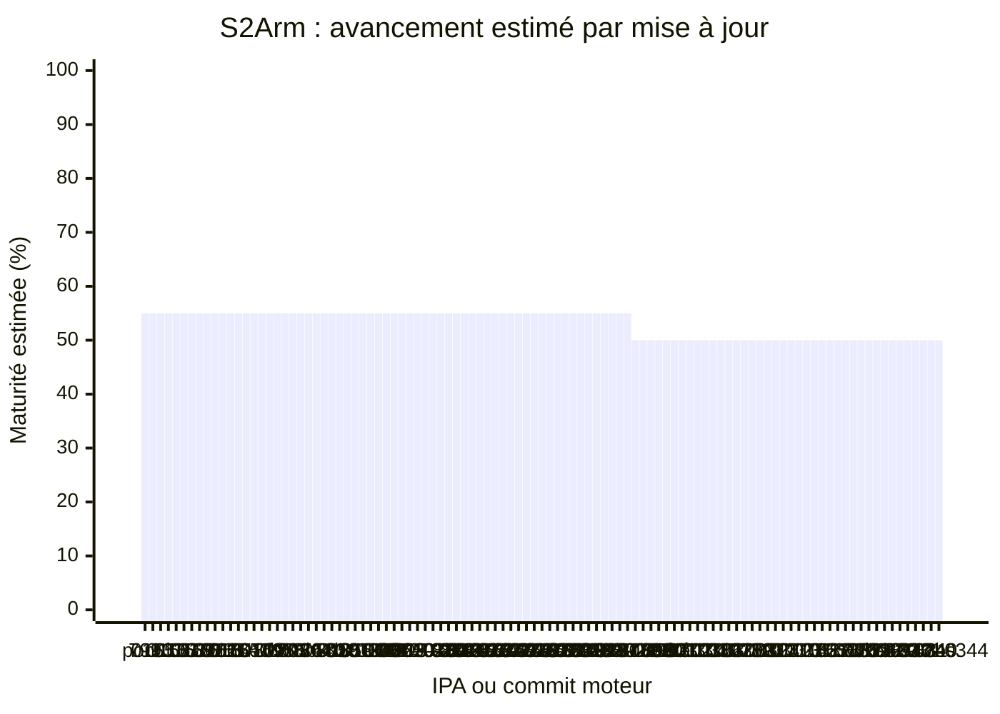

[Preuves techniques conservées](https://github.com/TarbleFR/RewindBox/blob/1a734455b8162ed70c7cf8e7a7fc76f85e5af69e/docs/AI_TASK_BOARD.md) : causes, essais, résultats et limites ; vérifier les anciens statuts, sans réactiver leurs procédures. Consignes actuelles : [AGENTS.md](../AGENTS.md). 20 novembre — [SSBU / Nextendo](evidence/nextendo-ssbu-ipa785-2026-11-18.md#après-le-certificat--journal-du-20-novembre-ipa-799) : journal IPA 799 / Core `13ffc868` analysé. Certificat accepté à 11:13:33 UTC, sans preuve de login NEX ni de matchmaking. Défaut de lecture TLS reproduit (99 octets disponibles masqués par `Socket.Poll`) et corrigé : tampon propre, `Pending`/`Peek`, annulation des lectures à la fermeture et diagnostics après handshake. Lecture 100/100 octets, 523 contrôles du contrat, [Core `bde1a21c` compilé et authentifié](evidence/nextendo-tls-buffer-core-2026-11-20.json), deux sessions simulateur réussies. À la demande du mainteneur, [801 relancée avec Nextendo et S2Arm 0164–0165](https://github.com/TarbleFR/RewindBox/actions/runs/44733205671), source `f1d0df55` ; le run `44731993742` sans ces corrections est annulé. Contrat local réussi, moteurs réutilisés, destinataire privé conservé. Les 799/800 gardent le Core précédent ; [IPA 801 livrée et vérifiée](evidence/rewind801/delivery.json), partie SSBU sur iPhone encore non validée.

20 novembre — [Coupe Champignon 150 cc à 1×, IPA privée 797](evidence/rewind797/delivery.json). 35 recettes exactes vérifiées et ajoutées au profil prioritaire. Historique fusionné au premier dessin, préchargement borné et réduction du travail Metal et des lectures spéculatives. Les vérifications Metal sur Mac et la migration synthétique depuis la 796 passent. Les quatre courses, les promotions depuis les caches du joueur et la cadence en 1× restent à mesurer sur iPhone 16 Pro Max.

20 novembre — [IPA privée 799](evidence/rewind799/delivery.json). La livraison embarque le patch S2Arm 0154 pour la préparation et la récupération de l’historique de pipelines. Les charges utiles, les identifiants de mise à jour et la présence du patch dans l’IPA sont vérifiés. La [capture 799](evidence/s2arm-799-frame-stalls.md) mesure la cadence moteur ; les quatre courses et le gain comparatif à 1× restent à identifier.

20 novembre — [IPA privée 803 livrée et vérifiée](evidence/rewind803/delivery.json) : cadence native 0170, protocole générique 0171 et derniers correctifs Nextendo authentifiés. Première référence reproductible ; fluidité, son, chaleur et régressions sur iPhone restent à observer.

20 novembre — [IPA privée 804 livrée et vérifiée](evidence/rewind804/delivery.json) : moteur S2Arm revu `f956b7d8`, instrumentation et restitution du tas hôte 0172–0176. Clé privée existante réutilisée, quatre pièces chiffrées et IPA finale vérifiées, 97 images vérifiées et 10 identifiants de bundles conservés. Les différences de relais des deux ponts recompilés sont expliquées ; aucun nouvel avertissement Xcode face à 803. Comparaison mémoire et temps d’image sur iPhone en attente, estimation inchangée.

24 novembre — [S2Arm, ennemi n°1 : 60 i/s durables malgré le plafond de puissance d'iOS](evidence/s2arm-power-wall.md). Journaux 830 : à pleine fréquence, image de 23,7 ms pour 12,0 ms de GPU ; après 15 à 38 s de course, sonde GPU fixe ×3,4 et 24 i/s. Correctifs de l'étape 1 en cours ; aucun gain mesuré.

24 novembre — [IPA privée 831 livrée](evidence/rewind831/delivery.json) : la 830 avec le seul nouveau DeSmuME (3D dessinée pendant la composition 2D), à la demande du mainteneur ; vérifiée hors ligne, envoyée ; rien de mesuré sur iPhone.

24 novembre — [DeSmuME après la 830 : la 3D pendant la composition 2D](desmume-arm64-jit-architecture.md#165-après-lipa-830--journaux-du-mainteneur-la-3d-pendant-la-composition-2d). Journaux 830 : JIT actif (64 Mio, 31 555 blocs, aucun vidage) ; ×5 + 3D 2x à 42,4 i/s, dont 9,2 ms d'attente de la 3D lancée à la ligne 262. La 2D n'attend plus que ses propres lignes 3D, la conversion de sortie passe en NEON. Banc : 42–48 → 57–65 i/s en ×5 + 3D 2x, images identiques au bit près. Rien de mesuré sur iPhone.

24 novembre — [DeSmuME : JIT absent sans cause, ×10 à 20 fps](desmume-arm64-jit-architecture.md#16-état--jit-absent-sans-cause-10-à-20-fps-24-novembre-2026). JIT : mêmes binaires 829 avec et sans JIT à sept minutes d'écart ; la préparation s'arrêtait côté Flutter (LocalDevVPN ou appairage) sans trace dans la session, chaque cause est désormais journalisée ; arène à 64 Mio. ×10 : travail série par pixel (composition 2D, conversions, copie de 39 Mo) ; images RGB565 envoyées telles quelles au GPU et suréchantillonnage 3D (×5 + 3D 2x : 59,5 fps contre 48,9 en ×10 sur le banc, 192 Mo contre 311 pour le cœur), mesures `[rb-perf]`. Collection `67ce2d3b` compilée (run 45304481777, artefact 14881770592) et inscrite, pont compilé pour iPhone ; aucune IPA, rien de mesuré sur iPhone.

23 novembre — [DeSmuME : gel de la 828 et rendu en haute résolution](desmume-arm64-jit-architecture.md#15-état--gel-de-lipa-828-corrigé-rendu-en-haute-résolution-23-novembre-2026). Cause trouvée hors appareil : les STM et PUSH du JIT écrivaient hors de la table des blocs depuis l'étape 1 (reproduit, corrigé, 45 homebrews sans plantage). Rendu : ×10 de 82,6 à 29,5 ms par image sur le banc x86, images identiques au bit près ; `desmume_num_cores` à `auto`. Collection `ccd5f047` compilée (run 45284351707) et inscrite ; aucune IPA, rien de mesuré sur iPhone, ×10 non garanti fluide (rendu logiciel).

23 novembre — [Hogwarts 824–828 : gel à t≈22 s](evidence/melonx-hogwarts-freeze-824-828-2026-11-23.md). Compilations compute ×200 = cache Metal du système vide (remplissage prouvé session par session) ; code de compilation et MoltenVK identiques à la 822. Appel exact du gel non visible dans les journaux : relevé des piles « aucune image depuis 2/5/12 s » ajouté au bridge (fb88bf8f0) et outil `tools/melonx/stall_report.py`. Mesure sur iPhone en attente.

23 novembre — [Nextendo : un seul interrupteur, tous les jeux NEX](evidence/nextendo-online-all-games-2026-11-23.md). Certificat privé, serveur sécurisé par adresse et choix DNS étendus de SSBU à tout titre NEX ; écran réduit au compte et aux services en ligne. Core et app compilés localement (HLE/Library) ; NPLN non couvert ; iPhone non testé.

23 novembre — [Grand nettoyage Actions, 500 dernières exécutions gardées](actions-history-cleanup-2026-11-23.md) : 2 584 exécutions supprimées en deux passages, reçus et relecture complète vérifiés ; 940 restent, dont 416 anciennes encore utilisées (épinglages, manifeste 826, routes actives, `main`, non terminées). 3 008 artefacts détachés (131 Go) attendent la purge différée de GitHub. Lanceur ponctuel retiré.

21 novembre — Préchargement 0192–0197. Rendement par source et octets lus par le processus. Mesures sur iPhone en attente.

21 novembre — Gouverneur mémoire 0186–0191. Suivi de dix minutes, seuils sur appareil en attente.

20 novembre — Textures Metal 0181–0185. Budget des copies facultatives et attribution des ré-envois. Mesure sur iPhone en attente.

20 novembre — Pipelines Metal 0177–0180. Compteurs par durée de vie, préchauffage récent et éviction après cinq minutes. Comparaison 803 sur appareil en attente.

21 novembre — [Cadence, passes NVN2 et QoS, 0262–0267](evidence/s2arm-race-pacing.md). Cadence de course A18 Pro à mesurer.

21 novembre — [Passes de profondeur/stencil et QoS, 0260–0261](evidence/s2arm-first-draw.md#gpu-et-qos-des-invités). Temps GPU sur iPhone non mesuré.

21 novembre — [Préparation des shaders et des dessins indirects, 0256–0259](evidence/s2arm-first-draw.md#correctifs-02560259). Résultat sur A18 Pro non mesuré.

21 novembre — [Première utilisation des shaders, 0248–0255](evidence/s2arm-first-draw.md). Temps par circuit et cadence soutenue sur A18 Pro à mesurer.

## S2Arm

Objectif : 60 FPS constants sans saccades à 1×. Périmètre initial : Mario Kart World 1.0.0, Coupe Champignon 150 cc, quatre circuits, iPhone 16 Pro Max. Les notes évaluent ce périmètre, pas tous les jeux ou moteurs de RewindBox.

> **Ennemi n°1, épinglé le 24 novembre 2026 : tenir 60 i/s en session longue malgré le plafond de puissance d'iOS.** [Diagnostic, historique et plan](evidence/s2arm-power-wall.md). IPA 830, quatre journaux : à pleine fréquence, image p50 de 23,7 ms pour 12,0 ms de GPU, parce que le processeur et le GPU travaillent l'un après l'autre. Après 15 à 38 s de course, iOS divise l'horloge du GPU par environ 3 (sonde fixe de 0,24 à 0,82 ms) et la course tombe à 24 i/s, aux états thermiques 0 à 2. Plan : moins d'énergie par image pour tous les jeux, puis processeur et GPU en parallèle ; aucune baisse de résolution. Non corrigé ; aucun gain mesuré.

**Point de départ au 20 novembre 2026 : environ 55 % de maturité estimée.** Cette estimation de pilotage n’est ni un taux de tâches terminées ni le rapport FPS/60. La session 799 donne 30,414 FPS moteur sur 7 232 intervalles ; les quatre circuits restent à annoter.

| Jalon | Poids | Estimation 799 | État et limite |
| --- | ---: | ---: | --- |
| I — Import, préparation et lancement | 15 % | 90 % | Parcours fonctionnel et jeu exécuté ; reprise et sauvegardes à confirmer de bout en bout. |
| R — Rendu et parcours jouable | 20 % | 60 % | Course affichée ; fidélité et quatre circuits complets à valider. |
| C — Préparation et réutilisation graphiques | 25 % | 65 % | Caches et contrôles Metal présents ; premières utilisations sans blocage à démontrer sur iPhone. |
| P — Budget CPU/GPU pour 60 FPS à 1× | 25 % | 35 % | 799 : 30,414 FPS moteur ; p95 69,364 ms, p99 136,830 ms. |
| S — Stabilité prolongée, mémoire et chauffe | 15 % | 25 % | 803 : tag 2 à 755 Mio rapportés. Attribution par propriétaire et restitution du tas livrées dans 804 ; objectif −250 Mo et temps d’image en attente des trois fenêtres valides par version. |

Calcul conservé d’une version à l’autre : somme(note × poids) / 100, arrondie au multiple de 5 le plus proche ; ici 54,25 → 55 %. Toute révision des notes exige une preuve ou une justification explicite ; une régression peut les faire baisser. Un changement de périmètre ou de pondération ouvre une série distincte.

| Date | IPA / source | I / R / C / P / S (%) | Global estimé | Évolution et preuve / mesure sur appareil |
| --- | --- | --- | ---: | --- |
| 2026-11-20 | [799](evidence/rewind799/delivery.json) / `27316165` | 90 / 60 / 65 / 35 / 25 | 55 % | Point initial : patch 0154 de préparation et récupération d’historique, contrôles Metal sur [Mac](https://github.com/TarbleFR/RewindBox/actions/runs/44659775244), compilation et livraison vérifiées ; [session appareil](evidence/s2arm-799-frame-stalls.md) : 30,414 FPS moteur, indice de course 27,282 ; 153/41/10 pauses >100/200/500 ms ; pic 5006 Mio, préparation 288,140 s. |
| 2026-11-20 | [Moteur 0155](https://github.com/TarbleFR/RewindBox/commit/49db0f52ba0679fd08ba9ffac58e547a5cf917f3) | 90 / 60 / 65 / 35 / 25 | 55 % | [Textures, attentes, RomFS, préparation, audio et cadence visible](evidence/s2arm-799-frame-stalls.md). [Compilé sur macOS 15 et 26](https://github.com/TarbleFR/RewindBox/actions/runs/44670712737) ; mesure iPhone en attente. |
| 2026-11-20 | [Pont iOS après 0155](https://github.com/TarbleFR/RewindBox/commit/4abe6bbe7755794b1ef3c44c7d4f9ac4dc8b53ea) | 90 / 60 / 65 / 35 / 25 | 55 % | Durées monotones du moteur (prepareMs) et des exports de preuves (exportMs), y compris en réutilisation. [Compilation iOS arm64 réussie](https://github.com/TarbleFR/RewindBox/actions/runs/44670870535). Mesure iPhone en attente. |
| 2026-11-20 | [Moteur 0156](https://github.com/TarbleFR/RewindBox/commit/b3ab1140d686cd570c53a08212f00e5bb8b55d26) | 90 / 60 / 65 / 35 / 25 | 55 % | Petits transferts CPU regroupés sur Mario Kart World, encodeur de calcul ouvert à la demande, prélecture bornée même en concurrence et fermeture des fichiers RomFS évincés hors verrou. [Compilé sur macOS 15 et 26](https://github.com/TarbleFR/RewindBox/actions/runs/44671317240), empreintes des patches 0155/0156 vérifiées. Gain sur appareil à mesurer. |
| 2026-11-20 | [Moteur 0157](https://github.com/TarbleFR/RewindBox/commit/1178423daea79396531b12ee84cd24b7620bf558) | 90 / 60 / 65 / 35 / 25 | 55 % | Réveil ciblé des threads et mise en sommeil du travailleur de copies Metal lorsque iOS signale une chauffe sérieuse. Essai Linux, 8 threads et 5 000 événements reçus à chaque passage, 7 passages par version. Réveils 40 000 → 5 000, temps CPU médian 1 354,8 → 138,5 ms. À chacun des quatre niveaux thermiques simulés, les 34 768 copies se terminent dans l’ordre. Chauffe et FPS sur iPhone non mesurés avec ce moteur. |
| 2026-11-20 | [Moteur 0158](https://github.com/TarbleFR/RewindBox/commit/3472b90f158f01ff3c5fe895ca2a129e7e591fbf) | 90 / 60 / 65 / 35 / 25 | 55 % | Écritures du journal de course regroupées. Rejeu local des 7 232 images et 153 lignes de pause de la 799. Les écritures passent de 7 385 à 226 avec 2 089 095 octets identiques. Les lignes hors capacité et la sortie d’erreur gardent le format initial. Chauffe et FPS sur iPhone non mesurés avec ce moteur. |
| 2026-11-20 | [Moteur 0159](https://github.com/TarbleFR/RewindBox/commit/b4e34f4382761fa27a40650449a702749bc59ab9) | 90 / 60 / 65 / 35 / 25 | 55 % | Réveil du présentateur classique uniquement quand il peut présenter. Essai pthread synchronisé sur 5 000 images en mode DisplayLink et trois notifications distinctes par image. Revérifications inutiles du présentateur 15 000 → 0. Après 100 bascules, 1 001 images classiques traitées. Rejeu des 1 341 lignes de premier dessin de la 799 en 94 groupes observés ou subdivisés. Écritures 1 341 → 116 pour 400 406 octets identiques. Mesure sur iPhone en attente. |
| 2026-11-20 | [Moteur 0160](https://github.com/TarbleFR/RewindBox/commit/e5d8c2a08f8ecbba7b13c71d32ef5ec12f577303) | 90 / 60 / 65 / 35 / 25 | 55 % | Lancement de Mario Kart World. Rejeu séquentiel du manifeste de la 799, 698 → 298 contrôles de disponibilité pour 298 variantes. Empreintes des textures identiques dans 312 cas. Temps CPU médian du hachage de 131,25 Mio sur Linux, 43,71 → 14,84 ms. [Vidéo, mesures et méthode](evidence/s2arm-799-frame-stalls.md#chargement-de-la-carte-de-mario-kart-world). [Compilation réussie sur macOS 15 et 26](https://github.com/TarbleFR/RewindBox/actions/runs/44689588152). Les 160 empreintes de correctifs et les deux frameworks iOS arm64 correspondent au manifeste de [l’artefact](https://github.com/TarbleFR/RewindBox/actions/runs/44689588152/artifacts/14608277766). Gain en jeu à mesurer. |
| 2026-11-20 | [Moteur 0161](https://github.com/TarbleFR/RewindBox/commit/484b3d2ff2c2087b051273e1484e3ca76bf7d92e) | 90 / 60 / 65 / 35 / 25 | 55 % | Les tâches de préchauffage promues suivent le plafond thermique. Reprise à un worker pendant cinq secondes après la dernière mesure de chauffe sérieuse, si iOS autorise la reprise. Attente signalée lors d’un premier pipeline et regroupement des ajouts au manifeste personnel. Banc de quatre workers en pause thermique pendant 4,25 s : 64 → 14 réveils sur minuterie. Rejeu de 498 lignes : 498 → 6 écritures, 180 254 octets identiques. [Compilation réussie](https://github.com/TarbleFR/RewindBox/actions/runs/44718999549). Chauffe et cadence en jeu à mesurer sur iPhone. |
| 2026-11-20 | [Moteur 0162](https://github.com/TarbleFR/RewindBox/commit/3aae8ed4e30d9e4a9deebeac3cb5170849ef6cbf) | 90 / 60 / 65 / 35 / 25 | 55 % | La préparation de référence peut démarrer un pipeline exact déjà requis au premier plan. Un élément facultatif promu hors de ce préfixe reste soumis au plafond thermique. [Banc des files et mesures](evidence/s2arm-799-frame-stalls.md#réveil-des-workers-et-chauffe-après-0160). [Compilation macOS 15 et 26 réussie](https://github.com/TarbleFR/RewindBox/actions/runs/44719352785), les 162 empreintes et les frameworks iOS arm64 concordent. Validation iPhone en attente. |
| 2026-11-20 | [Moteur 0163](https://github.com/TarbleFR/RewindBox/commit/8eb3af9023298ac69c2966eefedca59715d03a5c) | 90 / 60 / 65 / 35 / 25 | 55 % | [Banc de 300 images et 1 683 recherches par image](evidence/s2arm-799-frame-stalls.md#débit-en-course-après-0162) : 36 à 81 % de recherches évitées selon les invalidations simulées. Regroupement de premiers transferts compatibles et mesure des échéances visibles. [Compilation macOS 15 et 26 réussie](https://github.com/TarbleFR/RewindBox/actions/runs/44725883644). Cadence à 1× sur iPhone à mesurer. |
| 2026-11-20 | [Moteur 0164](https://github.com/TarbleFR/RewindBox/commit/19706772b8f3857df70a93d13f611da3c0fa7a29) | 90 / 60 / 65 / 35 / 25 | 55 % | Marge iOS de zéro reconnue, écriture bornée de l’historique et export RAM aux étapes de la session. Mesure sur iPhone en attente. |
| 2026-11-20 | [Moteur 0165](https://github.com/TarbleFR/RewindBox/commit/71ea69e8173db4db3795c8092d74f552a8e89d90) | 90 / 60 / 65 / 35 / 25 | 55 % | Sous pression, récupération bornée des tampons Metal surdimensionnés après confirmation de fin du lot. [Moteur 0164–0165 compilé pour iOS](https://github.com/TarbleFR/RewindBox/actions/runs/44729718541). [Bancs et référence 799](evidence/s2arm-799-frame-stalls.md#empreinte-mémoire-et-transferts-après-0163). Réallocations et retransferts à mesurer sur iPhone. |
| 2026-11-20 | [IPA privée 801](evidence/rewind801/delivery.json) / `f1d0df55` | 90 / 60 / 65 / 35 / 25 | 55 % | Débit en course et audit RAM livrés avec les correctifs Nextendo du même lot. [Identité du moteur signé](evidence/rewind801/s2arm-identity801.json) authentifiée, 165 patches et identifiants des bundles identiques à la 799. Mesures du menu, de la relance et des quatre circuits sur iPhone en attente. |
| 2026-11-20 | Moteur 0166–0168 | 90 / 60 / 65 / 35 / 25 | 55 % | [Session 801 et changements](evidence/s2arm-801-driving-analysis.md) : 8 254 intervalles sans nouvelle compilation, périodes GPU 36–39 ms, attentes SVC et premiers uploads distincts. Réutilisation des adresses UBO, identifiants de vues et constantes identiques ; captures GPU bornées, producteur des attentes et séries de retards visibles. Revue indépendante et [compilation iOS réussie](https://github.com/TarbleFR/RewindBox/actions/runs/44743007001) ; candidats de binding réévalués puis remplacés par 0169. Gain iPhone non mesuré. |
| 2026-11-20 | [Moteur 0169](https://github.com/TarbleFR/RewindBox/commit/355273cc089ad414dedb0e6b0628999851bdf012) | 90 / 60 / 65 / 35 / 25 | 55 % | [Contre-expertise mesurée](evidence/s2arm-801-driving-analysis.md#contre-expertise-mesurée-et-chemin-court-0169--20-novembre-2026) : second cache UBO et comparaison des constantes retirés ; garde d'adresse inline et RID validé direct. [Banc RID](https://github.com/TarbleFR/RewindBox/actions/runs/44745877482) : 3,287 → 1,182 ns/appel, 11/11 passages favorables sur runner arm64 virtuel. Core ML exécuté, ANE indisponible ; reconstruction inactive. [Moteur iOS compilé sur macOS 15 et 26](https://github.com/TarbleFR/RewindBox/actions/runs/44746620489), 169 patches authentifiés. Banc isolé macOS `-O3`, couche NVN iOS `-Os` : mesure iPhone en attente, aucun FPS extrapolé. |
| 2026-11-20 | [IPA privée 802](evidence/rewind802/delivery.json) / `ffdb82c3` | 90 / 60 / 65 / 35 / 25 | 55 % | Chemins courts 0169 livrés avec les diagnostics bornés 0166–0168 et les correctifs Nextendo conservés. [Livraison réussie](https://github.com/TarbleFR/RewindBox/actions/runs/44749830555), téléchargement déchiffré et vérifié : 97 images binaires, 10 identifiants de bundles identiques à la 801, [moteur signé et 169 patches authentifiés](evidence/rewind802/s2arm-identity802.json). Même 1×, budget textures 192 Mio, préparation et caches compatibles conservés. FPS, qualité, chauffe et stabilité prolongée sur iPhone non mesurés avec la 802 ; estimation inchangée. |
| 2026-11-20 | Moteur 0170 / cadence native | 90 / 60 / 65 / 35 / 25 | 55 % | [Audit des exports 801/802 et correction](evidence/s2arm-cadence-803.md) : le manifeste générique contournait les intervalles 2 sans correction de vitesse. Retrait au consommateur, modules préparés et caches conservés ; profils, tables et patches explicites inchangés. MKW 802 : 34,388 FPS moteur sur 6 400 intervalles / 186,111 s ; fenêtres GPU 10,99–39,58 ms, aucune comparaison causale entre versions. Revue et application du patch réussies ; [compilation sur macOS 15 et 26 réussie](https://github.com/TarbleFR/RewindBox/actions/runs/44759330364), artefact authentifié. Livraison regroupée avec 0171 ; mesure iPhone en attente. |
| 2026-11-20 | Moteur 0171 / protocole générique | 90 / 60 / 65 / 35 / 25 | 55 % | [Protocole reproductible](s2arm-benchmark-protocol.md), [audit des 81 patchs / 18 familles](evidence/s2arm-fluidity-803/audit-803.md), fenêtre de 180 s et attribution VM complète après le score. Cadence native 0170 conservée ; Nextendo inclus dans le lot 803. Aucun changement de budgets/caches/audio ; aucun gain iPhone mesuré. [Compilation macOS 15 et 26 réussie](https://github.com/TarbleFR/RewindBox/actions/runs/44772035018), source `342f534e`, 171 patchs authentifiés et zéro avertissement sur les lignes ajoutées. Chaîne shaders inchangée (`0be3f28548fd`). [Pin contrôlé](https://github.com/TarbleFR/RewindBox/actions/runs/44774890033), livré dans 803 ; observations iPhone en attente. |
| 2026-11-20 | [IPA privée 803](evidence/rewind803/delivery.json) / `c5422386` | 90 / 60 / 65 / 35 / 25 | 55 % | [Livraison réussie](https://github.com/TarbleFR/RewindBox/actions/runs/44775472323), IPA téléchargée et vérifiée : 97 images, 10 identifiants de bundles conservés. Cadence 0170, banc générique 0171 et Core Nextendo `8988ced5` authentifiés. Zéro avertissement sur les lignes ajoutées ; chaîne shaders `0be3f28548fd` conservée. Première référence instrumentée : aucun avant/après iPhone comparable, aucun gain déclaré ; clé privée supprimée après remise. |
| 2026-11-20 | Moteur 0172–0176 / tas hôte | 90 / 60 / 65 / 35 / 25 | 55 % | [Attribution, couverture et critères](evidence/s2arm-fluidity-803/implementation-status.md#tas-hôte-ios--lots-0172-à-0176). Zones malloc et propriétaires, plafond des archives ouvertes et restitution sous pression. [Premier moteur `6bdf6fec` compilé et authentifié](evidence/s2arm-fluidity-803/engine176-build.json), pin contrôlé. Révision de revue ci-dessous ; gain iPhone non mesuré. |
| 2026-11-20 | [Révision tas hôte `f956b7d8`](https://github.com/TarbleFR/RewindBox/commit/f956b7d84b03c23f8ecb9ff500c7965a2ff25807) | 90 / 60 / 65 / 35 / 25 | 55 % | Archives détruites hors verrou, reconstruction après échec conservée, fournisseur audio protégé et horaires de collecte explicites. [Compilation macOS 15 et 26 réussie](evidence/s2arm-fluidity-803/engine176-review-build.json), 176 patchs authentifiés, aucun avertissement sur les 374 lignes nouvelles. Comparateur de trois fenêtres par version, compatible avec les deux booléens numériques de 803 sans changer les autres validations. [Pin contrôlé en CI](https://github.com/TarbleFR/RewindBox/actions/runs/44793831852), fichier régénéré identique au pin intégré. IPA privée et mesures iPhone en attente ; gain non mesuré. |
| 2026-11-20 | [IPA privée 804](evidence/rewind804/delivery.json) / `5f8fc02a` | 90 / 60 / 65 / 35 / 25 | 55 % | [Livraison réussie](https://github.com/TarbleFR/RewindBox/actions/runs/44803751366), fichier privé déchiffré avec la clé existante et remis après vérification. [Moteur signé revu et 176 patchs authentifiés](evidence/rewind804/s2arm-identity804.json), 97 images, 10 identifiants de bundles inchangés, Nextendo et autres moteurs conservés. [Deux écarts de relais expliqués](evidence/rewind804/bridge-image-difference804.json), [aucun nouvel avertissement Xcode face à 803](evidence/rewind804/application804-warnings.json). Corrigé, compilé et livré ; aucune fenêtre candidate sur appareil, aucun propriétaire >100 Mo établi, objectif −250 Mo/tag 2 et page-ins non validé. Repli `S2A_RB_HEAP_TRIM=0`, estimation inchangée. |
| 2026-11-20 | Moteur 0177–0180 / pipelines Metal | 90 / 60 / 65 / 35 / 25 | 55 % | [Mémoire et temps d’image](evidence/s2arm-fluidity-803/implementation-status.md#pipelines-metal-vivants). [Moteur revu `5bc7fa90` compilé sur macOS 15 et 26](evidence/s2arm-fluidity-803/engine180-build.json). Les recettes de rendu fusionné et les temps d’acquisition sont inclus. Gain sur appareil non mesuré. |
| 2026-11-20 | IPA 805 / livraison privée | 90 / 60 / 65 / 35 / 25 | 55 % | [IPA déchiffrée et vérifiée](evidence/rewind805/delivery.json). Les fenêtres comparables face à 803 restent à mesurer sur iPhone. |
| 2026-11-20 | Moteur 0181–0185 / textures Metal | 90 / 60 / 65 / 35 / 25 | 55 % | [Budget, attribution historique et conditions de mesure](evidence/s2arm-fluidity-803/implementation-status.md#textures-metal). Gain sur appareil non mesuré. |
| 2026-11-21 | IPA 806 / livraison privée | 90 / 60 / 65 / 35 / 25 | 55 % | [IPA vérifiée](evidence/rewind806/delivery.json). Mémoire des textures, ré-envois et temps d’image en attente des mesures sur iPhone. |
| 2026-11-21 | Moteur 0186–0191 / gouverneur mémoire | 90 / 60 / 65 / 35 / 25 | 55 % | [Quotas, ordre de réduction et critères de pagination](evidence/s2arm-fluidity-803/implementation-status.md#pagination-sur-dix-minutes). Non mesuré sur iPhone. |
| 2026-11-21 | Moteur 0192–0196 / préchargement | 90 / 60 / 65 / 35 / 25 | 55 % | [Mesures par source et critère de lecture](evidence/s2arm-fluidity-803/implementation-status.md#rendement-de-la-lecture-anticipée). Gain sur appareil non mesuré. |
| 2026-11-21 | Moteur 0197 / confirmation des lectures | 90 / 60 / 65 / 35 / 25 | 55 % | Lectures invitées confirmées et observations censurées distinguées dans le [suivi](evidence/s2arm-fluidity-803/implementation-status.md#rendement-de-la-lecture-anticipée). Non mesuré sur iPhone. |
| 2026-11-21 | Moteur 0203 / attribution et son | 90 / 60 / 65 / 35 / 25 | 55 % | Comptage des images longues et réserve audio dans le [suivi](evidence/s2arm-fluidity-803/implementation-status.md). Aucune mesure sur iPhone. |
| 2026-11-21 | Moteur 0204 / chronologie audio | 90 / 60 / 65 / 35 / 25 | 55 % | Récupération conditionnée aux retours de PCM réel après le fondu. Résultat sur iPhone non mesuré. |
| 2026-11-21 | IPA 807 / livraison privée | 90 / 60 / 65 / 35 / 25 | 55 % | [IPA vérifiée](evidence/rewind807/delivery.json). Pagination, rendement de lecture anticipée et temps d’image sur iPhone non mesurés. |
| 2026-11-21 | Moteur 0205 / priorité de circuit F14 | 90 / 60 / 65 / 35 / 25 | 55 % | [Comparaison sur deux circuits](evidence/s2arm-fluidity-803/implementation-status.md). Aucune fenêtre appariée sur appareil. |
| 2026-11-21 | IPA 808 / livraison privée | 90 / 60 / 65 / 35 / 25 | 55 % | [IPA vérifiée](evidence/rewind808/delivery.json). Attribution et latence audio sur iPhone non mesurées. |
| 2026-11-21 | Moteur 0206–0209 / Metal 4 A18 Pro | 90 / 60 / 65 / 35 / 25 | 55 % | [Attachements, trace MetalFX et profondeur](evidence/s2arm-fluidity-803/implementation-status.md#gpu-metal-4-sur-a18-pro). GPU et chauffe sur appareil non mesurés. |
| 2026-11-21 | Moteur 0210–0214 / A18 Pro | 90 / 60 / 65 / 35 / 25 | 55 % | [Trace 2813, attachements et copie D32](evidence/s2arm-fluidity-803/implementation-status.md#chronologie-vérifiée-sur-a18-pro). Gain après correction sur appareil en attente. |
| 2026-11-21 | Moteur 0215–0219 et pont iOS / A18 Pro | 90 / 60 / 65 / 35 / 25 | 55 % | [Charge soutenue, fences et MetalFX](evidence/s2arm-fluidity-803/implementation-status.md#charge-soutenue-sur-iphone-16-pro-max). Délai avant Fair et consommation sur appareil en attente. |
| 2026-11-21 | Moteur 0220–0225 / A18 Pro | 90 / 60 / 65 / 35 / 25 | 55 % | [Première utilisation des pipelines et protocole à deux lancements](evidence/s2arm-fluidity-803/implementation-status.md#première-utilisation-des-pipelines-sur-a18-pro). Mesure en jeu sur appareil en attente. |
| 2026-11-21 | IPA privée 810 livrée / `8e3db7f5` | 90 / 60 / 65 / 35 / 25 | 55 % | [Moteur iOS compilé et vérifié](evidence/s2arm-fluidity-803/engine225-build.json). Le test privé active la préparation asynchrone des pipelines pour le titre ciblé. [IPA signée vérifiée](evidence/rewind810/delivery.json). Cadence et chauffe sur iPhone non mesurées. |
| 2026-11-21 | IPA privée 811 livrée / `d11f3728` | 90 / 60 / 65 / 35 / 25 | 55 % | [Moteur iOS compilé et vérifié](evidence/s2arm-fluidity-803/engine229-build.json). Le test privé active la préparation asynchrone des pipelines pour le titre ciblé. [IPA signée vérifiée](evidence/rewind811/delivery.json). Cadence et chauffe sur iPhone non mesurées. |
| 2026-11-21 | IPA privée 812 livrée / `e7c8b693` | 90 / 60 / 65 / 35 / 25 | 55 % | [Moteur iOS compilé et vérifié](evidence/s2arm-fluidity-803/engine233-build.json). Rétention des cibles 3D, ombres à 0,75 et DRS par paliers en option. Le réglage PSO est identique à celui de la 811. [IPA signée vérifiée](evidence/rewind812/delivery.json). Cadence et chauffe sur iPhone non mesurées. |
| 2026-11-21 | Moteur 0234–0237 | 90 / 60 / 65 / 35 / 25 | 55 % | [Uploads, pager fichier, cadence réelle et profil par build](evidence/s2arm-upload-pacing.md). Titre 04007EF01F8AE000. [Backend Metal 4 macOS et framework iOS arm64 compilés](https://github.com/TarbleFR/RewindBox/actions/runs/44870326035), [pont UIKit compilé](https://github.com/TarbleFR/RewindBox/actions/runs/44869974500). Relecture de textures validée en Metal 3 sur GPU virtuel. Distribution des images après changement et pic mémoire sur iPhone non mesurés. |
| 2026-11-21 | Moteur 0238–0244 / thermique A18 Pro, Mario Kart World | 90 / 60 / 65 / 35 / 25 | 55 % | [Changements et protocole face à la 810](evidence/s2arm-thermal-813.md). [Backend macOS, frameworks iOS arm64 et tests Metal](https://github.com/TarbleFR/RewindBox/actions/runs/44873287460), [pont UIKit](https://github.com/TarbleFR/RewindBox/actions/runs/44873287530). La 810 de référence atteint Serious à 7,2 min. Thermique et cadence du nouveau moteur sur iPhone à mesurer. |

| 2026-11-21 | Moteur 0245–0247 / gel de présentation | 90 / 60 / 65 / 35 / 25 | 55 % | [Budget Mach, anti-rebond et quotas sous compression](evidence/s2arm-present-freeze.md). [247 patchs et frameworks iOS vérifiés](evidence/s2arm-fluidity-803/engine247-build.json). Deux périodes testées à 2,000 ms effectifs sur macOS arm64. Rejeu de 270 changements. Endurance sur iPhone à mesurer. |
| 2026-11-21 | IPA privée 813 livrée / `96b7e840` | 90 / 60 / 65 / 35 / 25 | 55 % | [Moteur iOS compilé et vérifié](evidence/s2arm-fluidity-803/engine247-build.json). Politique thermique GPU/PSO, QoS invité, budget Mach, anti-rebond et plafonds sous compression pour 0400C3F00006E000. Cadence et chauffe sur iPhone non mesurées. [IPA vérifiée, base 812](evidence/rewind813/delivery.json). |

| 2026-11-21 | Moteur 0256–0259 / chemin NVN2 | 90 / 60 / 65 / 35 / 25 | 55 % | [Travail par passe, identité de shader au rejeu, couverture du disque et utilitaires précalculés](evidence/s2arm-first-draw.md#correctifs-02560259). FPS affichés et temps de compilation sur iPhone non mesurés. |

| 2026-11-21 | Moteur 0260–0261 / A18 Pro et NVN2 | 90 / 60 / 65 / 35 / 25 | 55 % | [Effacement partiel D32F/S8 et mesure des transitions de QoS](evidence/s2arm-first-draw.md#gpu-et-qos-des-invités). [Moteur iOS arm64 compilé et vérifié, 261 patchs](evidence/s2arm-fluidity-803/engine261-build.json). Fréquence des cas éligibles et gain GPU sur appareil non mesurés. |
| 2026-11-21 | Moteur 0262–0267 / A18 Pro et NVN2 | 90 / 60 / 65 / 35 / 25 | 55 % | [Passes, événements, retenue de présentation, DRS thermique et transitions de QoS](evidence/s2arm-race-pacing.md). Temps GPU, cadence et évictions en course sur iPhone à mesurer. |
| 2026-11-21 | IPA privée 814 livrée / `a1007799` | 90 / 60 / 65 / 35 / 25 | 55 % | [Moteur iOS compilé et vérifié](evidence/s2arm-fluidity-803/engine267-build.json). Préparation des shaders et pipelines, passes NVN2, synchronisation, cadence et QoS thermique. Cadence et chauffe sur iPhone non mesurées. [IPA vérifiée, base 813](evidence/rewind814/delivery.json). |
| 2026-11-21 | Moteur 0268–0273 / comparaison 814 | 90 / 60 / 65 / 35 / 25 | 55 % | [Persistance, AIR, premier draw, uniformes et files NVN2](evidence/s2arm-nvn2-build814.md). Trames, réutilisation après relance et évictions à mesurer sur iPhone. |

| 2026-11-21 | Moteur 0274–0277 / NVN2 | 90 / 60 / 65 / 35 / 25 | 55 % | [Uniformes en vol, première passe après prépasse, AIR et charge en Fair](evidence/s2arm-nvn2-build814.md). Mesure sur iPhone en attente. |
| 2026-11-21 | Moteur 0278–0279 / NVN2 | 90 / 60 / 65 / 35 / 25 | 55 % | [Moteur iOS arm64 épinglé, archives et premier draw vérifiés sur Mac](evidence/s2arm-nvn2-build814.md#vérifications-apple-de-0279). Cadence et évictions sur iPhone à mesurer. |
| 2026-11-21 | IPA privée 815 livrée / `c9474bfb` | 90 / 60 / 65 / 35 / 25 | 55 % | [Moteur iOS compilé et vérifié](evidence/s2arm-fluidity-803/engine279-build.json). Cache de pipelines, premier draw, uniformes, cadence et résolution sur le chemin NVN2. Cadence et chauffe sur iPhone non mesurées. [IPA vérifiée, base 814](evidence/rewind815/delivery.json). |
| 2026-11-21 | Moteur 0280–0282 | 90 / 60 / 65 / 35 / 25 | 55 % | [Uniformes après transfert, MRT en Fair et réveils des workers](evidence/s2arm-nvn2-build816.md). Cadence, trafic mémoire et chauffe sur A18 Pro non mesurés. |
| 2026-11-21 | IPA privée 816 livrée / `ac2d9422` | 90 / 60 / 65 / 35 / 25 | 55 % | [Moteur iOS compilé et vérifié](evidence/s2arm-fluidity-803/engine282-build.json). Uniformes et ordonnancement thermique NVN2. Cadence et chauffe sur iPhone non mesurées. [IPA vérifiée, base 815](evidence/rewind816/delivery.json). |
| 2026-11-21 | Moteur 0283–0287 | 90 / 60 / 65 / 35 / 25 | 55 % | [Préparation des shaders NVN2 et premier draw](evidence/s2arm-nvn2-startup.md). Latence de la trame 0 et du chargement de circuit sur A18 Pro non mesurées. |
| 2026-11-22 | Moteur 0288–0292 | 90 / 60 / 65 / 35 / 25 | 55 % | [Allocations Metal, tuiles sparse, staging, bornes d’uniformes et politique thermique](evidence/s2arm-nvn2-startup.md). Mesures de cadence, de bande passante et de mémoire A18 Pro en attente. |
| 2026-11-22 | Moteur 0293 | 90 / 60 / 65 / 35 / 25 | 55 % | Le worker de replay conserve l’initialisation de secours d’une texture neuve. Une marge Metal épuisée suspend le travail facultatif. Mesures A18 Pro en attente. |
| 2026-11-22 | IPA privée 817 livrée / `8575a50b` | 90 / 60 / 65 / 35 / 25 | 55 % | [Moteur et tests Metal](evidence/s2arm-fluidity-803/engine293-build.json) · [Vérification de l’IPA](evidence/rewind817/nvn2-817.json). Premier draw, cadence, mémoire et bande passante en jeu sur A18 Pro à mesurer. |
| 2026-11-22 | Moteur 0294–0297 | 90 / 60 / 65 / 35 / 25 | 55 % | [Démarrage de la 817](evidence/s2arm-nvn2-startup.md#blocage-au-démarrage-de-la-817). Bind sans attente du préchauffage, budget Metal et lecture différée des archives. Délai au premier écran et progression sur iPhone à mesurer. |
| 2026-11-22 | [Moteur 0298–0299](https://github.com/TarbleFR/RewindBox/actions/runs/44979639172) | 90 / 60 / 65 / 35 / 25 | 55 % | Les deux compilations iOS arm64 passent. Le bind rend la main sous contention et deux PSO rouverts produisent les pixels attendus sur Mac. Les buffers d’upload respectent la marge validée du gouverneur. Démarrage et débit sur iPhone à mesurer. [Banc GPU](https://github.com/TarbleFR/RewindBox/actions/runs/44980382168/job/137079378851). |
| 2026-11-22 | IPA privée 818 observée sur iPhone / `1d228176` | 50 / 60 / 65 / 35 / 25 | 50 % | Régression : Mario Kart World reste à l’image 0 puis s’arrête sur `graphics_prepare`. La vérification reportée par 0297 tourne après `S2A_Init`, où l’état Fair retient tous les workers. I passe de 90 à 50 % sur cette preuve. [Analyse](evidence/s2arm-nvn2-startup.md#échec-graphics_prepare-de-la-818). |
| 2026-11-22 | Moteur 0296 corrigé, 0297 retiré | 50 / 60 / 65 / 35 / 25 | 50 % | La vérification et la préparation du cache graphique reviennent avant la configuration du moteur. L’index des archives s’ouvre de nouveau dès que le device Metal est prêt. Compilation à suivre ; lancement sur iPhone non mesuré, note inchangée. |
| 2026-11-22 | Moteur 0300 | 50 / 60 / 65 / 35 / 25 | 50 % | [Incohérences de 0270–0299](evidence/s2arm-nvn2-startup.md#patch-0300--incohérences-de-la-vague-02700299) : admission de la préparation obligatoire en Fair, archives après reprise et à l’arrêt, file de pages, publication des vidages, anneau d’upload, emplacements de lecture anticipée. Compilation à suivre ; iPhone non mesuré. |
| 2026-11-22 | IPA privée 819 livrée / `6342f078` | 50 / 60 / 65 / 35 / 25 | 50 % | [Vérification de l’IPA](evidence/rewind819/delivery.json), base 818. Moteur 0001–0300 sans 0297, Core MeloNX `8988ced5`. Lancement de Mario Kart World, fermeture et cadence sur iPhone à mesurer. |
| 2026-11-22 | IPA privée 820 livrée / `9a245f9e` | 50 / 60 / 65 / 35 / 25 | 50 % | [Vérification de l’IPA](evidence/rewind820/delivery.json), base 819. Moteur S2Arm inchangé ; Core MeloNX `0fe58d62` et nettoyage des dossiers d’anciennes installations. Lancement de Mario Kart World sur iPhone à mesurer. |
| 2026-11-22 | Moteur 0301 et pont | 50 / 60 / 65 / 35 / 25 | 50 % | [Génération graphique jamais activée depuis la 817](evidence/s2arm-nvn2-startup.md#génération-graphique-jamais-activée-depuis-la-817) : le manifeste de la preuve nomme le dossier d’archives `pipelines-v2`, le pont l’active. Moteur compilé (run 45036469078, macOS 26 et 15) et épinglé ; pont compilé et test hôte `pipelines-v2` vert (run 45036946760). Journal iPhone de la 820 : Mario Kart World en course (image 10804), archives dans `pipelines-v2/ea0c0edc…`, migration refaite — la cause est confirmée sur appareil. Aucune IPA ne contient ce correctif ; second lancement non mesuré, score inchangé. |
| 2026-11-22 | IPA privée 821 livrée / `4cb224f5` | 50 / 60 / 65 / 35 / 25 | 50 % | [Vérification de l’IPA](evidence/rewind821/delivery.json), base 820, construite par la session MeloNX et vérifiée hors ligne par la session S2Arm. Moteur S2Arm avec le patch 0301 (épingle `1f95a3a9`) et pont à jour ; Core MeloNX `c82639d5` (run 45041051613, épingle `d07a8f1b`) et MoltenVK à neuf parties (run 45041051603, épingle `70b6675a`), [preuve MeloNX](evidence/melonx-820-close-stutter-retention.md), contrat du Core non regelé en entier (2 portes neuves, 119 non rejouées). Rien n’est mesuré sur iPhone : second lancement de Mario Kart World (`graphics verified`) à observer. |
| 2026-11-22 | Moteur 0302 | 50 / 60 / 65 / 35 / 25 | 50 % | [Pipelines connus construits au dessin sous chauffe](evidence/s2arm-nvn2-startup.md#pipelines-connus-construits-au-dessin-sous-chauffe) : session iPhone après la 821, archive servie à 99,5 % mais 912 premiers dessins sur 1 170 construits au dessin, préchauffage suspendu dès Fair. Le patch garde deux voies jusqu'à Fair et une à Serious pour les lignes des programmes enregistrés, et ajoute le compteur `[rb-pso-ready]`. Compilé et testé en CI sur le GPU du Mac (run 45058228506), épinglé (`37562f23`) ; effet et chauffe non mesurés sur iPhone, score inchangé. |
| 2026-11-22 | Moteur 0303 | 50 / 60 / 65 / 35 / 25 | 50 % | [Fausse saturation du budget Metal](evidence/s2arm-nvn2-startup.md#gouverneur-mémoire--fausse-saturation-du-budget-metal) : `tier=2` et quotas à 4 Mio avec 5,7 Go de marge, parce que le total Metal compte de l'espace d'adressage. L'échantillon est borné par l'empreinte du processus, la chaleur sort du signal mémoire, le premier échantillon est pris tel quel. Le test d'archive qui ne compilait plus depuis 0300 reçoit sa fonction de remplacement. Compilé et testé en CI (run 45058228506), épinglé (`37562f23`) ; rien de mesuré sur iPhone, score inchangé. |
| 2026-11-22 | Moteur 0304 et pont | 50 / 60 / 65 / 35 / 25 | 50 % | [Index d'adresses des pools](evidence/s2arm-nvn2-startup.md#index-dadresses-des-pools--tris-complets-répétés) : 809 à 833 tris complets pour 1 215 à 1 239 modifications isolées par session, jusqu'à 1,8 tri par image pendant un chargement. Une modification applique désormais celle laissée en attente ; le pont active ce chemin pour tous les titres. Moteur et pont compilés et testés en CI (runs 45059398232 et 45059398170), épinglé (`37562f23`) ; rien de mesuré sur iPhone, score inchangé. |
| 2026-11-22 | Moteur 0305 | 50 / 60 / 65 / 35 / 25 | 50 % | [Planchers de TIMESTAMP et cadence 30](evidence/s2arm-race-pacing.md#planchers-de-timestamp-et-cadence-30-demandée-par-le-jeu) : pas d'attente parasite à l'affichage ; à Fair le moteur annonçait au jeu 18,68 à 22 ms de GPU et 32 à 59 % des images de course passaient à l'intervalle 2, contre 3 % avec le maintien de 16,6 ms. La chaleur seule garde désormais le maintien à Fair. Compilé et testé en CI (run 45060097526), moteur 0302–0305 épinglé (`37562f23`, artefact 14769571463). Aucune IPA ne contient encore ces patchs ; rien de mesuré sur iPhone, score inchangé. |
| 2026-11-23 | Moteur 0306 | 50 / 60 / 65 / 35 / 25 | 50 % | [Enregistrements de programmes abandonnés](evidence/s2arm-nvn2-startup.md#enregistrements-de-programmes-abandonnés-pendant-un-chargement) : la file d'avance gardait 32 enregistrements et abandonnait les autres sans compteur ; elle en garde 128 et compte les refus. Compilé et testé en CI (run 45096582947) ; rien de mesuré sur iPhone, score inchangé. |
| 2026-11-23 | Moteur 0307 | 50 / 60 / 65 / 35 / 25 | 50 % | [Poussée de résolution au plancher](evidence/s2arm-race-pacing.md#poussée-de-résolution-maintenue-au-plancher-du-jeu) : à Serious, le jeu déjà à 1248×700 recevait encore un temps GPU hors budget et demandait l'intervalle 2 pour 106 à 124 images sur 300 ; la poussée cesse quand elle ne réduit plus la taille. Compilé et testé en CI avec les contrôles thermiques (run 45098230085), moteur 0302–0307 épinglé (`785114b3`, artefact 14784704158). Aucune IPA ne contient encore les patchs 0302 à 0307 ; rien de mesuré sur iPhone, score inchangé. |
| 2026-11-23 | IPA privée 822 livrée / `c0679d06` | 50 / 60 / 65 / 35 / 25 | 50 % | [Vérification de l’IPA](evidence/rewind822/delivery.json), base 821, run 45107696035, vérifiée hors ligne (`cc4878ac…792aa6`, 333 836 921 octets). Moteur S2Arm avec les patchs 0302 à 0307 (épingle `785114b3`) et pont à jour ; Core MeloNX `8d810e8f` de la session MeloNX (run 45105667251, épingle `c31ffdda`). Images changées et déclarées : MeloNXCore, S2ArmEngine, Runner. Trois ponts changés sans être déclarés (armsx2, libretro, melonx) : mêmes tailles et mêmes sections, seuls `__LINKEDIT`, `__TEXT,__stubs` et `__TEXT,__objc_stubs` diffèrent de la 821, donc ce que fabrique l’éditeur de liens. Rien n’est mesuré sur iPhone : `[RB-MEM-GOV]`, `[rb-pso-ready]`, `[rb-bind-ahead] dropped=`, `pool address index`, `[rb-guest-drs] floor` et les images par seconde à Serious sont à lire dans `host.log`. |
| 2026-11-23 | Moteur 0308 | 50 / 60 / 65 / 35 / 25 | 50 % | [File d'avance saturée](evidence/s2arm-nvn2-startup.md#file-davance-saturée-par-des-étages-déjà-construits) : sur l'IPA 822, 512 enregistrements mis en file et 5 850 refusés avant l'image 300, puis 21 compilations MSL sur le fil de soumission dans les 900 premières images (4,1 s). Quatre tâches sur cinq trouvaient leur étage déjà chargé. Un étage chargé, réglé ou en vol ne prend plus de place ; la file tient 2 048 enregistrements et une seconde voie travaille à Fair ou plus froid, et les voies cèdent la place à une première utilisation en cours. Compilé et testé en CI (run 45115892568) ; non mesuré sur iPhone avec ce patch, score inchangé. |
| 2026-11-23 | Moteur 0309 | 50 / 60 / 65 / 35 / 25 | 50 % | [Verrou à 30 images par seconde](evidence/s2arm-race-pacing.md#verrou-à-30-images-par-seconde-et-gpu-ralenti-à-cette-cadence) : à l'intervalle 2 les mêmes passes sont 2,2 à 2,9 fois plus lentes (9,86 ms puis 24,47 ms à Fair) et le maintien de 33,2 ms empêche le jeu de lire un temps sous budget. Un essai rend le maintien de 16,6 ms pendant 30 images, avec attente doublée après un échec. Compilé et testé en CI avec les contrôles thermiques (run 45115892568) ; rien de mesuré sur iPhone, score inchangé. |
| 2026-11-23 | Moteur 0310 et IPA 822 observée | 50 / 60 / 65 / 35 / 25 | 50 % | [Session IPA 822 sur iPhone](evidence/s2arm-race-pacing.md#session-ipa-822-sur-iphone--patchs-0302-à-0307-observés) : FPS mesurés à Serious, 41,4 à 52,1 en course hors verrou (27,6 à 43,8 avant le patch 0307), 26,4 à 27,8 dans le verrou à 30 (2 360 images sur 7 800), 56,2 juste après. `tier=0` et 13 tris complets confirmés. Le plancher de résolution avait été appris dans un menu (1920×1080) : seule une poussée qui rétrécit la scène l'apprend désormais. Compilé et testé en CI (run 45115892568), moteur 0302–0310 épinglé (`c89c29fa`, artefact 14792755785) ; score inchangé tant que les patchs 0308 à 0310 ne sont pas mesurés. |
| 2026-11-23 | IPA privée 823 livrée / `afbbdcb6` | 50 / 60 / 65 / 35 / 25 | 50 % | [Vérification de l’IPA](evidence/rewind823/delivery.json), base 822, run 45119196431, vérifiée hors ligne (`d4691043…f601568`, 333 833 014 octets). Moteur S2Arm avec les patchs 0308 à 0310 (épingle `c89c29fa`) ; Core MeloNX `8d810e8f` retenu, inchangé. Images changées et déclarées : S2ArmEngine, Runner. Le pont MeloNX a changé sans être déclaré : mêmes tailles et mêmes sections, seuls `__LINKEDIT`, `__TEXT,__stubs` et `__TEXT,__objc_stubs` diffèrent de la 822 (ils reprennent les octets de la 821), donc ce que fabrique l’éditeur de liens. Rien n’est mesuré sur iPhone : `[rb-bind-ahead] dropped= known=`, `[rb-guest-drs] trial` et `floor … wait=`, la durée des fenêtres 300 à 900 et les images par seconde à Serious sont à lire dans `host.log`. |
| 2026-11-23 | Moteur 0311 et pont | 50 / 60 / 65 / 35 / 25 | 50 % | [File d'avance devenue une compilation continue](evidence/s2arm-nvn2-startup.md#file-davance-devenue-une-compilation-continue-patch-0308-et-cache-du-compilateur-metal) : sur l'IPA 823, 4 240 compilations de bibliothèques (1 905 s cumulées, 449 ms en moyenne contre 13 ms sur la 822), préparation froide figée pendant le menu, image de 24,2 s à la première course. Régression du patch 0308. Le patch 0311 limite la file aux annonces au compte-gouttes (16, une voie) et compte `known` / `deferred`. Le pont porte le cache du compilateur Metal de 64 Mio à 1 Gio et applique `Documents/env.txt` avant ses valeurs par défaut. [Audit course de l'IPA 823](evidence/s2arm-race-pacing.md#session-ipa-823-sur-iphone--course-fil-de-soumission-et-verrou) : à Fair, 23,8 à 50,0 images par seconde en course ; le fil de soumission est le premier verrou (17,7 à 21,5 ms par image contre 14,2 à 16,2 ms de GPU), à une horloge de 1,26 à 1,52 GHz décidée par le système ; verrou à 30 : 7 essais, 2 tenus. Compilé et testé en CI (moteur run 45134845578, avec le test GPU d'une rafale ; pont run 45134845737), moteur 0001–0311 épinglé (`311ec9be`, artefact 14799847367). Rien de mesuré sur iPhone avec ces changements, score inchangé. |
| 2026-11-23 | IPA privée 824 livrée / `6df22f05` | 50 / 60 / 65 / 35 / 25 | 50 % | [Vérification de l’IPA](evidence/rewind824/delivery.json), base 823, run 45137359219, vérifiée hors ligne (`3071eb2d…8e4e3e6`, 333 863 966 octets). Moteur S2Arm avec le patch 0311 (épingle `311ec9be`) et pont à jour (cache du compilateur Metal à 1 Gio, `Documents/env.txt` appliqué avant ses valeurs par défaut) ; Core MeloNX `fcea4ea2` de la session MeloNX (run 45130903131, épingle `2e76fb74`). Images changées et déclarées : MeloNXCore, S2ArmEngine, Runner. Le pont libretro a changé sans être déclaré : même taille et mêmes sections, seuls `__LINKEDIT`, `__TEXT,__stubs` et `__TEXT,__objc_stubs` diffèrent de la 823, donc ce que fabrique l’éditeur de liens. Rien n’est mesuré sur iPhone : `[rb-bind-ahead] translations_on_disk=` puis `known= deferred= dropped=`, la durée de `msl_source_ms` rapportée à `msl_source_count` au premier affichage, `[rb-pso-ready] prepared` pendant le menu et les images longues aux chargements de course sont à lire dans `host.log`. |
| 2026-11-23 | Moteur 0312 | 50 / 60 / 65 / 35 / 25 | 50 % | [Clippings noirs fugaces](evidence/s2arm-mkw-black-flicker.md) : sur l’IPA 824, aucun dessin sauté (`draws_skipped_pso` et `draws_skipped_shlib` à 0, aucune image isolée), mais 2 659 reprises de stockage dont 2 655 d’objets vivants, et 157 textures écrites par le GPU libérées comme orphelines : un objet qui perd sa texture la refait et relit en noir ce que le GPU y avait dessiné. Le patch 0312 reprend trois correctifs amont S2Arm (`5863a69cf`, `cb6853c50`, `50f032a62`) : clé de partage normalisée (échantillons, disposition des blocs) et textures lues par un identifiant enregistré gardées ; journal `[alias] near-miss`. Compilation iOS vérifiée (run 45148099154). Le test Metal `t_nvn_alias_orphan` ⑤–⑦ s'arrête sur le GPU virtuel de la CI (création du `MTLResidencySet` impossible) : il ne tourne que sur un Mac réel. La CI lance à sa place `t_rb_alias_key`, un test en C pur de la clé (8 cas), déjà passé en local. Rien de mesuré sur iPhone, score inchangé. |
| 2026-11-23 | Moteur 0313 | 50 / 60 / 65 / 35 / 25 | 50 % | [Attentes de pipelines](evidence/s2arm-pipeline-waits-824.md) : sur l’IPA 824, 576 pipelines construits à la demande ont coûté 7,2 s, dont 5,4 s pour 8 constructions. 248 pipelines déjà enregistrés et premiers dessinés entre les images 300 et 600 n’ont pas été préparés à temps, faute d’ordre dans le préchauffage. Le patch 0313 range la liste générique par image du premier dessin enregistré (`S2A_RB_WARM_FIRST_USE=0` : ordre précédent) et écrit toute attente d’une seconde ou plus avec la façon dont le pipeline a été obtenu (archive, compilation, construction déjà en cours). Gain attendu non mesuré : environ 0,9 s d’attente. Test C pur `t_rb_warm_order` passé en local ; CI à suivre. Score inchangé. |
| 2026-11-23 | Moteur 0314 | 50 / 60 / 65 / 35 / 25 | 50 % | [Trafic des passes](evidence/s2arm-pass-traffic-824.md) : l’essentiel des 321 / 364 Mio par image de l’IPA 824 est de la comptabilité (atlas creux de 191 Mio en quelques microsecondes) ; le trafic réel est dans la passe principale rouverte 6 à 11 fois et dans les copies de profondeur. Le patch 0314 reprend le correctif amont S2Arm `864e92cf1` : une écriture de stencil ne rend plus périmée une copie de la profondeur lue par une vue de profondeur (`DM_NVN_DSNAP_STRICT=1` : ancienne règle). L’amont a mesuré sur iPhone un CPU de 0,51 à 0,30 W et un GPU occupé de 763 à 518 ms/s sur un autre titre ; rien de mesuré sur Mario Kart World. Test C pur `t_rb_dsnap_rule` passé en local ; CI à suivre. Score inchangé. |
| 2026-11-23 | Moteur 0315 | 50 / 60 / 65 / 35 / 25 | 50 % | [Coût CPU du fil de soumission](evidence/s2arm-submit-cpu-825.md) : l’anticipation des pipelines vérifie son échéance toutes les 8 commandes au lieu de chaque commande, et le suivi d’usage des pipelines lit l’horloge une fois par soumission. La ligne `[rb-look-budget]` donne le temps total de l’anticipation et sa moyenne par image (l’IPA 824 ne donnait que le maximum, 2,063 ms par soumission). Gain faible, non mesuré ; CI à suivre. Score inchangé. |
| 2026-11-23 | Moteur 0316 | 50 / 60 / 65 / 35 / 25 | 50 % | [Coût CPU du fil de soumission](evidence/s2arm-submit-cpu-825.md) : correctif amont S2Arm `cbf37ad7d`. Avec le fil d’encodage actif (réglage par défaut sur iPhone), aucun tas de compteurs n’était créé, si bien que chaque limite de segment de 64 dessins soumettait un vrai tampon de commandes même quand le GPU était occupé. Le tas est désormais construit et ces limites ne gardent qu’un horodatage (`DM_NVN_CUT_BUSY=0` : comme avant). Gain attendu : quelques soumissions de moins par image, non mesuré. Test `t_nvn_cut_busy` ⑥ repris (Mac réel seulement) ; CI à suivre. Score inchangé. |
| 2026-11-23 | Moteur 0317 | 50 / 60 / 65 / 35 / 25 | 50 % | [Tri de l’amont S2Arm](evidence/s2arm-upstream-triage-825.md) : patch 0317, correctifs de stabilité du runtime amont (`892454c0e`, `464e19898`, `185de53d7`, `08fd71f8a`, `6b1a22267`, `8d1bae402` décodeur). Défaut de page ré-exécuté quand la page est déjà accessible ; `WaitSynchronization` épingle les événements (fin de l’arrêt 2001-0114 en fin de vidéo, que 0157 rendait systématique) ; repli par copie de `MapMemory` ; `SetHeapSize` et paires exclusives « far » corrigés. Le run 45161270894 a échoué : la cible `xstack_leaf` dépend d’une variable `S2A_UNAME` absente de notre arbre, et deux tests de retraduction ont échoué alors qu’ils passaient avant. Les bouts « feuille » (`bdaf69d07`, `b56e1c8b0`, `59f257104`) et le nettoyage de session (`9e2a24ed4`) sont retirés jusqu’à examen. Tests `t_crash` ⑩, `t_thread` ③b, `t_svc_mem`, `t_far` ; CI à suivre. Score inchangé. |
| 2026-11-23 | Moteur 0318 | 50 / 60 / 65 / 35 / 25 | 50 % | [Tri de l’amont S2Arm](evidence/s2arm-upstream-triage-825.md) : patch 0318, dernier lot de ports amont. `d2a28bf43` : contexte caméra sans appareil ; l’amont avait vu Mario Kart World s’arrêter juste après cet appel dans 5 sessions sur 5 sur iPad. `0b8145a6b` : une erreur GPU de mémoire épuisée ne met plus de programmes en quarantaine permanente. `73e4b57ce` : fuite du pool de mesures audren. `1dc3dd611` : la détection amiibo n’occupe plus un cœur. `a8918d7eb` : polices lues d’un bloc. `344609653` : export du diagnostic par blocs. Fil de soumission : `9ca83e5b1` (arène sans autorelease) et `905e91390` (`gw_commit` sur les seules pages notées). Le lot du traducteur de shaders est reporté : il invaliderait le pack NVN2 de Mario Kart World. CI complète à suivre. Score inchangé. |
| 2026-11-23 | IPA privée 825 livrée / `21dd9e04` | 50 / 60 / 65 / 35 / 25 | 50 % | [Vérification de l’IPA](evidence/rewind825/delivery.json), base 824, run 45187182554, vérifiée hors ligne (`b496f9e0…60592a5`, 334 024 357 octets). Moteur S2Arm avec les patchs 0312 à 0318 (épingle `79dfffd9`, run 45163398115) ; Core MeloNX `7d45996a` sur le Core Nextendo `3554d839`, sans `fcea4ea2` ; travail libretro de l’autre session inclus à la demande (présentation MetalFX, hôte JIT), avec la partie encore différée du travail sur les succès `b06888a9` dont il dépend (66 chemins, plus 3 lignes de service via `86970b20`). Deux runs rouges avant celui-ci : 45179246589 (`RBDiscHashReader.h` introuvable) et 45182840165 (paramètre Dart `contentPath` inconnu). Images changées et déclarées : App, MeloNXCore, S2ArmEngine, libretro_internal_bridge, melonx_internal_bridge, Runner. Rien n’est mesuré sur iPhone : les lignes `RewindBox (patch 0313): generic prewarm list by recorded first use` et `long pipeline wait`, `[rb-look-budget] … per_frame_ms=` et le compteur `same-pass depth sampling` sont à lire dans `host.log`. |
| 2026-11-23 | IPA 825 observée sur iPhone (4 sessions) | 50 / 60 / 65 / 35 / 25 | 50 % | [Verrou à 30 et récupération GPU](evidence/s2arm-race-pacing.md#sessions-ipa-825-sur-iphone--verrou-à-30-et-récupération-gpu) : en course, relance à 52–60 images par seconde hors verrou et 27–41 au verrou (jeu à l'intervalle 2, GPU 2 à 2,6 fois plus lent par image à 33,3 ms, comme sur la 824) ; première session à 27–42 même hors verrou, avec des attentes du jeu (`guest_sync`, p50 51 ms) qui suivent la relecture de la mémoire invité depuis ses fichiers (133 à 688 Mo par 10 s). [Flash noir](evidence/s2arm-mkw-black-flicker.md#ipa-825--flash-noir-et-récupération-gpu) : dans la vidéo, il précède de 1,4 s un gel ; le journal montre une image de 10,09 s puis 5 tampons rejetés « victim of GPU error/recovery », sans tampon fautif du moteur. Même récupération sur la 824 et le 16 novembre : pas introduite par 0312–0318. Saut à la première utilisation, attachements non chargés et `gpu-pass` écartés. Quatrième session, sans réglage changé : aucun flash, jamais au verrou, aucun essai 0309, taille de scène stable en course ; la première session après l'installation compile 15 fois plus longtemps (cache du compilateur Metal froid). Groupe de travail éteint (`S2A_WORKGROUP=0`) : jamais mesuré. Aucun changement de code, score inchangé. |
| 2026-11-23 | IPA privée 826 vérifiée, base de la 827 / `cef7a2d0` | 50 / 60 / 65 / 35 / 25 | 50 % | [Vérification de l’IPA](evidence/rewind826/delivery.json), base 825, run 45200418190, vérifiée hors ligne (`0b92c70b…58cd8`, 334 159 819 octets). Construite par la session libretro : Azahar 2127.0-rc5 sur l’interface JIT libretro, `LibretroJITHelper.appex`, MetalFX en pause seulement à l’état Critical. Moteur S2Arm inchangé (épingle `79dfffd9`). Vérifiée et enregistrée ici comme base de la 827, sans envoi : le mainteneur a demandé qu’une autre session que la session libretro fasse l’IPA. Deux ponts changés sans être déclarés (armsx2, rpcs3) : mêmes tailles et même `__text` ; seuls `__LINKEDIT`, l’UUID, `__TEXT,__stubs` (un stub) et `__TEXT,__objc_stubs` (tous) diffèrent de la 825, deux entrées de la table des imports ayant échangé leur place. C’est ce que fabrique l’éditeur de liens. Score inchangé. |
| 2026-11-23 | Moteur 0319, pont et Flutter | 50 / 60 / 65 / 35 / 25 | 50 % | [Jamais de verrou à 30](evidence/s2arm-race-pacing.md#patch-0319--jamais-de-verrou-à-30) : dans les 4 sessions 825, la limite d’images était sur « sans limite » ; le 30 venait du mode automatique du moteur (intervalle 2 tenu une seconde, maintien à 33,2 ms, GPU ralenti à cette cadence). Garde `S2A_RB_DRS_NO_LOCK` (posée par le pont pour Mario Kart World) : pas de poussée de résolution sous Serious, une série de moins de 3 images lentes lit le maintien de 16,6 ms, et quand le jeu passe à l’intervalle 2 ses rapports lisent 16,6 ms jusqu’à son retour à l’intervalle 1 (12 images au plus ; repos de 90 à 360 images après 3 échecs ou si la scène grossit). Option 30 retirée du moteur, du pont, du menu en jeu et de Flutter ; une valeur 30 enregistrée est lue comme « sans limite » et effacée. Tests : `t_rb_adaptive_drs.c` (local, gcc), `test/s2arm_never_30_lock_test.py` (13 cas, vérifiés par mutation), tests Dart ajoutés. CI moteur, pont et Flutter à suivre. Rien n’est mesuré sur iPhone : score inchangé. |
| 2026-11-23 | IPA privée 827 livrée / `9f2dee5a` | 50 / 60 / 65 / 35 / 25 | 50 % | [Vérification de l’IPA](evidence/rewind827/delivery.json), base 826, run 45218995176, vérifiée hors ligne (`8868f7e7…a0f8`, 334 696 336 octets), envoyée. Moteur S2Arm avec le patch 0319 (épingle `e68e505c`, run 45212529373) : Mario Kart World ne reste plus à 30 ; option 30 retirée du pont, du menu en jeu et de Flutter. À la demande de l’utilisateur, collection libretro `6cd6a89b` de la session « RetroArch MetalFX et JIT » (run 45213717171) : DeSmuME en JIT AArch64, Beetle PSX et PSX HW avec Lightrec, Azahar 2127.0-rc5, avec leur catalogue et leurs notices (`f449e07c`). 44 images retenues identiques à la 826 (RPCS3, ARMSX2, Dolphin, MeloNX et ses dépendances, Xenia, NS2Pro, 31 cœurs et MoltenVK). Images changées et déclarées : App, S2ArmEngine, Runner et les quatre cœurs. Quatre ponts changés sans être déclarés (armsx2, libretro, melonx, rpcs3) : mêmes tailles et même `__text` ; seuls `__LINKEDIT`, l’UUID, `__TEXT,__stubs` et `__TEXT,__objc_stubs` diffèrent de la 826. C’est ce que fabrique l’éditeur de liens. `c45e6566` (NeoStation), arrivé après le gel, n’y est pas. Rien n’est mesuré sur iPhone : lignes `[rb-guest-drs] no-lock guard on`, `escape`, `spike` et `[rb-jit]` à lire dans les journaux. Score inchangé. |
| 2026-11-23 | IPA privée 828 livrée / `859382b5` | 50 / 60 / 65 / 35 / 25 | 50 % | [Vérification de l’IPA](evidence/rewind828/delivery.json), base 827, run 45249524422, vérifiée hors ligne (`8e388c88…3a0f08`, 334 798 580 octets), envoyée. Moteur S2Arm inchangé (épingle de la 827, patch 0319), comme RPCS3, ARMSX2, Dolphin, MeloNX, Xenia et NS2Pro. Collection libretro `66e232e0` (run 45237317896) : DeSmuME JIT étapes 1 à 4 et interpréteur en cache sans JIT ; Azahar et les deux Beetle PSX recompilés à l’identique, donc retenus (le contrat l’admet désormais, la construction prouve l’égalité à l’octet). NeoStation (`d672e8d8`, `d21dcc8f` : cheats 3DS et PS1, packs HD), ligne d’état JIT et surimpression de performances libretro (`6c10d94d`), boîtes de jeu en vue 360° (`58f73018`). Images changées, exactement celles déclarées : App, Runner, desmume_libretro et les ponts armsx2, dolphin, libretro et neo_texture_catalog ; aucun changement non déclaré. Rien n’est mesuré sur iPhone. Score inchangé. |
| 2026-11-23 | Moteur 0320–0331 | 50 / 60 / 65 / 35 / 25 | 50 % | [Causes lues dans les journaux 827 et onze patchs](evidence/s2arm-mkw-60-0320-0331.md) : vues de textures par ID gardées tant que leur série et leur pool ne bougent pas (0320), échelle Fair retirée quand elle ne tient rien (0321), sondes d’audit échantillonnées (0322), faits de liaison par shader (0323), salissure limitée à l’étage fragment (0324), bloc d’arguments refait en partie (0325), bilan des 300 images étalé (0326), trois corrections de la garde 0319 sans en retirer une ligne (0327), trace des demandes d’intervalle 2 (0328), voie de lecture anticipée des textures liées (0329), détecteur d’image sombre (0331). Chaque patch a son interrupteur `S2A_RB_*` et son test de logique pure (12 tests, gcc et clang). 0330 (premier envoi hors du fil de soumission) non écrit : défaut de protection de pages reproduit. CI moteur à suivre. Rien n’est mesuré sur iPhone : score inchangé. |
| 2026-11-24 | IPA privée 829 livrée / `5a550d21` | 50 / 60 / 65 / 35 / 25 | 50 % | [Vérification de l’IPA](evidence/rewind829/delivery.json), base 828, run 45289424111, vérifiée hors ligne (`2eacfeef…06c7`, 334 888 201 octets), envoyée. Moteur S2Arm avec les patchs 0320–0331 ([causes et correctifs](evidence/s2arm-mkw-60-0320-0331.md) ; épingle `714b438e`, run 45281444784, 329 patchs) : moins de travail par dessin sur le fil de soumission, bilan des 300 images étalé, garde 0319 corrigée sans en retirer une ligne, lecture anticipée des textures liées, détecteur d’image sombre et trace des demandes d’intervalle 2. À la demande du mainteneur, la 829 embarque aussi ce que les autres sessions avaient poussé : Core MeloNX `e776bfd4` (moteur de la 822 avec Nextendo, épingle `7e48f06e`, artefact 14869999889) et relevés de piles du pont MeloNX pour le gel de Hogwarts Legacy ; collection libretro `ccd5f047` (artefact 14872740403 : correctif du JIT DeSmuME et rendu plus rapide, correctif des triches Beetle PSX) ; bouton de performances et mode JIT libretro ; améliorations et identités de textures HD de NeoStation. Aucun commit différé. La base 828 n’était plus sur la ligne « premier parent » : neuf fusions sans réécriture l’y remettent (recette § 3.9). 86 images retenues identiques à la 828 ; 11 images changées et déclarées (App, Runner, S2ArmEngine, MeloNXCore, DeSmuME, les deux Beetle PSX, ponts libretro et MeloNX, catalogues de triches et de textures). Une image changée sans être déclarée : `rpcs3_internal_bridge`, dont les sources sont identiques à la 828 mais qui se lie à `neo_cheat_catalog`, modifié dans cette build ; la comparaison section par section avec la 828 n’a pas pu être faite ici (la charge de la 828 est chiffrée pour une autre clé). Clé privée 829 détruite après la remise. Rien n’est mesuré sur iPhone : lignes `[rb-args]`, `texture-ID views`, `[rb-report]`, `[rb-guest-drs]`, `[rb-itv]`, `[rb-bind-lane]` et `[rb-dark]` à lire dans les journaux. Score inchangé. |
| 2026-11-24 | Moteur 0332–0340 | 50 / 60 / 65 / 35 / 25 | 50 % | [Diagnostic du plafond de 30 i/s et huit patchs](evidence/s2arm-mkw-60-0332-0341.md). En course à l'état Fair, trois causes : la traduction sur le fil du jeu (13,5 à 19,5 ms de CPU par image), le plafond de puissance qui divise l'horloge des cœurs P par deux en course (+6,7 à +9,4 ms, 16 à 26 mJ par image pour 15 au plus à 60 i/s) et la sérialisation CPU/GPU (3,1 à 5,0 ms après la soumission). Retirés par défaut, chacun derrière son interrupteur : échelle Fair (0332), QoS thermique des fils invités (0335), palier mémoire lié à la mémoire compressée (0336), attente du fil d'encodage après chaque pièce (0337), poussées thermiques de la DRS (0339), sonde d'image sombre (0340). Remplacé : synchro d'acquisition à la barrière du present qui retire la texture de l'écran, comme sur la console (0333) ; cœur de traduction compilé en -O2 (0334). Retirés du lot après relecture : 0338 (gain de 0 à 0,3 ms, deux défauts) et 0341 (deux défauts majeurs de cadence, gain nul). Tests de logique pure hors dépôt (gcc, clang ; AGENTS.md §2). Relecture adverse : 0333 corrigé (l'image N attendait N-3, moins que la console ; maintenant N-2), 0337 corrigé (vidanges avant une attente de file Metal 4 et à l'arrêt de session), témoin de construction de 0334, ligne de 0332 ; rien sur 0335, 0336 et 0339. CI moteur verte sur 735265b1 (run 45329221310, aucun avertissement sur les lignes ajoutées), moteur épinglé (artefact 14892675111, 337 patchs). Rien n'est mesuré sur iPhone : score inchangé. |
| 2026-11-24 | IPA privée 830 livrée / `f6686325` | 50 / 60 / 65 / 35 / 25 | 50 % | [Vérification de l’IPA](evidence/rewind830/delivery.json), base 829, run 45332507027, vérifiée hors ligne (`e51c105e…4a92`, 335 035 077 octets), envoyée. Tentative 3 : la première a buté sur la source MeloNX amont, refusée au runner (403, puis identifiants demandés par le miroir) alors qu’elle répondait d’ici ; la deuxième, relance du seul job en échec, ne pouvait pas passer le contrôle du contrat, dont le nom porte le numéro de tentative. Moteur S2Arm 0332–0340 ([diagnostic et patchs](evidence/s2arm-mkw-60-0332-0341.md) ; épingle `f0e555af`, run 45329221310, 337 patchs). Aussi, poussés par les autres sessions : Core MeloNX `7cf4ff80d` (épingle `97dfda63` : la vérification de liaison de Hogwarts Legacy demande d’abord son préchauffage), collection libretro `67ce2d3b` (DeSmuME : suréchantillonnage 3D, `[rb-perf]`, arène JIT de 64 Mio), pont libretro et App. 98 images : 89 identiques à la 829 ; 6 changées et déclarées (App, Runner, S2ArmEngine, MeloNXCore, DeSmuME, pont libretro) ; 3 changées sans être déclarées (ponts ARMSX2, Dolphin et RPCS3, dont les sources sont identiques à la 829 : reconstruits par cette compilation complète, sans changement de code). Clé privée 830 détruite après la remise. Rien n’est mesuré sur iPhone : lignes `[nvn] power`, `[nvn] translation` et `translation detail`, `[nvn] timing`, `[rb-acquire]` et `[rb-piece]` à lire dans les journaux. Score inchangé. |
| 2026-11-24 | IPA 830 observée sur iPhone (4 journaux), ennemi n°1 | 50 / 60 / 65 / 35 / 25 | 50 % | [Plafond de puissance d'iOS](evidence/s2arm-power-wall.md) : limite « sans limite » ou 60 sans effet. 33 fenêtres de course à pleine fréquence : image p50 23,7 ms, GPU 12,0 ms, 39,1 i/s. 61 fenêtres plafonnées après 15 à 38 s de course : GPU 34,2 ms, sonde fixe 0,24 → 0,82 ms, 24,1 i/s, états thermiques 0 à 2. Tests A, B et C : 0333, 0335, 0337, échéances temps réel et priorités écartés. Trafic des cibles : 652 Mio par image en course. Notes inchangées, P reste à 35 % ; aucun gain mesuré. |
| 2026-11-24 | IPA privée 831 livrée / `7b933e36` | 50 / 60 / 65 / 35 / 25 | 50 % | [Vérification de l’IPA](evidence/rewind831/delivery.json), base 830, run 45363528917, vérifiée hors ligne (`baf05722…28c9`, 335 038 758 octets), envoyée. À la demande du mainteneur, la 830 avec les seules corrections DeSmuME de la session libretro, rien des autres sessions : collection `LibretroCores-6f969042` (artefact 14903781916), seul `desmume_libretro` change ([3D dessinée pendant la composition 2D](desmume-arm64-jit-architecture.md#165-après-lipa-830--journaux-du-mainteneur-la-3d-pendant-la-composition-2d)). S2Arm, MeloNX, RPCS3 et Xenia inchangés depuis la base, App et ponts de la 830. Images changées : `desmume_libretro` et `Runner`, déclarées ; `dolphin_internal_bridge` changé sans être déclaré, sources identiques à la 830, cache de compilation de l’hôte manqué (compilation complète) ; comparaison section par section avec la 830 impossible ici (sa charge était chiffrée pour une clé jetable détruite). Fusion de réalignement `a691220a` (recette § 3.9) : la fusion 50e26093 avait mis la 830 hors de la ligne des premiers parents. Clé privée 831 détruite après la remise. Rien n’est mesuré sur iPhone. Score inchangé. |
| 2026-11-24 | Moteur 0342–0344 | 50 / 60 / 65 / 35 / 25 | 50 % | [Étape 1 de l'ennemi n°1](evidence/s2arm-power-wall.md#étape-1--patchs-0342-à-0344), pour tous les jeux : la passe continue quand le jeu rebinde les mêmes cibles (0342, 30 à 75 Mio réels par image visés), coupée avant tout dessin qui lit une cible déjà modifiée, poignées des tampons d'uniformes comprises. Pas de chargement d'une cible que le premier dessin recouvre (0343, 30 à 35 Mio). Garde anti-verrou 30 pour tout jeu vu alterner 60 et 30 (0344). Aucune baisse de résolution. Plans profondeur/stencil inutilisés non traités (nouveaux pipelines à compiler). Logique pure testée hors dépôt ; compilation iOS, IPA et mesure sur iPhone à suivre ; aucun gain mesuré. |

**Mesures de référence, à conserver séparément de l’estimation :** [IPA 795](evidence/rewind796/profile-observations-795.json), 26,886 FPS moteur sur 9 145 intervalles sans lacune dans la plage observée (≈ 5 min 40 s), 213 >100 ms dont 36 >500 ms ; [ancien moteur 0001–0089](evidence/s2arm-ipa783-device-2026-11-18.md), 60 FPS sur 526 intervalles (≈ 8,8 s), scène non identifiée ; [IPA 786](evidence/s2arm-ipa786-device-2026-11-18.md), deux fenêtres à l’affichage à 23,9 / 22,5 FPS et GPU médian à 33,38 / 35,03 ms ; [IPA 794](evidence/s2arm-first-race-795.md), pic échantillonné de 5 175 Mio. Parcours, caches et réglages non uniformisés : aucun gain avant/après attribuable à partir de ces seuls relevés.

Le protocole est désormais générique pour les jeux Switch 2. La série à 55 % ci-dessus reste l’estimation historique MKW ; aucune note globale de compatibilité Switch 2 n’est déduite de cette compilation.

**Priorités actuelles :** l'[ennemi n°1](evidence/s2arm-power-wall.md), 60 i/s durables malgré le plafond de puissance d'iOS, pour tous les jeux et sans baisse de résolution. Ensuite : comparaison 803/804 avec trois fenêtres valides par version selon le [protocole générique de 180 secondes](s2arm-benchmark-protocol.md), attribution de la mémoire compressée et identification des propriétaires au-dessus de 100 Mo. Objectif : tag 2 réduit d’au moins 250 Mo et médiane des page-ins plus basse, sans hausse du p95 affiché ni des images >100 ms. CPU, son et endurance viennent ensuite selon les mesures. Le même protocole couvre les deux autres jeux Switch 2 cités par le mainteneur. Les anciens parcours non appariés restent des preuves diagnostiques, pas un avant/après. Un seul lot cohérent par IPA ; aucune hausse de maturité pour une compilation.
**À chaque mise à jour S2Arm :** compléter ce même MD avec date, IPA ou commit moteur, changements, preuves, notes par jalon et statut distinct (corrigé, compilé, livré, observé sur appareil), puis actualiser le tableau courant et le graphique depuis l’historique. Une mise à jour documentaire seule ne crée pas de nouvelle version moteur. Indiquer « non mesuré » pour toute mesure absente, sans reprendre les FPS d’une ancienne IPA comme ceux de la nouvelle ; sans nouvelle justification, conserver les notes. Pour les mesures, identifier jeu/version, appareil, résolution, scène, cache et durée ; séparer cadence moteur et affichage, relever p95/p99, pauses >100/500 ms, GPU, mémoire et chauffe. Publier le graphique actualisé dans le bilan remis à l’utilisateur ; ne pas ajouter de workflow, compilation ou suite de tests pour ce suivi documentaire.
