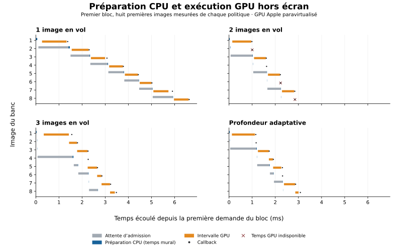

# Première série · GPU Apple paravirtualisé

Le [run du 27 novembre](https://github.com/TarbleFR/RewindBox/actions/runs/46026682080) a mesuré quatre blocs de 180 images hors écran pour chacun des quatre bras, après préchauffage. Le passage indépendant à marqueurs variables a validé pour chaque bras les 180 images et leurs 179 prédécesseurs. L’artefact GitHub `15212571879` a pour SHA-256 `25573c27a307d71880dc971e12beb048549e29e55664097291d0cef5b37414ff`.

| Profondeur | Images GPU terminées/s | Encodage CPU recouvert par tout GPU antérieur | CPU recouvert par le GPU de N−1 uniquement | Demande à callback p95 / p99 |
| --- | ---: | ---: | ---: | ---: |
| 1 | 1 411 | 0 % | 0 % | 2,23 / 4,47 ms |
| 2 | 2 919 | 56,48–56,61 % | 56,48–56,61 % | 1,54 / 2,87 ms |
| 3 | 3 261 | 85,62–85,95 % | 22,52–26,98 % | 1,96 / 3,28 ms |
| Adaptative | 3 742 | 91,11–91,21 % | 22,27–27,00 % | 1,94 / 4,02 ms |

Chaque case temporelle ou de débit est la médiane des quatre valeurs par bloc. Les bornes de recouvrement incluent les timestamps manquants. La borne basse utilise les commandes effectivement horodatées, la haute leur ajoute l’intervalle maximal des commandes non résolues. À trois images en vol, la préparation de N peut encore chevaucher le GPU de N−2. Le temps couvert est l’intersection entre la préparation murale CPU et l’union des intervalles GPU antérieurs. Les échantillons sans paire GPU valide représentent 0, 36, 37 et 41 images sur 720 respectivement. Aucune paire observée ne déborde de sa fenêtre d’horloge hôte. L’allocation finale Metal mesurée vaut 23 166 976 octets dans les 16 lots. Dans le bras adaptatif, l’admission a choisi deux slots sur 32 images et trois sur 688.

Les mesures portent sur le triangle homebrew et trois surfaces hors écran. L’utilisateur ne voit aucun de ces dessins. Le délai jusqu’au callback inclut son ordonnancement et ne mesure pas la latence d’entrée. L’ancien test d’arrêt du GPU a échoué à la compilation après la réussite de ce banc. Le commit `198a6998` corrige son appel de sonde et vérifie le seuil de trois images longues.

[Échantillons bruts compressés](frames.csv.gz) · [Synthèse de la file et de la mémoire](summary.csv) · [Recouvrement avec toutes les commandes précédentes](any-prior.csv).

Chaque panneau prend pour origine la première demande de son bloc. Les segments CPU et GPU d’une même image sont décalés verticalement. Une croix à l’instant du callback indique une durée GPU indisponible. Les 16 blocs, y compris ceux dont le débit est plus bas, entrent dans le tableau.
